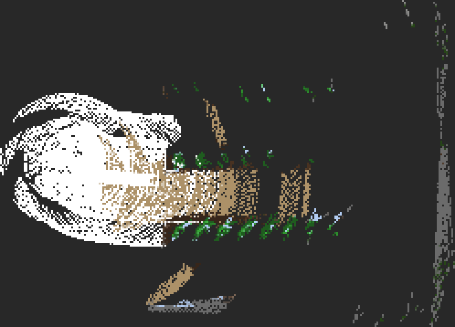

# 3D Digital Twin Navigation (RTAB-Map + Foxglove)

[← Back to README](../README.md) · [Roadmap](roadmap.md) · [Tour](tour.md) · [Troubleshooting](troubleshooting.md)

[`scripts/runtime/wifi_3d_nav.sh`](../scripts/runtime/wifi_3d_nav.sh) runs the
normal 2D session and adds a live, dense 3D map of the building on top of it.
You can view the map in Foxglove from the Windows host and send the dog
somewhere by clicking in the 3D view.

`wifi_nav.sh` is **not modified**. Use `wifi_nav.sh` when you only need 2D
exploration, and `wifi_3d_nav.sh` when you want the 3D view.

---

## Architecture

```
go2-lidar3d container (wifi_nav.sh, unchanged)       go2-3d container (wifi_3d_nav.sh)
──────────────────────────────────────────────       ─────────────────────────────────
Point-LIO (Jetson) ─► /lidar3d/registered ──────────► RTAB-Map ─► /rtabmap/cloud_map
go2_odom_tf ─► TF lidar3d_map → base_link ──────────►   (TF odometry)   rtabmap_map → lidar3d_map
Nav2 ◄── /goal_pose ◄───────────────────────────────── go2_click_to_goal ◄── /clicked_point
RViz, explorer, camera relay                          foxglove_bridge :8765 ◄──► Foxglove (Windows)
```

- **Point-LIO stays in charge of localization.** Nav2 still plans in
  `lidar3d_map`. RTAB-Map reads Point-LIO's pose from TF as its odometry and
  builds the dense map. Its own frame `rtabmap_map` becomes the parent of
  `lidar3d_map`, and Nav2 does not notice.
- **RTAB-Map runs in its own container (`go2-3d`).** `wifi_nav.sh` tears down
  `go2-lidar3d` when it exits. If RTAB-Map ran inside it, it would be killed
  before saving its database. `wifi_3d_nav.sh` stops `go2-3d` gracefully
  after the session ends, so the map is always written.
- **Same DDS settings as the session.** `go2-3d` copies `ROS_DOMAIN_ID`,
  `RMW_IMPLEMENTATION` and the CycloneDDS config from a running session
  node, so it sees exactly the topics RViz sees. This also works with `--sim`.
- **Foxglove bridge, not rosbridge, by default.** `foxglove_bridge` sends point
  clouds in binary form. rosbridge encodes them as JSON, which is far slower
  for a dense map. `--rosbridge` is available if you need it (port 9090).

---

## One-time setup

On the VM (needs internet, ~1–2 GB download):

```bash
./scripts/runtime/wifi_3d_nav.sh --build      # builds go2-3d:local
./scripts/runtime/wifi_3d_nav.sh --check      # wifi_nav.sh checks + image check
```

On Windows: install the Foxglove desktop app from
[foxglove.dev/download](https://foxglove.dev/download). The open-source fork
[Lichtblick](https://github.com/lichtblick-suite/lichtblick) also works with
the same connection.

---

## Running

```bash
./scripts/runtime/wifi_3d_nav.sh                  # explore + 3D map (wifi_nav.sh defaults)
./scripts/runtime/wifi_3d_nav.sh --no-explore     # you drive by clicking goals
./scripts/runtime/wifi_3d_nav.sh --sim            # against the Gazebo simulation
```

Any `wifi_nav.sh` option is passed through (`--robot-ip`, `--arm`,
`--no-camera`, …). The 3D-specific options are:

| Option | Effect |
|---|---|
| `--fusion` | **Camera + LiDAR fusion.** RTAB-Map colours the 3D map from the built-in front camera, using the LiDAR as depth. Also publishes `/camera/lidar_overlay`. Needs a camera calibration, see [Camera + LiDAR fusion](#camera--lidar-fusion---fusion) |
| `--omni` | Full Go2 mobility: walk backwards, sidestep, stuck recovery. See [omni_nav.md](omni_nav.md) |
| `--camera-obstacles` | **Camera obstacles for Nav2.** LiDAR-scaled monocular depth marks glass, thin legs and near obstacles in the costmap. Needs the calibration and `--build`. See [camera_lidar_fusion.md](camera_lidar_fusion.md#camera-obstacles-for-nav2) |
| `--rgbd` | Also feed RealSense colour + depth to RTAB-Map (coloured map). Needs the RealSense driver publishing `/camera/color/*` and `/camera/depth/*` |
| `--rosbridge` | rosbridge on `:9090` instead of foxglove_bridge on `:8765` |
| `--no-bridge` | RTAB-Map only, no web bridge |
| `--build` | Build the `go2-3d:local` image |
| `--export [DB]` | Export the newest (or the given) database to a PLY point cloud |
| `--stop` | Stop a running `go2-3d` and save its database |

About 20–60 s after RViz opens, the terminal prints a `3D digital twin READY`
block with the database path and the Foxglove address.

**Stop:** Ctrl+C as usual. `wifi_nav.sh` shuts the session down first. Then
RTAB-Map gets up to `TWIN_STOP_TIMEOUT` (60 s) to write the database. Wait for
`[3d] Map saved: …` before closing the terminal.

Each run writes its own database:
`~/files/go2-nav2-wifi/ws/maps/rtabmap/rtabmap-YYYYmmdd-HHMMSS.db`.

---

## Camera + LiDAR fusion (`--fusion`)

```bash
./scripts/runtime/wifi_3d_nav.sh --fusion                 # real dog (needs a calibration)
SIM_RENDER_ENGINE=ogre ./scripts/runtime/wifi_3d_nav.sh --sim --no-explore --fusion
```

The front camera has no depth of its own, so the LiDAR supplies it:

```
/camera/image_raw ──► go2_fusion_camera ──► /twin/rgb/image        (undistorted, front_camera_optical)
/lidar3d/registered ─►  (projects the  ──► /twin/rgb/camera_info
TF, calibration ─────►   LiDAR into    ──► /twin/depth/image      (16UC1 mm, same stamp)
                         the camera)              │
                                                  ▼
                               RTAB-Map RGB-D + scan ──► /rtabmap/cloud_map (x y z rgb)
```

- **Calibration:** `--fusion` needs the lens calibration
  `config/camera/front_camera.yaml`
  ([how to make it](camera_lidar_fusion.md#1-intrinsic-calibration-once-per-camera-and-resolution)).
  `--sim` uses the exact Gazebo one. Override with `TWIN_CAMERA_INFO_FILE`.
- **Coloured map:** the 3D map is coloured where the camera saw it; LiDAR-only
  parts (behind and beside the dog) stay white. It fills in as the dog moves,
  because RTAB-Map adds a node every 5 cm or 0.05 rad, not while standing still.
- **Live check:** `/camera/lidar_overlay` (the [overlay](camera_lidar_fusion.md#2-overlay-check))
  runs automatically.
- **Logs:** `fusion_camera.log` reports RGB-D frames and LiDAR depth pixels
  per frame every 10 s; `overlay.log` the overlay.



*Top-down view of `/rtabmap/cloud_map` in `--sim --fusion` after driving
2.3 m: tan path, brown bed edges and green tree rows from the camera;
white is LiDAR-only.*

### In RViz

`wifi_nav.sh` adds three displays to the session's RViz layouts
(`lidar3d_planning.rviz`, `lidar3d_navigation.rviz` in go2-nav2-wifi), once,
via [`scripts/tools/rviz_add_camera.py`](../scripts/tools/rviz_add_camera.py):

| Display | Topic | Shows |
|---|---|---|
| Front camera | `/camera/image_raw` | Live camera (any mode) |
| LiDAR on camera | `/camera/lidar_overlay` | LiDAR points on the image (`--fusion`, or `lidar_overlay.sh`) |
| 3D map (RTAB-Map) | `/rtabmap/cloud_map` | The 3D map, in camera colour with `--fusion` (Color Transformer RGB8) |

The image displays open as panels; drag them where you want and save the
layout. The 3D map display is Transient Local, so it shows the last map even
while the dog stands still. Both image displays are Reliable, matching the
camera relay and Gazebo.

---

## Foxglove setup

1. **Open connection → Foxglove WebSocket →** `ws://<VM IP>:8765`.
   The VM IP is the `Foxglove :` line printed by the script, i.e. the VM's
   Wi-Fi address (DHCP, so it changes). From a browser or Foxglove inside the
   VM itself, `ws://localhost:8765` also works.
   With `--rosbridge`, choose **Rosbridge** and port `9090`.
2. **Import the team layout** (recommended, skips steps 3–4):
   [`config/foxglove_layout.json`](../config/foxglove_layout.json).
   See [Import the layout](#import-the-layout) below.

If the 3D panel shows *"Error creating WebGL context"*, see
[WebGL / Hardware Acceleration Error](#webgl--hardware-acceleration-error).

### Import the layout

[`config/foxglove_layout.json`](../config/foxglove_layout.json) contains a
3D panel and an Image panel side by side:

| Panel | Pre-configured |
|---|---|
| 3D | Display frame `lidar3d_map`; `/rtabmap/cloud_map` (coloured by `z`), `/tf`, `/plan`, `/clicked_goal_markers` on; `/lidar3d/registered` and `/global_costmap/costmap` listed but off; **Publish → Point** on `/clicked_point` |
| Image | `/camera/image_raw` |

To import it:

1. Copy the file to the machine running Foxglove (for Windows, e.g. through the
   VirtualBox shared folder, or `scp` it from the VM).
2. In Foxglove, open the **Layouts** menu (top-left, next to the layout name)
   or the **Layouts** sidebar.
3. Choose **Import from file…** and select `foxglove_layout.json`.
4. Connect as in step 1 above. The panels fill as soon as the topics arrive.

The layout is stored in Foxglove after import. To share a change with the team,
use **Layouts → Export…** and commit the file over
`config/foxglove_layout.json`.

### Manual setup

Without the layout file:

1. **Add panel → 3D.** In its settings:
   - **Display frame:** `lidar3d_map`
   - Enable topics:
     - `/rtabmap/cloud_map`: the dense 3D map. Colour by `z` for a height map
     - `/lidar3d/registered`: the live scan
     - `/tf`: the dog's pose
     - `/plan`: Nav2's route
     - `/global_costmap/costmap`: optional
     - `/clicked_goal_markers`: grey cylinder where you clicked, green arrow at the snapped goal
2. **Add panel → Image** → `/camera/image_raw` for the live camera.
3. **Layout → Save** (or export it to a JSON file to share with the team).

### Click-to-go

1. In the 3D panel, switch to the **2D (top-down) view**.
2. Click **Publish** in the panel toolbar and choose **Point**. The default
   topic is `/clicked_point`.
3. Click the floor where the dog should go.

`go2_click_to_goal` transforms the point into the costmap frame
(`lidar3d_map`) and **snaps it to the nearest navigable floor**. It then faces
the goal along the robot → goal direction and publishes `/goal_pose`, and Nav2
plans and drives there.

Snapping, on `/global_costmap/costmap`:

1. A breadth-first search runs outward from the clicked cell, ring by ring,
   up to `max_snap_distance` (2 m).
2. A cell is accepted only if it **and its 8 neighbours** (a 3×3 block, so
   the body fits) are known and cost < `free_threshold` (50). Unknown space
   is never accepted.
3. Of the accepted cells in the nearest ring, the one closest to the click
   wins.

A click on a desk or wall therefore lands on the free floor next to it.
`/clicked_goal_markers` shows a grey cylinder at the click and a green arrow
at the goal actually sent. If no safe floor is within reach, or no costmap has
arrived yet, no goal is sent and the log says why.

Why top-down: Foxglove projects a click onto the display frame's `z = 0`
plane. `lidar3d_map`'s `z = 0` is at the LiDAR's start height, not the floor.
In an oblique 3D view, a click aimed at the floor therefore lands short of it.
From directly above the error disappears.

Alternatives:
- **Publish → Pose** with the topic set to `/goal_pose` sends a goal with the
  heading you drag, bypassing the click node.
- **Publish → Pose estimate** publishes `/initialpose`, the same as RViz's
  2D Pose Estimate.

Each click replaces the current goal. The **Publish → Pose** route above
skips the snapping.

Node parameters (see
[`go2_click_to_goal.py`](../scripts/nodes/go2_click_to_goal.py)):

| Parameter | Default | Meaning |
|---|---|---|
| `free_threshold` | `50` | Costmap value (0–100) below which a cell counts as floor |
| `clearance_cells` | `1` | Free radius around the goal cell: 1 = 3×3, 2 = 5×5 |
| `max_snap_distance` | `2.0` | How far (m) a click may be moved |
| `max_goal_distance` | `0` | Ignore goals farther than this from the robot (0 = off) |
| `costmap_topic` | `/global_costmap/costmap` | Grid used for snapping |
| `floor_z` | `0.0` | Height of the green arrow in the map frame |

---

## After the run: export and mesh

```bash
./scripts/runtime/wifi_3d_nav.sh --export          # newest db -> <db>-export/*.ply
python3 scripts/tools/export_tour.py <file.ply> --from-ply -o tour_mesh.ply
```

`--export` runs `rtabmap-export --scan` inside the `go2-3d` image (LiDAR
point cloud). Extra options go in `TWIN_EXPORT_ARGS`, e.g.
`TWIN_EXPORT_ARGS="--voxel 0.02"`. The database also opens in
`rtabmap-databaseViewer` for manual inspection and export.

---

## Tuning (environment variables)

| Variable | Default | Meaning |
|---|---|---|
| `TWIN_CLOUD_TOPIC` | `/lidar3d/registered` | Cloud fed to RTAB-Map |
| `TWIN_RTAB_ARGS` | — | Extra RTAB-Map parameters, e.g. `"--Grid/CellSize 0.1 --Grid/RangeMax 8"` (lighter on the VM) |
| `TWIN_BRIDGE_PORT` | `8765` / `9090` | Bridge port |
| `TWIN_RGB_TOPIC` / `TWIN_DEPTH_TOPIC` / `TWIN_CAMINFO_TOPIC` | RealSense defaults | `--rgbd` inputs |
| `TWIN_DB_DIR` | `$NAV2_WIFI_DIR/ws/maps/rtabmap` | Where databases go |
| `TWIN_LOG_DIR` | `$NAV2_WIFI_DIR/ws/log/3d` | `rtabmap.log`, `bridge.log`, `click_to_goal.log` |
| `TWIN_START_TIMEOUT` | `300` | Seconds to wait for the session's ROS nodes |
| `TWIN_STOP_TIMEOUT` | `60` | Seconds RTAB-Map gets to save on stop |

The RTAB-Map LiDAR defaults (ICP registration, proximity loop closures,
5 cm 3D grid) are in [`twin/start_inside.sh`](../twin/start_inside.sh).

---

## Troubleshooting

| Symptom | Check / fix |
|---|---|
| `image go2-3d:local missing` | `./scripts/runtime/wifi_3d_nav.sh --build` |
| `no ROS nodes in go2-lidar3d … 3D stack NOT started` | The 2D session never came up. Fix that first with `wifi_nav.sh` alone |
| Foxglove connects but shows no topics | VM firewall or wrong IP. Use the IP printed in the READY block; `ss -tlnp \| grep 8765` on the VM |
| Topics listed, but panels say "topic does not exist" or wait forever; `rtabmap.log` repeats `Did not receive data` | `go2-3d` is on the wrong DDS domain. `docker logs go2-3d \| grep 'DDS domain'` must show the session's domain (64) and `file:///tmp/go2-wifi-cyclonedds.xml`, not `domain 0`. Restart `wifi_3d_nav.sh`. Also check that the Foxglove layout's topics exist in this project (a layout from another project shows red topics) |
| `/rtabmap/cloud_map` empty | `tail ~/files/go2-nav2-wifi/ws/log/3d/rtabmap.log`. Look for TF errors (`lidar3d_map → base_link` must resolve) or no data on `/lidar3d/registered` |
| Clicks do nothing | `tail …/ws/log/3d/click_to_goal.log`. `no costmap received yet`: the session's Nav2 is not up. `no navigable floor`: click closer to open floor, or raise `max_snap_distance`. Also confirm the Publish tool's topic is `/clicked_point` |
| VM CPU pegged | `TWIN_RTAB_ARGS="--Grid/CellSize 0.1 --Grid/RangeMax 8 --Rtabmap/DetectionRate 0.5"` |
| Map not saved after a crash | A leftover `go2-3d` is stopped (and saved) at the start of the next run, or run `--stop` |
| Topics listed, but 3D panel says *"Error creating WebGL context"* | No GPU acceleration in the VM, see below |

`go2-3d` keeps its own log after it stops: `docker logs go2-3d`.

### WebGL / Hardware Acceleration Error

Symptom: Foxglove connects to `ws://localhost:8765` and the **Topics** list is
complete (`/rtabmap/cloud_map`, `/clicked_goal_markers`,
`/global_costmap/costmap`, …), but the 3D panel shows:

> Error creating WebGL context. Hardware Acceleration is not enabled. App
> performance may be severely degraded.

**This is not a bug in the repository.** The backend is working: the topics
reaching Foxglove prove that RTAB-Map, the bridge and DDS are all fine. Foxglove's 3D
panel renders with WebGL, and WebGL needs an OpenGL-capable GPU. A VirtualBox
VM has none by default, so the browser or Foxglove app inside the VM cannot
create a WebGL context. The **Image panel renders with WebGL too** and fails the
same way. Panels that don't draw graphics keep working: Plot, Raw Messages,
Diagnostics and the topic list. Use them to confirm the data is arriving.

#### Fix: enable 3D acceleration in VirtualBox

1. **Shut down** the VM completely (not *Save State*). These settings are
   greyed out while it runs.
2. VirtualBox Manager → select the VM → **Settings → Display → Screen**:
   - **Video Memory:** `128 MB` (drag the slider to the maximum)
   - **Graphics Controller:** `VMSVGA` (the recommended one for Linux guests)
   - Tick **Enable 3D Acceleration**
3. Start the VM and install the guest drivers:

   ```bash
   sudo apt update
   sudo apt install -y virtualbox-guest-utils virtualbox-guest-x11
   sudo reboot
   ```

   Alternatively, use **Devices → Insert Guest Additions CD image…** and run
   `sudo /media/$USER/VBox_GAs_*/VBoxLinuxAdditions.run`. Use one method, not
   both. The Guest Additions version should match the VirtualBox version on
   the host.
4. Check that OpenGL now goes through the host GPU:

   ```bash
   sudo apt install -y mesa-utils
   glxinfo -B | grep -E 'renderer|direct rendering'
   ```

   - `OpenGL renderer string: SVGA3D …`: accelerated, good.
   - `llvmpipe` or `softpipe`: still software rendering. Recheck steps 2–3
     and update the host GPU driver.
5. In the VM's browser, make sure **Settings → System → Use graphics
   acceleration when available** is on, then open `chrome://gpu` (Chrome or
   Chromium) and check that *WebGL* says *Hardware accelerated*. Firefox shows
   the same information on `about:support` under *Graphics*.
6. Reload Foxglove.

#### If WebGL still fails

VirtualBox 3D support depends on the host GPU and driver, and some setups
never get a working WebGL context. Use one of these instead.

1. **Run Foxglove natively on the Windows host (recommended).** Install
   the Foxglove desktop app on Windows (see [One-time setup](#one-time-setup)),
   where it uses the real GPU. Connect to `ws://<VM IP>:8765` (the IP in the
   READY block) instead of `localhost`, and import
   [`config/foxglove_layout.json`](../config/foxglove_layout.json). This needs the VM on
   **bridged** networking. On NAT, add a port-forwarding rule for TCP `8765`
   (VM Settings → Network → Advanced → Port Forwarding) and connect to
   `ws://localhost:8765` on Windows. This also takes the rendering load off
   the VM's CPU.
2. **Use RViz for the 3D view.** RViz already opens with every
   `wifi_3d_nav.sh` session and works with software OpenGL:
   - Fixed Frame `lidar3d_map`.
   - **Add → By topic → `/rtabmap/cloud_map` → PointCloud2**. Colour
     Transformer `AxisColor`, axis `Z` gives the same height map.
   - Add `/plan` (Path) and `/clicked_goal_markers` (MarkerArray) the same way.
   - Click-to-go still works: RViz's **Publish Point** tool publishes on
     `/clicked_point`, which `go2_click_to_goal` already listens to.
   - The dense map is heavy for a CPU renderer. Use **Style** `Points` with
     a small **Size**, untick `/lidar3d/registered`, or coarsen the map with
     `TWIN_RTAB_ARGS="--Grid/CellSize 0.1"`.
3. **Software WebGL in Chrome (last resort, slow).** Start Chrome in the VM
   with `google-chrome --enable-unsafe-swiftshader --ignore-gpu-blocklist`.
   WebGL then runs on the CPU via SwiftShader. Expect a low frame rate with
   `/rtabmap/cloud_map` visible, so use it only to check that the panel
   works.

---

## Not done yet

- **YOLO semantic layer.** A detector on the Jetson publishing
  `vision_msgs/Detection2DArray`, overlaid on the camera in Foxglove and
  projected into 3D markers. See [roadmap](roadmap.md#milestone-4--rtab-map-reconstruction).
- **Dense colour.** `--fusion` colours only where LiDAR points project into
  the image, so the colour is as sparse as the scan. A RealSense (`--rgbd`)
  gives dense depth.
- **Waypoint queue from Foxglove.** Each click replaces the current goal. For a
  queued route, use the RViz waypoint panel ([Tour](tour.md)).
