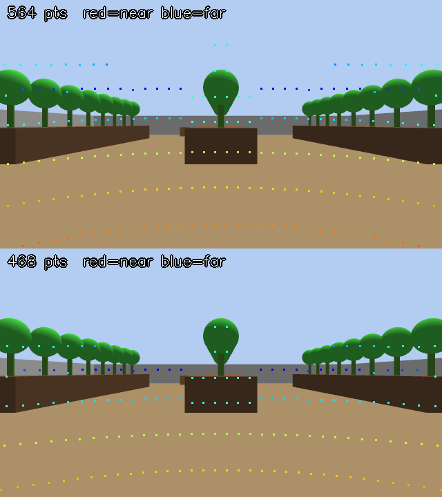

# Camera–LiDAR Fusion: Calibration and Overlay Check

[← Back to README](../../README.md) · [Camera](camera.md) · [3D Nav](3d_nav.md) · [Roadmap](../roadmap.md#milestone-3--camera-pipeline)

Before camera data can improve collision avoidance or mapping, a camera pixel
must map to the right LiDAR point. That takes two things:

1. **Intrinsics:** the lens model (focal length, optical centre, distortion),
   published as `/camera/camera_info`. Measured with a checkerboard.
2. **Extrinsics:** where the camera sits relative to the LiDAR. It comes from
   TF: `lidar3d_map → base_link → trunk → front_camera`. The URDF puts
   `front_camera` at (0.327, 0, 0.043) m with no rotation. The real camera can
   differ, so the overlay can apply a live correction.

The **overlay check** projects the LiDAR points onto the camera image. When
both calibrations are right, the points land on the objects they hit.



*Simulation. Top: camera pitched 0.1 rad (5.7°) wrong, so points float above
the beds into the sky. Bottom: the same scene after correcting it live with
`ros2 param set`. Red is near, blue is far.*

This is the verification step for the fusion that follows. The coloured
RTAB-Map map (`wifi_3d_nav.sh --fusion`, [3d_nav.md](3d_nav.md#camera--lidar-fusion---fusion))
is only as good as this alignment. See [What comes next](#what-comes-next).

---

## 1. Intrinsic calibration (once per camera and resolution)

You need a printed checkerboard on a flat, rigid board. The default is **9×6
inner corners** (10×7 squares) of **25 mm**. Measure your squares after
printing, because printers scale.

1. Start a normal session with the camera relay (the default):

   ```bash
   ./scripts/runtime/wifi_nav.sh --no-explore
   ```

   Check that frames arrive (`go2sh`, then `ros2 topic hz /camera/image_raw`).

2. Run the calibrator:

   ```bash
   ./scripts/tools/calibrate_camera.sh                                  # 9x6, 25 mm
   ./scripts/tools/calibrate_camera.sh --cols 8 --rows 5 --square 0.030 # other board
   ```

3. Move the board slowly through the image. Cover the centre, all four edges
   and the corners. Hold it near and far, and tilt it left/right and up/down.
   A view is captured automatically whenever the board is found in a new
   enough pose. The coverage bars show what is still missing:

   ```text
     view 12/25   X #######...  Y #####.....  size ####......  skew ###.......
   ```

4. After 25 views (or Ctrl+C with at least 8), it solves and prints:

   ```text
   RMS reprojection : 0.31 px   (< 0.5 good, < 1.0 usable, > 1.0 redo)
   fx fy            : 919.4 914.6   (horizontal FOV 69.7 deg)
   ```

   If the RMS error is under 1 px, the result is installed as
   [`config/camera/front_camera.yaml`](../../config/camera/). Each run's views and
   `undistorted_preview.png` go to `config/camera/runs/<date>/`, which git
   ignores. In the preview, straight edges should look straight.

5. Restart `wifi_nav.sh`. The relay now publishes `/camera/camera_info`
   alongside every image (`[camera] Calibration … -> /camera/camera_info`).

The calibration is only valid at the resolution it was taken at. The robot
sends 960x540 by default (`CAMERA_WIDTH=960`, see [camera.md](camera.md)), and
the relay warns if the frames and the calibration don't match.

To recalibrate from saved images without the robot:

```bash
python3 scripts/tools/calibrate_camera.py --from-dir config/camera/runs/<date>/views \
    --cols 9 --rows 6 --square 0.025 --out /tmp/recal
```

---

## 2. Overlay check

With a session running:

```bash
./scripts/tools/lidar_overlay.sh           # real camera, /camera/camera_info from the relay
./scripts/tools/lidar_overlay.sh --sim     # simulation: exact Gazebo intrinsics
```

It publishes **`/camera/lidar_overlay`**. Either viewer works, and neither
needs WebGL:

- **RViz:** Add → By topic → `/camera/lidar_overlay` → Image.
- **rqt:** `ros2 run rqt_image_view rqt_image_view /camera/lidar_overlay`.

Every 5 s the terminal reports images, overlays, points per overlay and, if
something is missing, why (`no camera_info`, `no TF to front_camera`, …).

**What good looks like:**

- Points on the floor follow the floor, and the rings get closer together
  with distance.
- Points on a wall, box or person sit on that object. A thin pole gets a
  vertical column of points.
- The colour changes where the depth changes: a near object is red/yellow
  against a blue background.

**What a wrong mount looks like:**

| Symptom | Likely error | Correct with |
|---|---|---|
| Points sit below their objects | pitch: the camera points further down than modelled | raise `offset_rpy` 2nd value (rad) |
| Points sit above their objects | pitch: the camera points further up | lower `offset_rpy` 2nd value |
| Everything shifted left or right | yaw | `offset_rpy` 3rd value |
| Horizon lines tilted | roll | `offset_rpy` 1st value |
| Near objects off, far ones fine | position | `offset_xyz` (m, in `front_camera`: x fwd, y left, z up) |
| Points smeared while turning | timing | Camera and LiDAR stamps disagree. Try `-p use_latest_tf:=true` and compare |

Tune it live from a second terminal, with no restart:

```bash
go2sh
ros2 param set /go2_lidar_overlay offset_rpy "[0.0, 0.03, 0.0]"
ros2 param set /go2_lidar_overlay offset_xyz "[0.0, 0.0, 0.01]"
```

Point the dog at something with clear vertical edges (a door frame, table
legs, a box) about 1–3 m away. Stand still while you tune. Once it lines up,
write down the offsets: they are the camera mount correction (roadmap 3.4),
the input to the fusion steps below.

Other node parameters ([`go2_lidar_overlay.py`](../../scripts/nodes/go2_lidar_overlay.py)):

| Parameter | Default | Meaning |
|---|---|---|
| `cloud_history` | `3` | Registered scans drawn together (one Point-LIO scan is sparse) |
| `min_depth` / `max_depth` | `0.3` / `15.0` | Depth range drawn (m) |
| `point_size` | `2` | Dot size (px) |
| `camera_frame` | `front_camera` | TF frame of the camera (URDF convention: x forward) |
| `frame_is_optical` | `false` | `true` if `camera_frame` is already an optical frame (z forward) |
| `camera_info_file` | — | Use a YAML instead of `/camera/camera_info` |

---

## Simulation

`--sim` tests the whole chain without the robot. The Gazebo camera is mounted
exactly at the URDF `front_camera` pose, and its intrinsics are known exactly
([`config/camera/sim_front_camera.yaml`](../../config/camera/sim_front_camera.yaml)),
so the correct overlay needs zero offsets. It can't test the lens calibration
(the sim has no checkerboard), only the projection.

With software GL (the old VM, or no GPU driver), headless Gazebo (`SIM_GUI=0`) renders a **black camera and an
empty LiDAR scan** with the default `ogre2` engine. Use the older engine:

```bash
SIM_GUI=0 SIM_RENDER_ENGINE=ogre ./scripts/runtime/wifi_nav.sh --sim --no-explore
./scripts/tools/lidar_overlay.sh --sim
```

---

## Troubleshooting

| Symptom | Fix |
|---|---|
| `no images on /camera/image_raw` | Relay not running or crashing: `docker exec go2-lidar3d tail /tmp/camera_relay.log` |
| `no camera_info` | No `config/camera/front_camera.yaml` yet (calibrate), or the session started before it existed (restart) |
| `no TF to front_camera` | `robot_state_publisher` not up yet, or the session is still starting |
| Overlay frames arrive slowly | The robot sends 5 fps (`CAMERA_FPS`); the overlay can only be as fast as the camera |
| Calibrator never captures | Board not found: more light, a flatter board, `--cols/--rows` count *inner* corners |
| `image size changed` in the calibrator | The relay resolution changed mid-run; restart the calibration |

---

## Camera obstacles for Nav2

```bash
./scripts/runtime/wifi_3d_nav.sh --build               # once: adds ONNX Runtime + the depth model to go2-3d
./scripts/runtime/wifi_3d_nav.sh --camera-obstacles    # needs config/camera/front_camera.yaml
```

The LiDAR misses **glass**, **thin chair and table legs**, **dark surfaces**
and the area **just in front of the sensor**. The camera sees them but has no
depth. [`go2_camera_obstacles.py`](../../scripts/nodes/go2_camera_obstacles.py)
(in `go2-3d`) closes that gap at about 1–2 Hz:

1. It undistorts the frame and runs **Depth Anything V2-Small** (ONNX, CPU,
   Apache-2.0), which gives relative depth for every pixel.
2. It projects the LiDAR into the same image and fits the network output to
   it (robust least squares), which turns relative depth into metres.
3. Pixels nearer than 3 m become 3D points. The node moves them to
   `base_footprint`, keeps those between the floor (estimated every frame) and
   1 m above it, and publishes them as `/camera/obstacle_points`.

`wifi_nav.sh` adds a **`camera` source** to the obstacle layer of the Nav2
costmaps (planner and controller), using
[`nav2_camera_source.py`](../../scripts/tools/nav2_camera_source.py) on
go2-nav2-wifi's `lidar3d_planner.yaml`. It is **marking only**: LiDAR rays
that pass through glass can't clear what the camera marked. In any session
without `--camera-obstacles` the source is removed again, and the file
returns byte-for-byte to how it was.

**Safety behaviour:**

- The source has `expected_update_rate: 5.0`. If no camera obstacles arrive
  for 5 s, Nav2 treats the costmap as out of date and the controller stops.
  The 5 s leaves room for slow inference on a busy CPU; LiDAR obstacles
  still update at full rate.
- At start-up, the dog won't drive until `go2-3d` is up and the first camera
  obstacles have arrived (about 30–60 s after RViz opens).
- A frame whose LiDAR fit is poor (median error above 25%, or fewer than 30
  LiDAR points in view) reuses the last good fit for up to 2 s, then
  publishes an empty cloud.

**Check it:**

- **RViz:** **Camera obstacles** (red points) should sit on chair legs, the
  glass door and walls. **Camera depth** (off by default) shows the metric
  depth, labelled with the fit error.
- **Log:** `~/files/go2-nav2-wifi/ws/log/3d/camera_obstacles.log` reports
  every 10 s: frames, obstacle points per frame, inference time and the
  median fit error. Under about 15% is good; above 25% means the calibration
  or the camera mount is off.

**Tested on the dog (pipeline only, before calibration):** with lens
settings guessed from a 110° field of view, the fit matched the LiDAR to a
median 7% (90°: 31%, 130°: 16%). That suggests the lens is about 110° wide.
The lab chair (pole, foot ring, base) came out as a cluster 1.1 m ahead and
the glass door as a wall about 2.5 m away. Inference took about 1 s per
frame on the old VM, with the rest of the session running.

| Node parameter | Default | Meaning |
|---|---|---|
| `max_range` | `3.0` | Only pixels nearer than this (m) become obstacles |
| `min_height` / `max_height` | `0.08` / `1.0` | Height band above the estimated floor (m) |
| `input_height` | `266` | Model input height (px, multiple of 14). 364 is sharper but about 2x slower |
| `rate` | `2.0` | Max frames/s processed |
| `max_fit_error` | `0.25` | Reject a frame's LiDAR fit above this median relative error |

**Limits:**

- **Calibration dependent:** the fit is only as good as the calibration and
  the camera mount. Run the [overlay check](#2-overlay-check) first.
- **Glass:** it's seen as a surface in most frames, not every frame; door
  frames and reflections help.
- **Floor estimate:** floor removal assumes the floor is the lowest dense
  band in view. A low step or ramp can be marked as an obstacle.

## What comes next

These steps build on a passing overlay:

1. **Fusion for mapping (done: `wifi_3d_nav.sh --fusion`).** The LiDAR is
   projected into the camera as a depth image, and RTAB-Map runs RGB-D +
   scan and colours the 3D map. See [3d_nav.md](3d_nav.md#camera--lidar-fusion---fusion).
2. **Fusion for collisions (done: `wifi_3d_nav.sh --camera-obstacles`).** See
   [Camera obstacles](#camera-obstacles-for-nav2) below.
3. **Language-queryable map (VLMaps-style).** RGB, the LiDAR depth image and
   camera poses are logged in the VLMaps dataset format and mapped offline on
   a GPU machine. The Go2 can then be sent to goals such as "the tomato
   plants".
