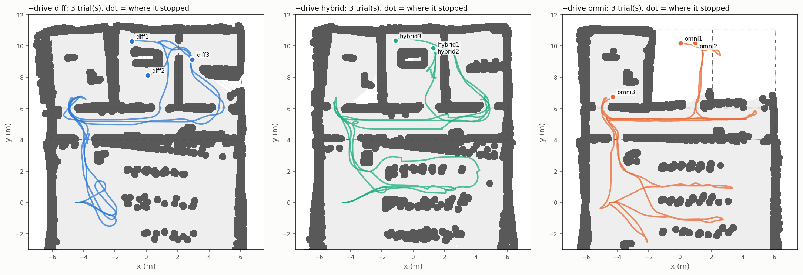
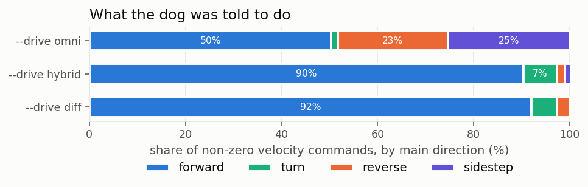
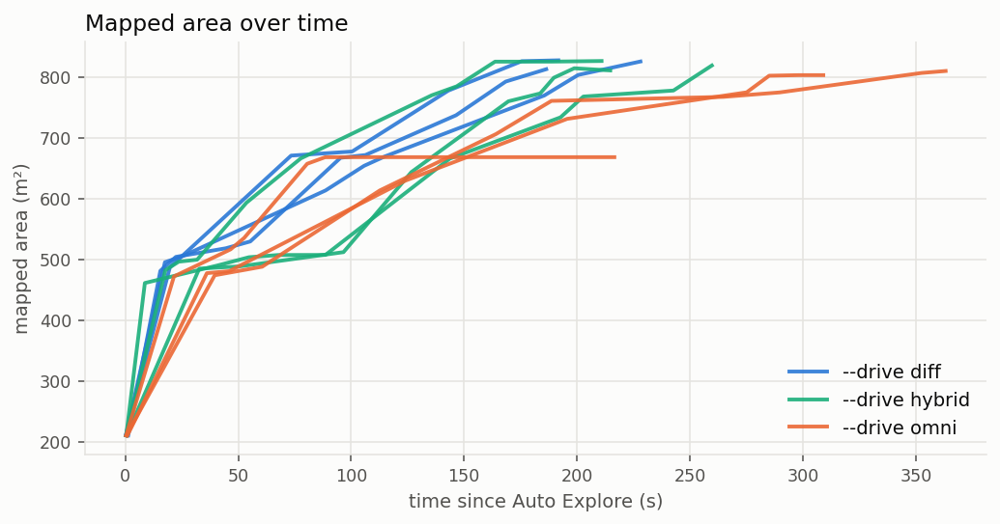
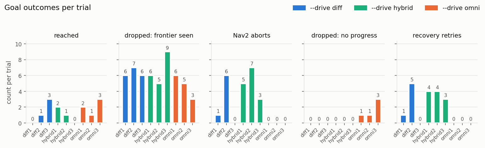

# Locomotion Comparison: `--drive diff` vs `hybrid` vs `omni`

[← Back to README](../README.md) · [Omni navigation](omni_nav.md) · [Exploration](exploration.md) · [Scripts](scripts.md)

How Nav2 should move the Go2: like a two-wheeled robot (the original setup),
or with what a quadruped can also do (walk backwards, sidestep). This page has
the sim results (2026-10-28), what is known from other projects, and how to
repeat the test in the sim and on the real dog.

**Short answer.**

- Walking backwards and sideways during normal driving (`omni`) is **not** an
  improvement for exploration. In the sim it was slower, and it entered fewer
  rooms. Half of its commands were not "walk forward": the dog crab-walked
  and reversed into space its lidar was not facing.
- Keeping the dog facing forward and using the omni moves **only to get
  unstuck** (`hybrid`) does as well as `diff`. It also has an escape when a
  wall is right behind the dog. In 3 runs each, `diff` was slightly faster,
  but the gap is within run-to-run spread. `hybrid` is now the default.
- None of the modes is stock Nav2: all of them run on the fixes listed in
  [What is not stock Nav2](#what-is-not-stock-nav2).
- No published project runs Nav2's omni controller on a Go2 or another
  quadruped. Everything below `omni` is our own test.

## The three drive modes

```bash
./scripts/runtime/wifi_nav.sh --drive hybrid   # default
./scripts/runtime/wifi_nav.sh --drive diff     # the original real-dog setup
./scripts/runtime/wifi_nav.sh --drive omni     # MPPI omni everywhere
./scripts/runtime/wifi_3d_nav.sh --drive diff  # same flag on the 3D launcher
GO2_DRIVE=diff ./scripts/runtime/wifi_nav.sh   # or from the environment
```

`--diff`, `--hybrid` and `--omni` are short for these. The start-up banner
shows the mode (`Drive : hybrid (...)`).

| | `diff` | `hybrid` (default) | `omni` |
|---|---|---|---|
| Planner | Smac lattice, forward arcs | same as `diff` | Smac lattice, omni primitives |
| Controller | Regulated Pure Pursuit + rotation shim | same as `diff` | MPPI, `Omni` motion model |
| Normal driving | faces where it walks | faces where it walks | walks backwards / sideways whenever MPPI finds it cheaper |
| Stuck recovery (aborted leg) | step back 0.3 m | step back, **or sidestep left/right** 0.3 m | step back or sidestep |
| Recovery command path | velocity smoother (`vy` clamped to 0) | straight to `/cmd_vel`, 1.5 s after the abort | velocity smoother (allows `vy`) |
| Extra install | none | none | `ros-humble-nav2-mppi-controller` in the container |

How `hybrid` is wired:

- Nav2 runs exactly as in `diff`. Its velocity smoother clamps sideways speed
  to 0.
- To sidestep, [`go2_stuck_recovery.py`](../scripts/nodes/go2_stuck_recovery.py)
  bypasses the smoother. It gets `cmd_topic:=/cmd_vel escape_delay_s:=1.5`
  and `allow_sidestep:=true`.
- The 1.5 s delay lets the smoother finish braking after the abort. The
  smoother's `velocity_timeout` is 1.0 s, and it then stops publishing, so
  the two never fight over `/cmd_vel`.
- The escape is 0.3 m at 0.12 m/s. It goes only into known free space in the
  local costmap, checked in this order: behind, left, right. If none of these
  is free, the dog does not move.
- After the escape, recovery re-sends the goal, and Nav2 drives forward again.

## Why "facing forward" matters on the Go2

- **The lidar looks forward.** The Go2's L1 lidar is on the head and points
  forward and down. When the dog walks backwards or sideways for metres, the
  space it walks into is seen late or not at all. Moving obstacles (people)
  behind it are not in the costmap.
- **Safety.** An operator expects the dog to walk where its head points.
  A dog that reverses down a row without warning surprises people.
- **The gait.** Unitree's sport mode walks backwards and sideways more slowly
  and less steadily than forwards.

## Has this been used before?

- **Nav2's MPPI controller** has `DiffDrive`, `Omni` and `Ackermann` motion
  models; `Omni` adds `vy` ([MPPI docs](https://docs.nav2.org/configuration/packages/configuring-mppic.html),
  [OmniMotionModel API](https://api.nav2.org/)).
- **Smac State Lattice** ships omni primitive files for holonomic bases
  ([Smac lattice docs](https://docs.nav2.org/configuration/packages/smac/configuring-smac-lattice.html)).
- **Omni Nav2 on real robots:** wheeled omni platforms such as Festo's
  Robotino ([arXiv 2411.09441](https://arxiv.org/abs/2411.09441)). The Nav2
  survey covers the stack in general ([arXiv 2307.15236](https://arxiv.org/abs/2307.15236)).
- **Quadrupeds:** legged-robot work treats the walking controller as a black
  box that takes `vx, vy, wz` ([arXiv 2307.12292](https://arxiv.org/abs/2307.12292)).
  Lateral gaits have been studied on their own (ETH, IROS 2017). We found
  **no** documented deployment of Nav2 MPPI-Omni on a Go2 or a similar dog.
  Go2 Nav2 projects (including go2-nav2-wifi) drive it as a differential
  robot.

So `omni` is reasonable to try. But "a quadruped can sidestep" does not by
itself make it better for navigation, and the sim says it is not, at least
for frontier exploration with a forward-looking lidar.

## What is not stock Nav2

All three modes, and every trial below, run on top of these changes. "diff"
here means the original real-dog setup **plus** these fixes, not plain Nav2.

### Getting unstuck

| Change | Stock behaviour | Ours |
|---|---|---|
| **Stuck recovery** ([`go2_stuck_recovery.py`](../scripts/nodes/go2_stuck_recovery.py)) | After an abort ("collision ahead"), the dog stands there facing the wall | Checks the local costmap for known free space behind the dog, steps back 0.3 m at 0.12 m/s, then re-sends the goal (up to 2 tries) |
| **Sidestep escape** (`hybrid`) | Impossible: the velocity smoother clamps `vy` to 0 | If the space behind is blocked, it tries left, then right. The command goes straight to `/cmd_vel`, 1.5 s after the abort |
| **Inflation counts as free** for recovery (`free_threshold` 99, was 50) | In a doorway every cell is inflation, so recovery reported `no free space` every time | It still refuses inscribed and lethal cells and unknown space |
| **Recovery on the stack's DDS setup** (`DDS_EXEC_ENV`) | Recovery never saw the aborts | It sees and handles them |
| **Explorer waits for recovery** (`recovery_wait_s` 8 s) | The explorer dropped the goal at once and sent a new one mid-escape | It keeps the goal until recovery retries it, then gives up if nothing happens |

### Not hitting obstacles

| Change | Why |
|---|---|
| **Lidar mount from the official Go2 URDF** (`lidar3d_robot_viz.yaml`) | The shipped value came from another robot. On ours it tilted the body about 20° and turned the heading about 120°, so Nav2 steered on the wrong heading |
| **Regulated Pure Pursuit instead of DWB**, behind a rotation shim (turns in place when more than 0.8 rad off the path) | DWB plans from the measured velocity, which is noisy over Wi-Fi (about ±0.1 m/s while standing still). RPP follows the path geometrically |
| **Velocity smoother** (acceleration limits, deadband) | Smooth starts and stops. No stepping in place on tiny commands |
| **Floor filter** ([`go2_floor_filter.py`](../scripts/nodes/go2_floor_filter.py)) | Fits the ground plane in each scan and removes floor points, so a slightly tilted floor is not marked as an obstacle |
| **Camera obstacles** (`--camera-obstacles`, [`go2_camera_obstacles.py`](../scripts/nodes/go2_camera_obstacles.py)) | Adds glass, thin legs, dark surfaces and the area right in front of the dog (all missed by the lidar) to the costmap. Monocular depth is scaled to metres with the lidar |
| **Safe click-to-goal** ([`go2_click_to_goal.py`](../scripts/nodes/go2_click_to_goal.py)) | A click on a wall or desk is moved to the nearest known free floor cell |
| **Stop on exit** | Ctrl+C sends a burst of zero commands, so the dog does not keep walking on its last command |

Details: [LAB-NAV-FIXES.md](LAB-NAV-FIXES.md),
[camera_lidar_fusion.md](camera_lidar_fusion.md#camera-obstacles-for-nav2).

### Explorer: where to go

| Change | Before | Effect |
|---|---|---|
| Goals clear of walls and unknown space (`goal_clearance_m` 0.6, `goal_unknown_clearance_m` 0.3) | Goals right against walls | Goals the dog can reach and turn at |
| Room to turn (`turn_clearance_m` 0.6) | Goals behind the dog in tight spots | Skipped when it can't turn in place |
| Doorway frontiers count (`frontier_max_cost` 98) | 1.2 m doorways were "too small" | No false "complete" in the corridor |
| Small unknown gaps filled (`unknown_hole_max_cells`) | Gaps in the lidar ring around the dog counted as frontiers | No stall on a fresh map |
| Timeout grows with distance (60 s + 4 s/m) | Long goals timed out | |
| Retry before giving up (`frontier_max_attempts` 3, 30 s blacklist) | One failure hid a frontier for good | No false "complete" |
| Frontiers scored by path length (upstream) | Frontiers behind walls were picked | Unreachable frontiers are dropped |
| Goal faces the frontier, and the goal is dropped once its frontier is seen (upstream) | | The dog arrives looking into the unknown and wastes no time |

Parameters: [exploration.md](exploration.md#parameters).

### Infrastructure that affects navigation

- **One DDS setup for every helper** (explorer, floor filter, recovery, stop).
  Before, START in RViz did nothing.
- **Clock-skew check** between the robot and the laptop at start-up. Skew
  causes drift and shudder ([drift-and-shudder.md](drift-and-shudder.md)).
- **Sim fixes:**
  - the body stays upright;
  - the feet are frictionless, so slow turns move the dog;
  - the real-time factor is checked at start-up;
  - the `agri_rooms` test world ([gazebo/README.md](../gazebo/README.md)).

### Built but off

- **Explorer unstick** (`unstick_enable`): reverses when boxed in. Stuck
  recovery replaces it.
- **Spin on goal** (`spin_on_goal`): a 360° look after each goal.

### Planned, not done

- `use_rotate_to_heading: true`, or a lower rotation-shim
  `angular_dist_threshold`, in go2-nav2-wifi. In the sim,
  `use_rotate_to_heading` got the dog through the room 2/3 doorway once.
  Neither change has had repeat trials yet.

## Sim results (2026-10-28)

**Setup.**

- World: `agri_rooms` (a crop field, a corridor, three rooms), spawn
  (−4.5, 0), facing +x.
- `wifi_nav.sh --sim --no-camera`, no 3D twin, real-time factor about 1.0.
- 3 trials per mode, interleaved, run by [`sim_trial.sh`](../scripts/tools/nav_compare/sim_trial.sh).
- Each trial ends at "Exploration complete" (no trial hit the 600 s limit).

### Per mode (mean of 3)

| | diff | hybrid | omni |
|---|---|---|---|
| Time to "complete" | 206 s | 233 s | **299 s** |
| Rooms walked into (of 3) | **3.0** | 2.7 | 1.7 |
| Mapped area | 822 m² | 818 m² | 760 m² |
| Distance walked | 32 m | 39 m | 36 m |
| Time standing still | 13 % | 16 % | 31 % |
| Goals sent / reached | 9.3 / 1.3 | 11.0 / 1.0 | 9.0 / 2.0 |
| Nav2 aborts | 2.3 | 5.0 | **0** |
| Recovery retries | 2.0 | 3.7 | 0 |
| Goals dropped for no progress | 0 | 0 | 1.7 |
| Commands mainly forward | 92 % | 90 % | **50 %** |
| Commands mainly reverse | 3 % | 2 % | 23 % |
| Commands mainly sideways | 0 % | 1 % | 25 % |
| Commands with any sideways drift (\|vy\| > 0.05) | 0 % | 1 % | 75 % |

"Reached" is low in every mode on purpose. The explorer drops a goal once
its frontier has been seen ("dropped early"), so most goals end before the
dog arrives.

### Per trial

| Trial | Time s | Rooms walked into | Area m² | Dist m | Still % | Goals | Reached | Dropped early | Aborts | Rec. retries | Rec. blocked | No progress | Fwd % | Rev % | Side % |
|---|---|---|---|---|---|---|---|---|---|---|---|---|---|---|---|
| diff1 | 196 | 1 2 3 | 827 | 31.0 | 12 | 7 | 0 | 6 | 1 | 1 | 0 | 0 | 95 | 1 | 0 |
| diff2 | 232 | 1 2 3 | 825 | 35.1 | 15 | 9 | 1 | 7 | 6 | 5 | 0 | 0 | 90 | 7 | 0 |
| diff3 | 190 | 1 2 3 | 813 | 30.7 | 12 | 12 | 3 | 6 | 0 | 0 | 0 | 0 | 91 | 0 | 0 |
| hybrid1 | 215 | 1 2 3 | 826 | 33.6 | 16 | 11 | 2 | 6 | 5 | 4 | 0 | 0 | 86 | 3 | 1 |
| hybrid2 | 264 | 1 2 3 | 819 | 41.9 | 21 | 12 | 1 | 5 | 7 | 4 | 3 | 0 | 89 | 2 | 1 |
| hybrid3 | 219 | 2 3 | 810 | 40.5 | 11 | 10 | 0 | 9 | 3 | 3 | 0 | 0 | 96 | 0 | 2 |
| omni1 | 367 | 1 2 | 810 | 53.0 | 12 | 10 | 2 | 6 | 0 | 0 | 0 | 1 | 60 | 14 | 25 |
| omni2 | 309 | 2 3 | 803 | 38.5 | 18 | 8 | 1 | 5 | 0 | 0 | 0 | 1 | 31 | 29 | 37 |
| omni3 | 221 | 1 | 668 | 15.9 | 63 | 9 | 3 | 3 | 0 | 0 | 0 | 3 | 60 | 26 | 14 |

- **omni3** stalled: the dog stood still 63 % of the time, three goals were
  dropped for no progress, and the explorer then reported a false "complete"
  with room 2 and room 3 unmapped.
- **hybrid3** mapped room 1 from its doorway without walking in, so "rooms
  walked into" is 2 while the map has all three.
- The costmap was not saved for diff1, diff2 and omni1 (a logger bug, fixed
  before the other trials). Their area comes from the explorer log, and the
  path plots use another trial's map as background.

Raw numbers: [`images/locomotion/trials.csv`](images/locomotion/trials.csv),
[`images/locomotion/summary.md`](images/locomotion/summary.md).

### Plots



*diff and hybrid follow the corridor and turn into the rooms. omni's paths
have long straight backward and sideways legs: the fans in the field
(y = 0..2) are the dog crab-walking between rows.*



*Under omni, only half of the commands were mainly forward.*





*omni had no Nav2 aborts, but it had "no progress" drops instead: MPPI keeps
trying rather than aborting, and sometimes it gets nowhere. hybrid2's three
"recovery blocked" events (not plotted) are aborts with no free space in any
direction.*

### What this says

1. **omni avoids aborts but explores worse.** MPPI never hit an abort, but it
   wandered: it took the longest and stood still the most. Backward and
   sideways driving made up half of its commands, which is the lidar and
   safety problem above.
2. **hybrid ≈ diff.** With 3 runs each, the differences (time, aborts) are
   within run-to-run spread. diff2 alone had 6 aborts, and earlier single runs
   ranged from 0 to 21. The sidestep fired as designed: in a sim check the dog
   moved 0.16 m left, with no change in heading, starting 1.5 s
   after the abort. Its value is in the case `diff` cannot handle, a wall
   right behind the dog (both aborts in run B3 on
   [exploration.md](exploration.md) were that case).
3. **Default: hybrid.** It drives like `diff`, it keeps the lidar facing the
   path, and it needs no MPPI install. It only adds a short, slow, bounded
   escape.

### Limits

- Sim only. Gazebo moves the body by setting its velocity, with no gait, so
  backwards and sideways cost nothing there. On the real dog they are slower
  and less steady, which makes omni look *better* in the sim than it would be.
- One world, one spawn pose, 3 runs per mode, with high variance.
- No moving obstacles in the sim, so the lidar argument is not measured here.

### Earlier runs

- **2026-10-27**, one run each (see
  [exploration.md](exploration.md#stuck-recovery-and---omni-with-this-explorer-2026-10-27)):
  - `--no-recovery`: 21 aborts, stuck in a doorway.
  - With the recovery fixes: 2 aborts, all three rooms.
  - With `--omni`: 0 aborts, all three rooms, two no-progress drops.
- **2026-10-28**, default `diff`, with the 3D twin at load 13.6: 14 goals,
  0 reached, 10 aborts; the dog wedged against a wall.
- **2026-10-28**, omni (C2): 466 s, all rooms, 1 abort fixed by a sidestep,
  4 no-progress drops.

## How to test the drive modes

The tools are in [`scripts/tools/nav_compare/`](../scripts/tools/nav_compare/):

| Tool | What it does |
|---|---|
| `record.sh start NAME --drive X` / `record.sh stop NAME` | Logs one trial of a running session (sim or real dog): pose (5 Hz), every `/cmd_vel`, the final costmap, the explorer and recovery logs |
| `sim_trial.sh NAME --drive X` | One unattended sim trial: starts the session, presses Auto Explore, records, stops at "complete" or `LIMIT` s (default 600) |
| `run_analysis.sh --out DIR [--rooms agri_rooms] TRIAL...` | Metrics table and plots. Uses the `go2-3d:local` image if the host matplotlib is broken |

Trials go to `~/files/go2-nav2-wifi/ws/log/nav_compare/NAME/` (set
`NAV_COMPARE_DIR` to change).

### In the simulator

Run from a terminal on the VM desktop, with nothing else heavy running (the
results depend on the real-time factor):

```bash
cd ~/files/Unitree_GO2_Agricultural
for i in 1 2 3; do for d in diff hybrid omni; do
    ./scripts/tools/nav_compare/sim_trial.sh $d$i --drive $d
done; done
N=~/files/go2-nav2-wifi/ws/log/nav_compare
./scripts/tools/nav_compare/run_analysis.sh --rooms agri_rooms --out docs/images/locomotion \
    $N/diff1 $N/diff2 $N/diff3 $N/hybrid1 $N/hybrid2 $N/hybrid3 $N/omni1 $N/omni2 $N/omni3
```

- Each trial takes about 5–8 minutes, including start-up and shutdown.
- Interleave the modes as above, so a slow period on the VM doesn't hit only
  one mode.
- Extra `wifi_nav.sh` options pass through (e.g. `sim_trial.sh h4 --drive
  hybrid --no-recovery`).
- Another spawn pose: `SIM_SPAWN="x y yaw"` before the command.
- Then check the `Speed:` / real-time factor in each trial's `session.log`.
  Drop runs far below 1.0.

Single-move checks, with `--sim --no-explore`, one mode at a time:

1. 2D Goal Pose 1 m straight behind the dog.
   - `diff` and `hybrid` turn around and walk.
   - `omni` walks backwards.
2. 2D Goal Pose 1 m to the side: the same pattern.
3. Drive the dog nose-first into a corner, then set a goal behind the wall.
   - `diff` steps back only.
   - `hybrid` and `omni` step back or aside (`docker exec go2-lidar3d tail
     /tmp/stuck_recovery.log`).

### On the real dog

Do this with the remote in hand, in a cleared area, with someone watching
the space behind the dog.

**Before.**

- Raise the network buffers once per VM boot (needs sudo). Without this, the
  lidar arrives late and the dog doesn't move. See
  [troubleshooting.md](troubleshooting.md#camera-at-02-fps-camera-unavailable-in-the-dashboard-empty-3d-map).

  ```bash
  printf 'net.core.rmem_max=16777216\nnet.core.rmem_default=8388608\n' | sudo tee /etc/sysctl.d/60-go2-dds.conf
  sudo sysctl --system
  ```

- Run `./scripts/runtime/wifi_nav.sh --setup-ssh` once, so the start-up doesn't stop at a password prompt.
- Use the same start pose for every trial: mark it on the floor with tape.
- Use the same lighting and layout, and no people walking through (unless
  that is the test).
- Run without the AI node (`--no-ai`) to keep CPU load equal.

**Stage 1: single moves**, in each mode (`--no-explore`). Restart the session
to change mode.

```bash
./scripts/runtime/wifi_3d_nav.sh --no-explore --no-ai --drive diff     # then hybrid, then omni
```

1. 2D Goal Pose 1.5 m ahead: all modes walk straight.
2. Goal 1 m behind, facing the same way.
   - `diff` and `hybrid` turn and walk.
   - `omni` should walk backwards. Watch how steady it is.
3. Goal 1 m to the side: the same pattern.
4. Goal through a doorway or between two boxes 1 m apart. Note any aborts.
5. Put the dog 0.5 m from a wall, facing it, and set a goal behind the wall.
   This triggers stuck recovery.
   - `diff` steps back.
   - `hybrid` steps back, or sidesteps if something is behind it (put a box
     there to force it).
   - Check `/tmp/stuck_recovery.log`.

**Stage 2: exploration**, 3 runs per mode, interleaved, same start pose:

```bash
./scripts/runtime/wifi_3d_nav.sh --no-ai --drive hybrid    # explorer waits for Auto Explore
./scripts/tools/nav_compare/record.sh start real_hybrid1 --drive hybrid --note "lab, tape mark A"
# press Auto Explore on the dashboard (or RViz), let it run, stop it or wait for "complete"
./scripts/tools/nav_compare/record.sh stop real_hybrid1
# Ctrl+C the session, put the dog back on the mark, next mode
```

Then analyse without `--rooms` (that only knows the sim world):

```bash
N=~/files/go2-nav2-wifi/ws/log/nav_compare
./scripts/tools/nav_compare/run_analysis.sh --out docs/images/locomotion_real $N/real_*
```

**What to compare.**

- Time and mapped area: the same as in the sim.
- Aborts and recovery retries.
- The command mix: how much was reversing and sidestepping.
- Your own notes on:
  - near misses;
  - moments the dog walked into space it hadn't looked at;
  - stumbles when walking sideways or backwards.

The numbers can't capture these, so write them in the `--note`.

**Stop at once** (take over with the remote, or Ctrl+C the session) if the
dog walks backwards toward a person or a drop.

## Related

- [omni_nav.md](omni_nav.md): how `omni` and stuck recovery are wired and tuned.
- [exploration.md](exploration.md): the frontier explorer, and the earlier runs.
- [scripts.md](scripts.md): every script, including `nav_compare/`.
