# Items World (`cluttered_items`): The Go2 Stepping Over Real Objects

[← Back to README](../../README.md) · [Gazebo sim](gazebo.md) · [First version, plain shapes](cluttered_nav.md) · [Indoor lab world](lab_office.md) · [Camera–LiDAR fusion](../ai_and_vision/camera_lidar_fusion.md)

The Go2 model with moving leg joints, walking through a Gazebo arena of real
objects: mugs, a power strip, a shoe, a keyboard, a chair and more. The front
camera says what each object is, the LiDAR measures it, and the 3D box picks how
high to step. Compared with a low-stepping baseline over 5 trials each,
2026-11-06.

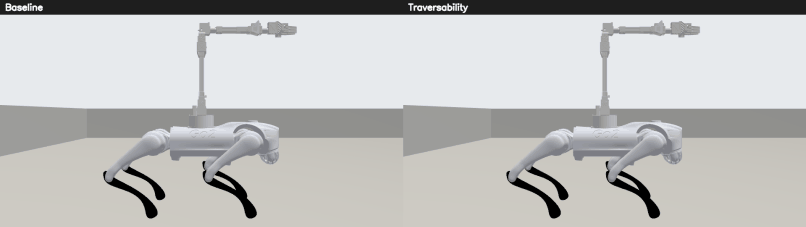

*Same route, same items. Full clips:
[baseline](../images/cluttered_items/walk_baseline.mp4),
[traversability](../images/cluttered_items/walk_traversability.mp4). Traversability
lifts its feet higher and takes longer strides near objects.*

## Results at a glance

| | `baseline` (n = 5) | `traversability` (n = 5) |
|---|---|---|
| Foot passes that cleared the item | 16 of 73 (**22 %**) | 55 of 90 (**61 %**) |
| Items the raised foot can clear (≤ 0.10 m) | 16 of 57 (28 %) | 50 of 76 (66 %) |
| Foot strikes on items, per metre walked | 0.75 | **0.58** |
| Goals reached (3 per trial) | 9 / 15 | 12 / 15 (p = 0.43, Fisher) |

| Fusion, traversability trials only | Before the fix (first version) | Now |
|---|---|---|
| **Unsafe labels** (a taller object marked lower than it is) | 13 tracks, in all 5 trials | **0** |
| Measured tracks in the wrong height band | 46 of 139 | **1 of 106** |
| Height error of the best track per object (median) | 1.8 cm | 1.1 cm |
| Objects known before first contact | 12 of 14 | 18 of 22, median 15 s ahead |

**In short: the fix worked for the unsafe labels, and feet cleared items almost
three times as often. It is not finished.** A stricter fusion misses more objects,
39 % of the feet still touched the item they crossed, and the stepping here is
kinematic, not walking physics. No result here shows the real dog stepping over
anything.

---

## The world

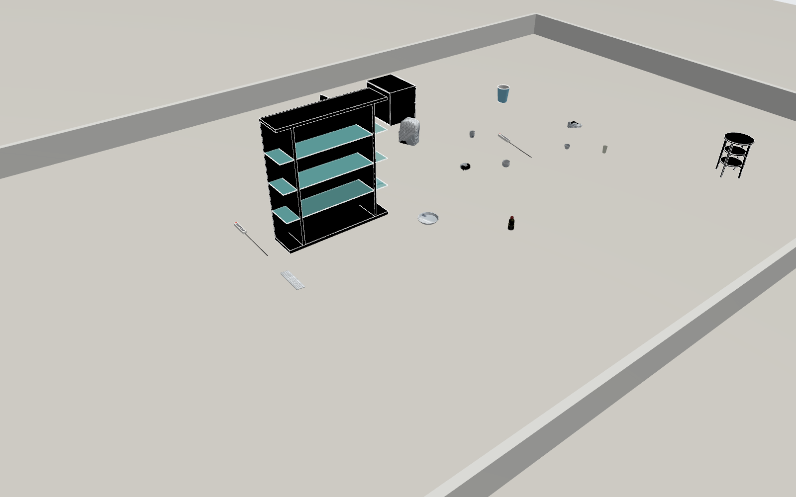

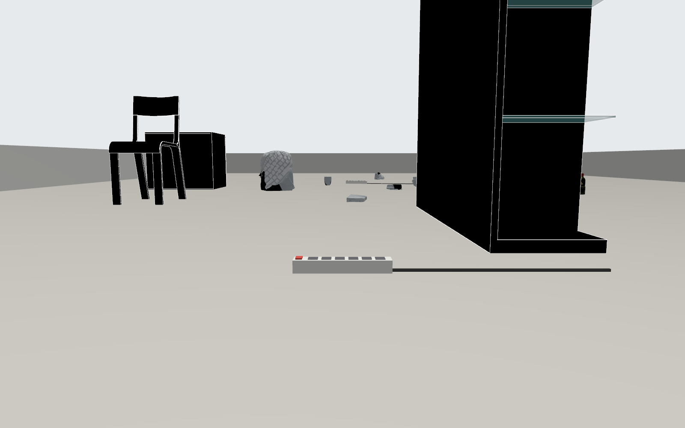

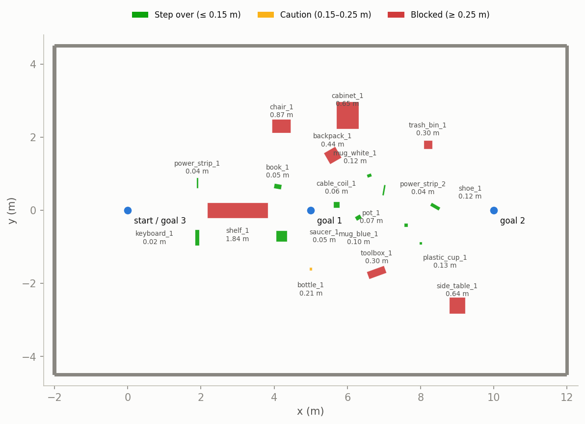

*Floor plan from the world's truth file. Color is the height band, also named in
the legend. Blue dots are the goals.*

The same 14 × 9 m arena and goals as the [first version](cluttered_nav.md), with
every plain shape replaced:

| Band | Objects | Source |
|---|---|---|
| Step over (≤ 0.15 m) | 2 power strips | **Modelled here:** Gazebo Fuel has none |
| | keyboard, book, plant saucer, cable coil, plant pot, 2 mugs, running shoe | [Google Scanned Objects](https://fuel.gazebosim.org/1.0/GoogleResearch/fuel/collections/Scanned%20Objects%20by%20Google%20Research) on Gazebo Fuel, CC BY 4.0 |
| | plastic cup | Fuel, OpenRobotics, CC0 |
| Caution (0.15–0.25 m) | water bottle (scaled to 0.21 m) | Fuel, iche033, CC BY 4.0 |
| Blocked (≥ 0.25 m) | bookshelf, chair, file cabinet, trash bin, side table | 3DGEMS models, as in `lab_office` |
| | backpack, toolbox | Fuel: Google Scanned Objects, OpenRobotics |

Visuals are the real meshes. Collisions are boxes from the measured mesh bounds, and
[`cluttered_items.json`](../../gazebo/worlds/cluttered_items.json) holds the same
boxes as ground truth.

### Use it

```bash
./gazebo/setup_gazebo.sh --furniture   # once, if not done already
./gazebo/setup_gazebo.sh --items       # the Fuel models
GO2_HOST_IP=127.0.0.1 SIM_ARM=0 SIM_WORLD=cluttered_items SIM_SPAWN="0 0 0" \
    SIM_CAMERA=1 SIM_CONTACTS=1 SIM_GAIT=1 ./gazebo/run_sim.sh up
tests/traversability/run_all.sh RESULTS_DIR "1 2 3 4 5"   # trials
```

Add `SIM_CHASE=1` for the camera that rides beside the robot, then
`tests/traversability/run_demo.sh OUT_DIR` films the clips.

## How the legs move

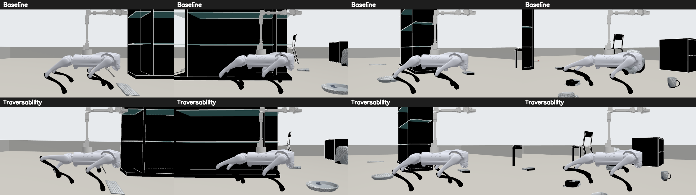

*Top: baseline, low step. Bottom: traversability, with a rear foot held high in
the first frame.*

`SIM_GAIT=1` turns the Go2's 12 leg joints into real moving joints.
[`leg_gait.py`](../../gazebo/sim/leg_gait.py) computes them with inverse kinematics
as a trot: planted feet move back at the body's speed, and swinging feet rise,
cross, then come down.

| Gait | Foot lift | Stride cycle | Chosen when |
|---|---|---|---|
| `NORMAL` | 4 cm | 0.6 s | nothing ahead |
| `HIGH_STEP` | 12 cm | 1.0 s | the tallest object ahead is ≤ 10 cm |
| `CAREFUL` | 12 cm | 1.0 s | taller than that, or not measured |
| `STOP` | 12 cm | 1.0 s | ≥ 0.25 m ahead (Nav2 should route round it) |

Each swing also picks a landing point 8 cm clear of any object the fusion knows
about.

**This is a kinematic gait, not walking physics.** VelocityControl still carries the
body. Nothing balances on the feet, gravity is off for the robot, and the feet pass
through the floor. Feet do collide with objects, so strikes are real contact events,
but a strike does not trip the robot. The 12 cm lift is an assumption until the real
foot height is measured.

## The fusion and what changed

The front camera detects objects; the LiDAR gives each one a 3D box and a height.

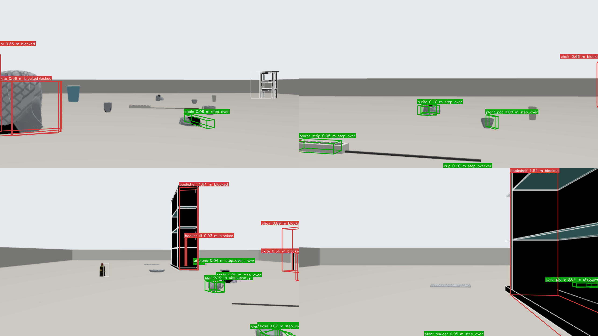

*Sim camera frames from traversability1, with fused 3D boxes: green step over, red
blocked. The labels show real YOLO's mistakes too: the backpack reads "kite", yet
its height still marks it blocked.*

[`object_box_fusion.py`](../../scripts/nodes/object_box_fusion.py) now refuses to
measure when the LiDAR points do not explain the detection, and reports
**unknown, never low**:

| Check | Catches |
|---|---|
| Use the cluster spanning most of the box, not the nearest | A small object in front (the cone read as a barrel) |
| The cluster must reach near the top of the box | Seeing only the bottom of an object |
| The cluster must sit at the box's floor-ray distance | A far object's box catching a near one's points |
| Tracks keep a high reading and merge duplicates | A partial view lowering the estimate |

An unknown object still gets a floor position within 3 m, and the gait treats it as
`CAREFUL`.

### Real YOLO this time

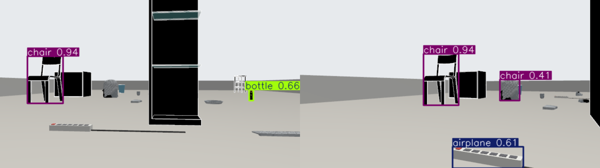

*Stock YOLO11s at confidence 0.40, the threshold the project's YOLO node uses.*

With real objects, **YOLO11s now detects things correctly**: on 154 frames it reported
chair 50, bottle 34, cup 9 and keyboard 4. It also added false labels: kite 11,
laptop 11, person 9. The power strip became "airplane" and the backpack "kite".

| Detector | Classes |
|---|---|
| Real YOLO11s (COCO) | cup, bottle, chair, backpack, book, keyboard |
| Stand-in, from the world file | power strip, saucer, cable, pot, shoe, toolbox, trash bin, side table, bookshelf, file cabinet |

**The stand-in is not a vision model.** COCO has no such classes, so it plays a
custom-trained detector, and these objects have perfect detections. A real model
will do worse.

## How it was tested

Trials alternated, baseline1, traversability1 and so on, from the spawn at (0, 0).

| | `baseline` | `traversability` |
|---|---|---|
| Global costmap | obstacles, inflation | the same (plugins stay local only) |
| Local costmap | obstacles, inflation | adds `HeightBandLayer` |
| Legs | always `NORMAL` | gait from the 3D boxes |
| Perception | none | YOLO11s, stand-in, fusion |

Nav2 uses the 3D stack's values with **collision detection on**. Goals are (5, 0),
(10, 0), then (0, 0), within 0.5 m. Legs end **reached**, **timeout** (120 s), or
**stuck** (0.15 m of progress in 45 s).

The gait node runs in `dry_run`, so nothing is sent to a sport client. The sim reads
`/gait/command` to move its legs, which is what makes the comparison possible.

[`analyze.py`](../../tests/traversability/analyze.py) scores both modes against
the world's truth:

| Metric | How |
|---|---|
| Foot pass | A foot's path crossing an item's footprint. **Cleared** if the foot stayed above the item's top the whole way |
| Foot strike | Gazebo contact between a foot and an object, with gaps under 0.5 s |
| Track audit | Every final track against the nearest true object |
| Right gait | The same rule applied to the true objects ahead |

## Results

### Stepping over items

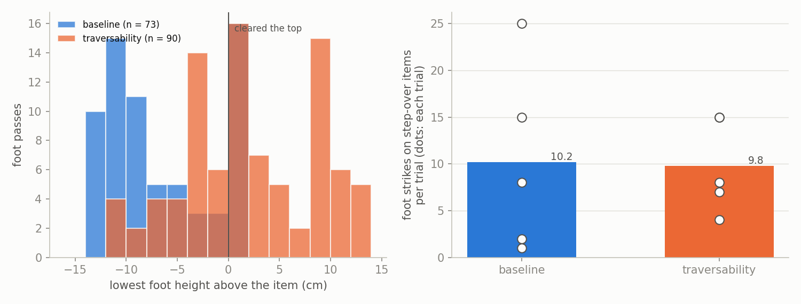

*Left: lowest foot height above the item on each pass; right of the line cleared it.
Right: strikes per trial. Stuck trials walked less, so they strike less: per metre is
the fairer figure.*

- **Feet cleared items on 61 % of passes, against 22 %.** Even 4 cm lifts clear the
  flattest items, which is why baseline is not zero.
- **Strikes per metre fell 23 %,** from 0.75 to 0.58. Per trial they look equal, 10.2
  and 9.8, because baseline walked less.
- **`HIGH_STEP` cleared 20 of 34 passes (59 %).** Fixing where feet land raised this
  from 45 %. The remaining failures were not broken down for this batch.

### Navigation

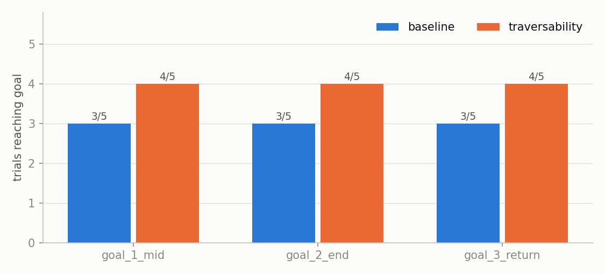

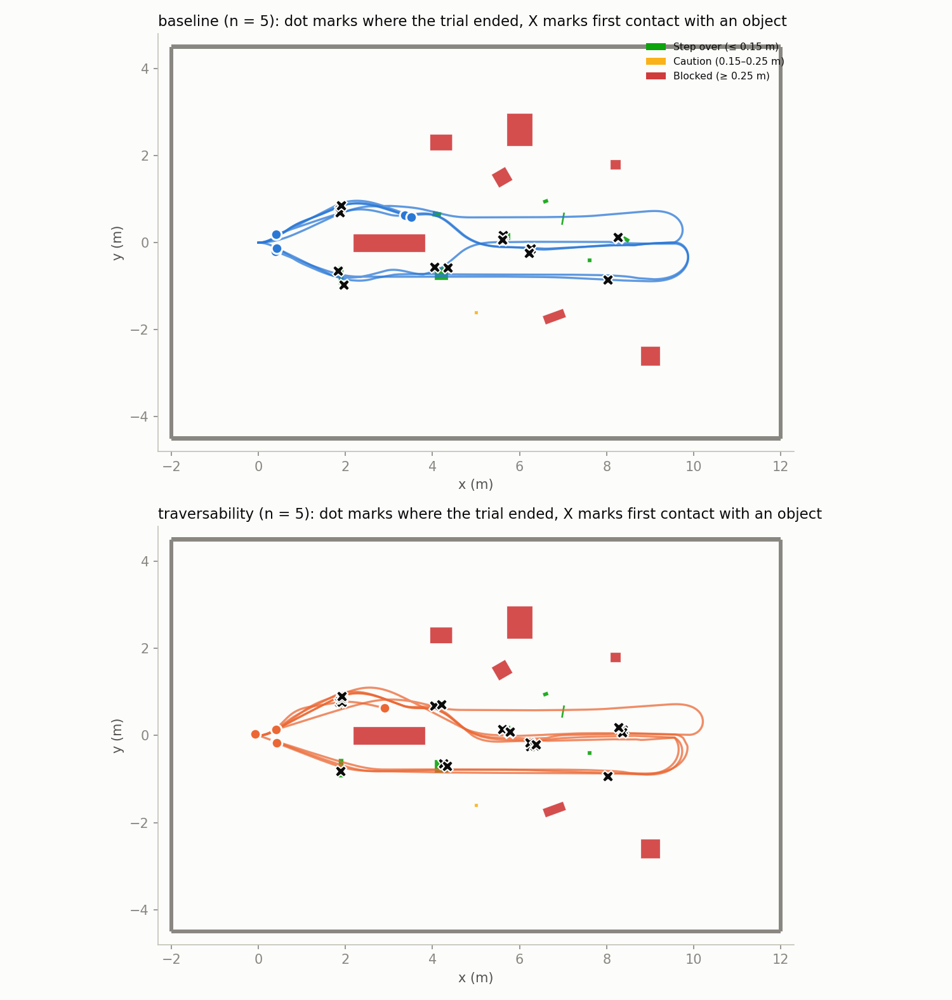

*Dot: where the trial ended. X: first contact with each object.*

- **No navigation claim can be made.** 12 of 15 against 9 of 15 is not significant
  (p = 0.43). In this sim the legs do not move the body, so the gait cannot cause it.
- **All failures are whole trials stuck near the shelf:** baseline3, baseline4 and
  traversability5, each ending with Nav2 refusing to plan: *Starting point in lethal
  space*. It is the same in both modes and is not understood yet.
- **Routes are the same in both modes,** because the global costmap is. The robot walks
  over step-over items instead of round them.

### Perception

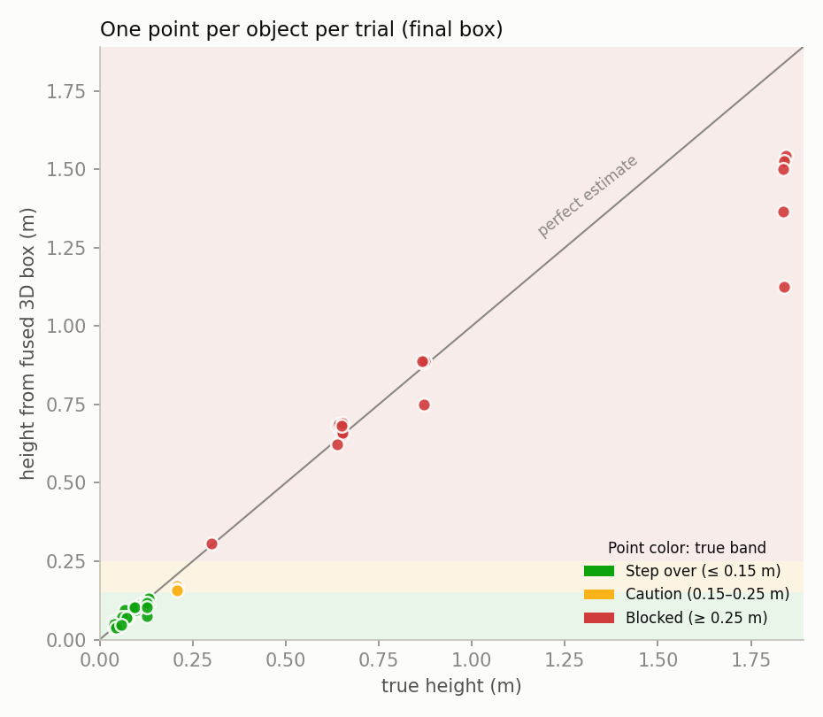

- **Measured boxes are reliable:** every one of the 57 best-match boxes has the right
  band, and 1 of 106 measured tracks overall is wrong. None is unsafe.
- **The cost is coverage.** Over 5 trials: backpack, book, keyboard and toolbox were
  never measured, the trash bin once, and the white mug once. The stricter checks and
  YOLO's misses both play a part.
- **False labels remain:** 47 of 124 tracks (38 %) carry a class that is not near them,
  almost all from YOLO. Their heights still came from real points, and none is unsafe.

### Gait choice

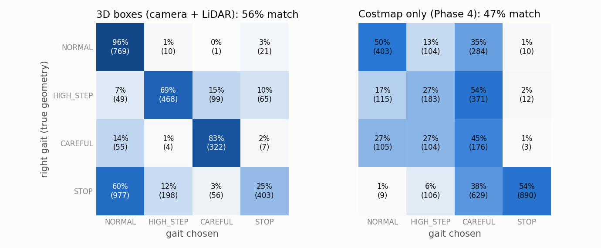

| | 3D boxes | Costmap only |
|---|---|---|
| Exact match, all samples (n = 3504) | 56 % | 47 % |
| Exact match at the 22 first contacts | 13 / 22 | 8 / 22 |
| `HIGH_STEP` when the foot would not clear (n = 2022) | 202 (10 %) | 210 (10 %) |
| `NORMAL` when more care was right (n = 2022) | **1032 (51 %)** | 114 (6 %) |

The boxes are ahead on matches, but **they leave the robot in `NORMAL` far too often**,
because an object it never detected cannot change the gait. That is the cost of the
stricter fusion. The costmap can use it as a backstop: if it reports something ahead
and the boxes do not, the gait should not stay `NORMAL`.

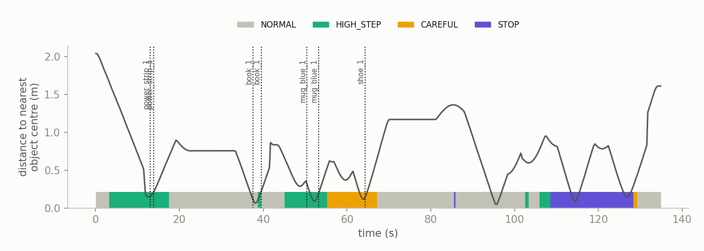

## What this says

1. **The unsafe-label problem is fixed in this sim.** Refusing to measure beats a wrong
   measurement.
2. **The concept works end to end here.** Real YOLO, LiDAR boxes, a gait choice and legs
   that visibly lift over real objects.
3. **Next: use the costmap as a backstop for what the camera misses.** 51 % `NORMAL` is
   the biggest remaining gap.
4. **A custom model is needed.** Stock YOLO cannot see the objects that matter most
   here, and it adds false labels.
5. **The stuck-near-the-shelf failure needs its own look,** since it ends whole trials.
6. **Real stepping needs the robot or a legged simulator** with a walking controller.

## Limits

- **Kinematic legs, as above.** Clearance here is geometry. It does not prove balance
  or a stable gait.
- **Tuned on this world.** The fusion and foothold changes were made after seeing an
  earlier batch of these same objects, so a new world will likely score lower.
- **The stand-in gives perfect detections** for 10 of the 16 classes.
- **5 trials per mode, one world, one spawn, 0.59× real time,** with Nav2 on wall-clock
  time. Most comparisons are not statistically significant.
- **12 cm foot lift is assumed.** It needs measuring on the robot.
- **Boxes stay JSON** on `/objects/boxes_json`; `SemanticObstacle.msg` has no size yet.
  `SemanticCostmapLayer`, `vlm_heuristic_node` and the critic node were not exercised.
- **The clips use a scripted route, not Nav2,** so the robot crosses the items in view.
  The D1 arm stands upright throughout.

## Found along the way

- **Footing, not lift, was failing.** In the batch before the last, feet peaked at 17 cm
  but only 45 % of `HIGH_STEP` passes cleared: 22 of 66 failed passes landed inside the
  item, and the rest clipped it on the way up or down. Hence the rise-first swing and
  the wider landing margin.
- **YOLO at 0.25 confidence produced 107 false tracks of 224.** The project's YOLO node
  uses 0.40. Matching it cut that to 47 of 124.
- **Fixing unsafe labels had a price.** The earlier batch matched the right gait 73 % of
  the time against this 56 %, with 13 unsafe tracks. Safety was chosen over that score.
- **The bookshelf was first too tight.** Set across the path, its corner left the 0.8 m
  long body in a lethal start position, so it was turned lengthwise.

## Full statistics

Generated by `analyze.py`: [`stats.md`](../images/cluttered_items/stats.md), [`trials.csv`](../images/cluttered_items/trials.csv).

Per mode over trials: mean ± SD [min–max]; p from Welch's t-test.

| Metric | `baseline` (n=5) | `traversability` (n=5) | p (Welch t) |
|---|---|---|---|
| Goals reached (of 3) | 1.80 ± 1.64 [0.00–3.00] | 2.40 ± 1.34 [0.00–3.00] | 0.545 |
| Total time (s) | 135.46 ± 19.71 [119.20–157.60] | 135.52 ± 14.56 [119.20–156.30] | 0.996 |
| Distance walked (m) | 13.51 ± 8.98 [3.60–20.16] | 16.77 ± 7.64 [3.13–20.81] | 0.554 |
| SPL | 0.60 ± 0.54 [0.00–1.00] | 0.80 ± 0.45 [0.00–1.00] | 0.542 |
| Foot strikes on step-over items | 10.20 ± 9.98 [1.00–25.00] | 9.80 ± 4.97 [4.00–15.00] | 0.939 |
| Foot strikes, all objects | 10.20 ± 9.98 [1.00–25.00] | 9.80 ± 4.97 [4.00–15.00] | 0.939 |
| Trunk hits | 0.40 ± 0.89 [0.00–2.00] | 0.00 ± 0.00 [0.00–0.00] | 0.374 |
| Objects touched | 3.60 ± 2.51 [1.00–6.00] | 4.40 ± 2.51 [1.00–8.00] | 0.628 |
| Nav2 collision aborts | 1.00 ± 0.00 [1.00–1.00] | 1.40 ± 1.14 [0.00–3.00] | 0.477 |
| Plans refused: start in lethal space | 5.60 ± 7.67 [0.00–14.00] | 2.80 ± 6.26 [0.00–14.00] | 0.545 |
| Goals re-sent | 5.40 ± 6.02 [1.00–12.00] | 3.60 ± 4.83 [0.00–12.00] | 0.617 |
| Closest to a tall object or wall (m) | 0.18 ± 0.04 [0.12–0.20] | 0.21 ± 0.02 [0.18–0.22] | 0.133 |
| Sim real-time factor | 0.59 ± 0.03 [0.56–0.62] | 0.59 ± 0.03 [0.54–0.60] | 0.759 |

`baseline` legs reached: 9/15

`traversability` legs reached: 12/15

Fisher exact, per leg: p = 0.427

## Per-trial results

| trial | mode | reached | time_s | walked_m | spl | foot_strikes | foot_strikes_low | body_hits | objects_hit | collision_aborts | start_in_lethal | resends | min_clear_tall_m | rtf |
|---|---|---|---|---|---|---|---|---|---|---|---|---|---|---|
| baseline1 | baseline | 3 | 119.2 | 20.16 | 0.991 | 25 | 25 | 2 | 6 | 1 | 0 | 1 | 0.2 | 0.622 |
| baseline2 | baseline | 3 | 121.5 | 19.9 | 1.0 | 8 | 8 | 0 | 4 | 1 | 0 | 1 | 0.2 | 0.616 |
| baseline3 | baseline | 0 | 156.4 | 3.6 | 0.0 | 2 | 2 | 0 | 1 | 1 | 14 | 12 | 0.16 | 0.558 |
| baseline4 | baseline | 0 | 157.6 | 3.76 | 0.0 | 1 | 1 | 0 | 1 | 1 | 14 | 12 | 0.12 | 0.557 |
| baseline5 | baseline | 3 | 122.6 | 20.14 | 0.992 | 15 | 15 | 0 | 6 | 1 | 0 | 1 | 0.2 | 0.617 |
| traversability1 | traversability | 3 | 130.4 | 19.81 | 1.0 | 7 | 7 | 0 | 4 | 2 | 0 | 2 | 0.2 | 0.602 |
| traversability2 | traversability | 3 | 119.2 | 20.81 | 0.993 | 8 | 8 | 0 | 4 | 0 | 0 | 0 | 0.215 | 0.598 |
| traversability3 | traversability | 3 | 128.0 | 19.91 | 1.0 | 15 | 15 | 0 | 8 | 1 | 0 | 1 | 0.22 | 0.597 |
| traversability4 | traversability | 3 | 143.7 | 20.21 | 0.993 | 15 | 15 | 0 | 5 | 3 | 0 | 3 | 0.22 | 0.604 |
| traversability5 | traversability | 0 | 156.3 | 3.13 | 0.0 | 4 | 4 | 0 | 1 | 1 | 14 | 12 | 0.18 | 0.538 |

## Graph data

The numbers behind each graph, also as CSV in [`docs/images/cluttered_items/data/`](../images/cluttered_items/data/), including every foot pass in `foot_passes.csv` and every track in `tracks.csv`.

### Every leg (goals.png)

| trial | mode | goal | result | time_s | path_m | shortest_m | spl | resends |
|---|---|---|---|---|---|---|---|---|
| baseline1 | baseline | goal_1_mid | reached | 37.25 | 4.93 | 5.51 | 1.0 | 1 |
| baseline1 | baseline | goal_2_end | reached | 25.13 | 4.94 | 5.48 | 1.0 | 0 |
| baseline1 | baseline | goal_3_return | reached | 56.85 | 10.29 | 10.01 | 0.97 | 0 |
| baseline2 | baseline | goal_1_mid | reached | 40.83 | 4.96 | 5.51 | 1.0 | 1 |
| baseline2 | baseline | goal_2_end | reached | 25.38 | 4.95 | 5.52 | 1.0 | 0 |
| baseline2 | baseline | goal_3_return | reached | 55.28 | 10.0 | 10.06 | 1.0 | 0 |
| baseline3 | baseline | goal_1_mid | stuck | 66.36 | 3.6 | 5.51 | 0.0 | 4 |
| baseline3 | baseline | goal_2_end | stuck | 45.0 | 0.0 | 6.99 | 0.0 | 4 |
| baseline3 | baseline | goal_3_return | stuck | 45.02 | 0.0 | 3.69 | 0.0 | 4 |
| baseline4 | baseline | goal_1_mid | stuck | 67.54 | 3.76 | 5.51 | 0.0 | 4 |
| baseline4 | baseline | goal_2_end | stuck | 45.02 | 0.0 | 6.83 | 0.0 | 4 |
| baseline4 | baseline | goal_3_return | stuck | 45.01 | 0.0 | 3.93 | 0.0 | 4 |
| baseline5 | baseline | goal_1_mid | reached | 41.99 | 4.86 | 5.51 | 1.0 | 1 |
| baseline5 | baseline | goal_2_end | reached | 25.25 | 4.97 | 5.52 | 1.0 | 0 |
| baseline5 | baseline | goal_3_return | reached | 55.32 | 10.31 | 10.06 | 0.98 | 0 |
| traversability1 | traversability | goal_1_mid | reached | 41.66 | 5.27 | 5.51 | 1.0 | 1 |
| traversability1 | traversability | goal_2_end | reached | 26.29 | 4.67 | 5.24 | 1.0 | 0 |
| traversability1 | traversability | goal_3_return | reached | 62.44 | 9.87 | 10.01 | 1.0 | 1 |
| traversability2 | traversability | goal_1_mid | reached | 31.86 | 5.02 | 5.51 | 1.0 | 0 |
| traversability2 | traversability | goal_2_end | reached | 26.68 | 5.23 | 5.52 | 1.0 | 0 |
| traversability2 | traversability | goal_3_return | reached | 60.7 | 10.57 | 10.36 | 0.98 | 0 |
| traversability3 | traversability | goal_1_mid | reached | 44.35 | 4.95 | 5.51 | 1.0 | 1 |
| traversability3 | traversability | goal_2_end | reached | 25.9 | 4.96 | 5.52 | 1.0 | 0 |
| traversability3 | traversability | goal_3_return | reached | 57.79 | 10.01 | 10.01 | 1.0 | 0 |
| traversability4 | traversability | goal_1_mid | reached | 43.88 | 5.01 | 5.51 | 1.0 | 1 |
| traversability4 | traversability | goal_2_end | reached | 35.73 | 4.94 | 5.52 | 1.0 | 1 |
| traversability4 | traversability | goal_3_return | reached | 64.07 | 10.26 | 10.06 | 0.98 | 1 |
| traversability5 | traversability | goal_1_mid | stuck | 66.33 | 3.13 | 5.51 | 0.0 | 4 |
| traversability5 | traversability | goal_2_end | stuck | 45.0 | 0.0 | 7.49 | 0.0 | 4 |
| traversability5 | traversability | goal_3_return | stuck | 45.0 | 0.0 | 3.19 | 0.0 | 4 |

### First contact with each object (trajectories.png)

| trial | mode | object | link | true_h | band | t_contact | right_gait | gait | costmap_gait | known | lead_s | lead_m | est_h |
|---|---|---|---|---|---|---|---|---|---|---|---|---|---|
| baseline1 | baseline | keyboard_1 | FL_calf | 0.024 | step_over | 9.0 | HIGH_STEP |  |  | False |  |  |  |
| baseline1 | baseline | saucer_1 | FL_calf | 0.046 | step_over | 31.0 | HIGH_STEP |  |  | False |  |  |  |
| baseline1 | baseline | cable_coil_1 | FL_calf | 0.061 | step_over | 44.8 | HIGH_STEP |  |  | False |  |  |  |
| baseline1 | baseline | mug_blue_1 | FR_calf | 0.095 | step_over | 48.2 | HIGH_STEP |  |  | False |  |  |  |
| baseline1 | baseline | shoe_1 | FL_calf | 0.124 | step_over | 58.8 | CAREFUL |  |  | False |  |  |  |
| baseline1 | baseline | plastic_cup_1 | base | 0.13 | step_over | 81.8 | CAREFUL |  |  | False |  |  |  |
| baseline2 | baseline | power_strip_1 | FR_calf | 0.04 | step_over | 12.5 | HIGH_STEP |  |  | False |  |  |  |
| baseline2 | baseline | cable_coil_1 | RL_calf | 0.061 | step_over | 49.9 | HIGH_STEP |  |  | False |  |  |  |
| baseline2 | baseline | mug_blue_1 | RR_calf | 0.095 | step_over | 51.5 | HIGH_STEP |  |  | False |  |  |  |
| baseline2 | baseline | shoe_1 | FL_calf | 0.124 | step_over | 61.3 | CAREFUL |  |  | False |  |  |  |
| baseline3 | baseline | power_strip_1 | FR_calf | 0.04 | step_over | 12.3 | HIGH_STEP |  |  | False |  |  |  |
| baseline4 | baseline | power_strip_1 | FR_calf | 0.04 | step_over | 12.6 | HIGH_STEP |  |  | False |  |  |  |
| baseline5 | baseline | power_strip_1 | FL_calf | 0.04 | step_over | 12.9 | HIGH_STEP |  |  | False |  |  |  |
| baseline5 | baseline | mug_blue_1 | FR_calf | 0.095 | step_over | 50.4 | HIGH_STEP |  |  | False |  |  |  |
| baseline5 | baseline | cable_coil_1 | RL_calf | 0.061 | step_over | 51.1 | HIGH_STEP |  |  | False |  |  |  |
| baseline5 | baseline | shoe_1 | FL_calf | 0.124 | step_over | 61.6 | CAREFUL |  |  | False |  |  |  |
| baseline5 | baseline | saucer_1 | FR_calf | 0.046 | step_over | 104.5 | HIGH_STEP |  |  | False |  |  |  |
| baseline5 | baseline | keyboard_1 | FL_calf | 0.024 | step_over | 115.3 | HIGH_STEP |  |  | False |  |  |  |
| traversability1 | traversability | power_strip_1 | RR_calf | 0.04 | step_over | 13.1 | HIGH_STEP | HIGH_STEP | CAREFUL | True | 12.9 | 2.04 | 0.039 |
| traversability1 | traversability | book_1 | FL_calf | 0.051 | step_over | 37.6 | HIGH_STEP | NORMAL | CAREFUL | False |  |  |  |
| traversability1 | traversability | mug_blue_1 | FR_calf | 0.095 | step_over | 50.4 | HIGH_STEP | HIGH_STEP | CAREFUL | True | 4.5 | 1.09 | 0.095 |
| traversability1 | traversability | shoe_1 | RL_calf | 0.124 | step_over | 64.3 | CAREFUL | CAREFUL | NORMAL | True | 19.2 | 3.3 | 0.118 |
| traversability2 | traversability | power_strip_1 | FR_calf | 0.04 | step_over | 12.2 | HIGH_STEP | HIGH_STEP | HIGH_STEP | True | 10.9 | 2.04 | 0.035 |
| traversability2 | traversability | book_1 | FL_calf | 0.051 | step_over | 28.2 | HIGH_STEP | NORMAL | CAREFUL | False |  |  |  |
| traversability2 | traversability | cable_coil_1 | RL_calf | 0.061 | step_over | 41.2 | HIGH_STEP | HIGH_STEP | CAREFUL | True | 21.3 | 3.38 | 0.075 |
| traversability2 | traversability | mug_blue_1 | FR_calf | 0.095 | step_over | 42.3 | HIGH_STEP | HIGH_STEP | HIGH_STEP | False |  |  |  |
| traversability3 | traversability | power_strip_1 | RR_calf | 0.04 | step_over | 16.7 | HIGH_STEP | HIGH_STEP | CAREFUL | True | 16.6 | 2.04 | 0.042 |
| traversability3 | traversability | book_1 | FL_calf | 0.051 | step_over | 40.4 | HIGH_STEP | HIGH_STEP | CAREFUL | False |  |  |  |
| traversability3 | traversability | cable_coil_1 | RL_calf | 0.061 | step_over | 53.7 | HIGH_STEP | CAREFUL | HIGH_STEP | True | 37.3 | 3.76 | 0.067 |
| traversability3 | traversability | mug_blue_1 | RR_calf | 0.095 | step_over | 56.1 | HIGH_STEP | CAREFUL | STOP | True | 5.1 | 0.98 | 0.103 |
| traversability3 | traversability | shoe_1 | FL_calf | 0.124 | step_over | 64.5 | CAREFUL | CAREFUL | CAREFUL | True | 15.2 | 3.34 | 0.11 |
| traversability3 | traversability | plastic_cup_1 | FL_calf | 0.13 | step_over | 87.0 | CAREFUL | CAREFUL | CAREFUL | True | 37.4 | 3.05 | 0.111 |
| traversability3 | traversability | saucer_1 | FR_calf | 0.046 | step_over | 108.2 | HIGH_STEP | STOP | CAREFUL | True | 17.3 | 3.5 | 0.042 |
| traversability3 | traversability | keyboard_1 | RL_calf | 0.024 | step_over | 122.3 | HIGH_STEP | STOP | CAREFUL | True | 9.2 | 1.73 |  |
| traversability4 | traversability | power_strip_1 | FR_calf | 0.04 | step_over | 13.6 | HIGH_STEP | HIGH_STEP | CAREFUL | True | 13.3 | 2.04 | 0.038 |
| traversability4 | traversability | cable_coil_1 | FL_calf | 0.061 | step_over | 52.0 | HIGH_STEP | STOP | CAREFUL | True | 35.3 | 3.63 | 0.072 |
| traversability4 | traversability | mug_blue_1 | FR_calf | 0.095 | step_over | 53.3 | HIGH_STEP | STOP | HIGH_STEP | True | 3.0 | 1.05 | 0.103 |
| traversability4 | traversability | shoe_1 | FL_calf | 0.124 | step_over | 74.2 | CAREFUL | CAREFUL | CAREFUL | True | 26.5 | 3.54 | 0.117 |
| traversability4 | traversability | saucer_1 | FR_calf | 0.046 | step_over | 125.6 | HIGH_STEP | STOP | CAREFUL | True | 14.4 | 3.48 | 0.042 |
| traversability5 | traversability | power_strip_1 | FL_calf | 0.04 | step_over | 12.5 | HIGH_STEP | HIGH_STEP | HIGH_STEP | True | 12.1 | 2.04 | 0.039 |

### Fused boxes per object (box_accuracy.png)

| object | class | true_h | true_band | seen_in_trials | mean_est_h | mean_err_xy | band_correct | mean_points |
|---|---|---|---|---|---|---|---|---|
| power_strip_1 | power_strip | 0.04 | step_over | 5/5 | 0.043 | 0.068 | 5/5 | 14.0 |
| keyboard_1 | keyboard | 0.024 | step_over | 0/5 |  |  |  |  |
| book_1 | book | 0.051 | step_over | 0/5 |  |  |  |  |
| saucer_1 | plant_saucer | 0.046 | step_over | 4/5 | 0.042 | 0.119 | 4/4 | 18.0 |
| cable_coil_1 | cable | 0.061 | step_over | 5/5 | 0.064 | 0.053 | 5/5 | 11.8 |
| pot_1 | plant_pot | 0.072 | step_over | 4/5 | 0.076 | 0.04 | 4/4 | 6.5 |
| mug_blue_1 | cup | 0.095 | step_over | 3/5 | 0.1 | 0.026 | 3/3 | 21.0 |
| power_strip_2 | power_strip | 0.04 | step_over | 4/5 | 0.05 | 0.06 | 4/4 | 12.0 |
| mug_white_1 | cup | 0.115 | step_over | 1/5 | 0.114 | 0.137 | 1/1 | 8.0 |
| shoe_1 | shoe | 0.124 | step_over | 4/5 | 0.116 | 0.038 | 4/4 | 36.8 |
| plastic_cup_1 | cup | 0.13 | step_over | 4/5 | 0.106 | 0.341 | 4/4 | 8.0 |
| bottle_1 | bottle | 0.208 | caution | 3/5 | 0.163 | 0.025 | 3/3 | 13.0 |
| shelf_1 | bookshelf | 1.84 | blocked | 5/5 | 1.412 | 0.33 | 5/5 | 524.0 |
| chair_1 | chair | 0.87 | blocked | 5/5 | 0.859 | 0.227 | 5/5 | 74.6 |
| cabinet_1 | file_cabinet | 0.65 | blocked | 5/5 | 0.671 | 0.43 | 5/5 | 58.0 |
| trash_bin_1 | trash_bin | 0.3 | blocked | 1/5 | 0.306 | 0.154 | 1/1 | 46.0 |
| backpack_1 | backpack | 0.44 | blocked | 0/5 |  |  |  |  |
| toolbox_1 | toolbox | 0.299 | blocked | 0/5 |  |  |  |  |
| side_table_1 | side_table | 0.64 | blocked | 4/5 | 0.667 | 0.204 | 4/4 | 113.8 |
