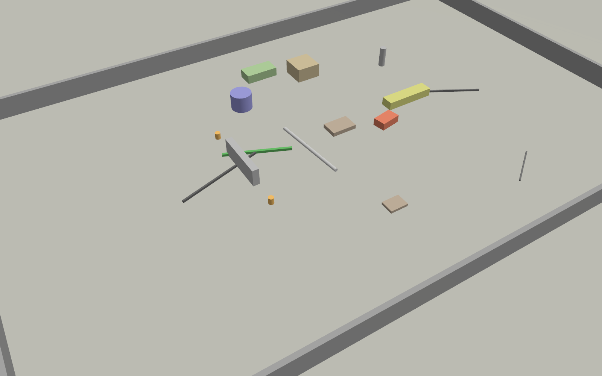
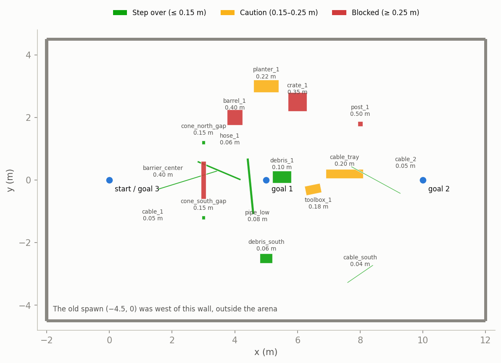
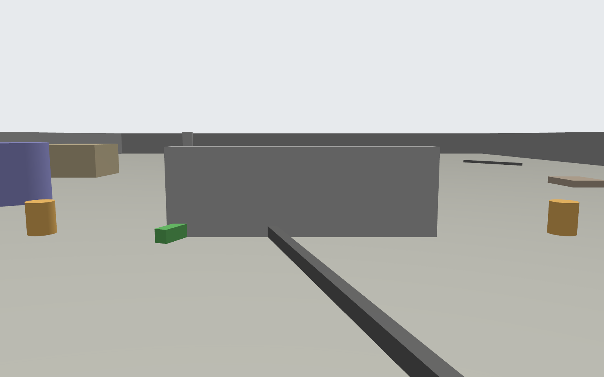
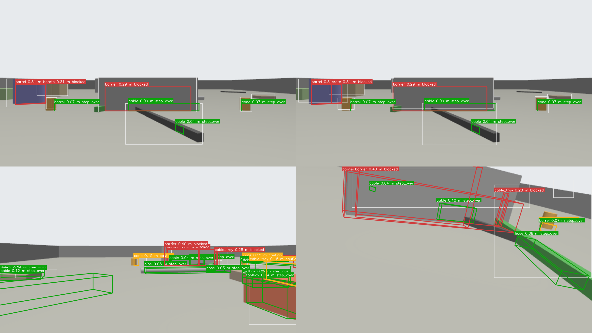
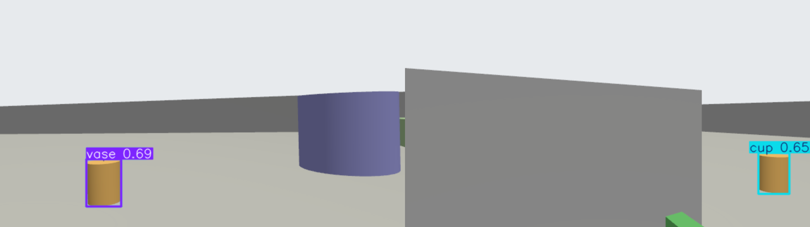
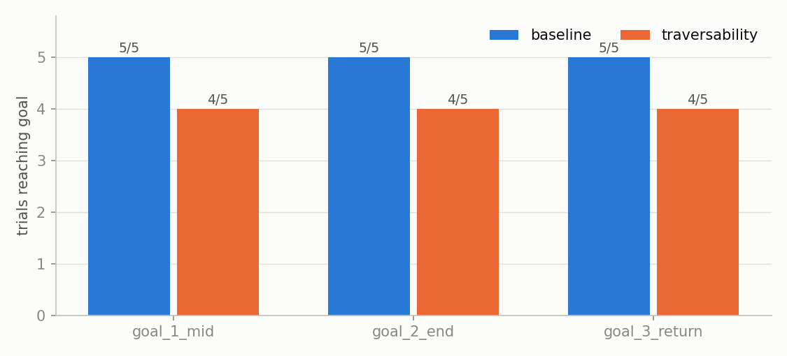
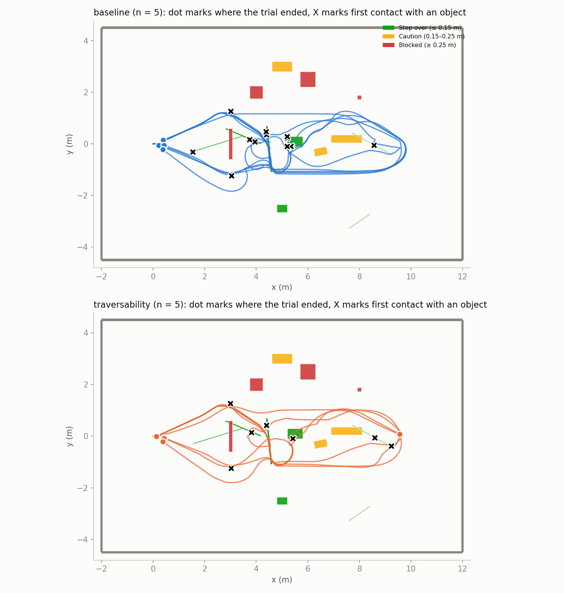
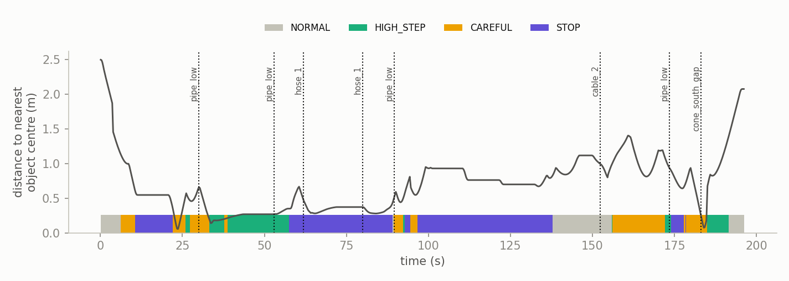
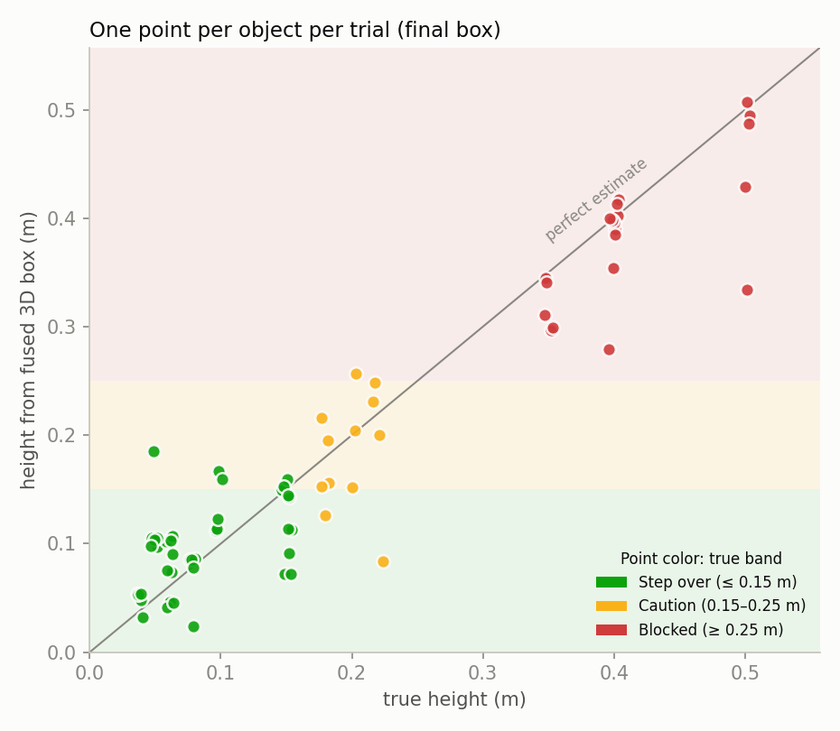
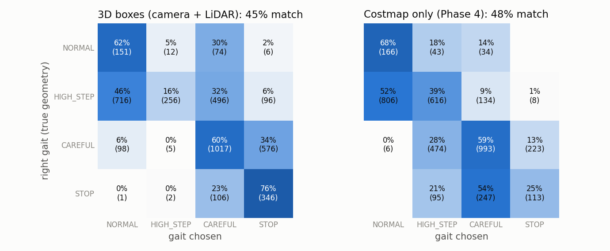

# Cluttered World (`cluttered_nav_test`): Traversability vs Baseline Navigation

[← Back to README](../../README.md) · [Gazebo sim](gazebo.md) · [Indoor lab world](lab_office.md) · [Camera–LiDAR fusion](../ai_and_vision/camera_lidar_fusion.md) · [Status](../STATUS.md)

A Gazebo arena of low and tall clutter, and the results of running Nav2 through
it with and without the traversability stack: the height costmap layer, the
camera + LiDAR 3D boxes, and the gait supervisor in `dry_run`
(5 trials each, 2026-11-06).

## Results at a glance

| | `baseline` (n = 5) | `traversability` (n = 5) | p |
|---|---|---|---|
| Goals reached (3 per trial) | **15 / 15** | 12 / 15 | 0.22 (Fisher, per leg) |
| Time per reached goal (median) | 51 s | 52 s | |
| SPL (1 = shortest path, every goal) | 0.91 ± 0.03 | 0.75 ± 0.19 | 0.13 |
| Contact episodes per trial | 5.8 ± 2.1 | 4.8 ± 2.4 | 0.50 |
| Nav2 "collision ahead" aborts per trial | 3.4 ± 1.3 | 4.6 ± 2.4 | 0.37 |
| Closest to a tall object or wall | 0.02 m | 0.14 m | |

Mean ± SD over trials; p from Welch's t-test unless noted. No navigation
difference reaches p < 0.05 with 5 trials per mode.

| Fusion, traversability trials only | Result |
|---|---|
| Height error of the best track per object (median, n = 72) | **1.8 cm** |
| Low objects known before first contact | **12 of 14** contacts, median 19 s ahead |
| Height band right, all final tracks (n = 139) | 93 of 139 (67 %) |
| Unsafe labels: a taller object's track marked lower than it is | **13 tracks, in all 5 trials** |

**In short: the fusion can see and measure low obstacles before the robot reaches
them, which plain Nav2 cannot do, but it is not ready to drive a gait.** It adds
no navigation benefit yet, and the traversability stack reached fewer goals,
though not significantly. Its tracks include repeatable false "step over" labels
on tall objects, which must be fixed before any test on the real dog. This
simulator cannot show stepping at all: the legs are fixed and the body glides.

---

## The world



*Rendered by Gazebo
(`CAM_OVERVIEW=... ./gazebo/worlds/render_world.sh cluttered_nav_test`).*



*Floor plan from the world file. Color is the height band, also named in the
legend. The heights are true object tops.*

- **14 × 9 m walled arena,** walls 0.5 m tall. The world expects the spawn at
  (0, 0): `SIM_SPAWN="0 0 0"`. The default spawn (−4.5, 0) is outside the wall.
- **16 objects in three height bands:**
  - step over (≤ 0.15 m): cables, a hose, a pipe, debris, two cones;
  - caution (0.15–0.25 m): a toolbox, a cable tray, a planter;
  - blocked (≥ 0.25 m): a barrel, a crate, a post, a central barrier.
- **A 1.2 m barrier at x = 3** forces a choice of north or south gap.
- **Plain shapes, no textures.** That matters for the camera: see
  [What a stock YOLO model sees](#what-a-stock-yolo-model-sees).



### Use it

```bash
GO2_HOST_IP=127.0.0.1 SIM_ARM=0 SIM_WORLD=cluttered_nav_test SIM_SPAWN="0 0 0" \
    SIM_CAMERA=1 SIM_CONTACTS=1 ./gazebo/run_sim.sh up
tests/traversability/run_all.sh RESULTS_DIR "1 2 3 4 5"
```

## The concept under test

The front camera says what an object is. The LiDAR says where it is and how tall
it is. Together they give a 3D box, and the box height picks the gait.

1. **2D detection:** YOLO's boxes on `/yolo/detections`. In this sim a stand-in
   supplies them (below).
2. **3D box:** [`object_box_fusion.py`](../../scripts/nodes/object_box_fusion.py)
   projects the last 15 self-filtered LiDAR scans into the image, keeps the points
   inside the 2D box and above the floor, clusters them in the floor plane and
   fits a box to the nearest cluster.
3. **Band:** step over, caution, blocked, or unknown when too few points hit it.
4. **World-fixed tracks,** so an object is still known when it has left the camera's
   view under the nose.
5. **Gait:** [`gait_supervisor.py`](../../scripts/nodes/gait_supervisor.py) takes the
   tallest object in the 1.5 m corridor ahead. It picks `HIGH_STEP` only if the
   raised foot (0.10 m) clears the object by 2 cm, otherwise `CAREFUL` or `STOP`.

Depth comes from the LiDAR cloud and not the costmap, because a 2D costmap has no
height.



*Sim camera frames from traversability1. White: 2D detections. Colored wireframes:
fused 3D boxes, with class, height and band in the label (green step over, yellow
caution, red blocked). Good boxes sit beside bad ones here: "barrel 0.07 m
step_over" is the cone standing in front of the barrel, and the second "toolbox"
track is too low. See [Fusion errors](#fusion-errors).*

### The detector is a stand-in

[`sim_box_detector.py`](../../scripts/nodes/sim_box_detector.py) is **not a vision
model**. It reads each object's true class and shape from the world file and
projects it into the camera, with 3 px of noise, a 6 m limit and a check for
objects hidden behind taller ones. It behaves like a perfect custom-trained
detector, so these results test the steps after the detector and say nothing about
detection itself.

### What a stock YOLO model sees



*The real YOLO11s (COCO) over the same frames, confidence 0.25.*

Over 216 frames from traversability1, stock YOLO11s reported 42 detections on 29
frames, **none of them a real class in this world**: cup 13, vase 10, airplane 10,
then single labels such as tv, bench and person. The cones became cups and vases.
COCO has no cable, hose, pipe or debris class, so the real system needs a
custom-trained model. It should also expect false labels on simple shapes.

## How it was tested

Trials alternated, baseline1, traversability1, baseline2 and so on, with the robot
reset to (0, 0) by Gazebo between trials. Both modes:

- Nav2 with the values of go2-nav2-wifi's 3D launch files: lattice planner, Regulated
  Pure Pursuit, full footprint, **collision detection on**;
- the URDF self-filter on, removing about 690 of the robot's own points per scan;
- commands through the same `go2_cmd_vel_tcp.py` TCP path the real robot uses;
- camera on, 5 Hz LiDAR, contact sensors on, about 0.79× real time.

| | `baseline` | `traversability` |
|---|---|---|
| Global costmap | obstacles, inflation | the same |
| Local costmap | obstacles, inflation | adds `HeightBandLayer` |
| 3D boxes and gait supervisor | off | on, `dry_run` |

In `dry_run` the gait is only recorded, so **it cannot change the robot's motion**.
Any difference in navigation comes from the height layer or chance.

Goals are (5, 0), (10, 0), then back to (0, 0), sent once to `/goal_pose`. A leg is:

- **reached** within 0.5 m;
- **timeout** after 120 s;
- **stuck** with less than 0.15 m of progress in 45 s.

The active path is cancelled when a leg ends. A leg that stops early is re-sent
after 8 s without motion.

[`analyze.py`](../../tests/traversability/analyze.py) scores every trial against
the world file, so both modes are measured the same way:

| Metric | How |
|---|---|
| Contact | Gazebo contact sensors. An episode is a touch with gaps under 2 s |
| SPL | Reached × shortest ÷ max(walked, shortest), mean over legs. Shortest path keeps 0.3 m from objects taller than 0.15 m |
| Closest approach | The 0.70 × 0.31 m body against objects taller than 0.15 m and walls |
| Box error | Final track of the object's class nearest the true object |
| Track audit | Every final track, duplicates included, against the nearest object of its class |
| Right gait | The gait rule applied to the true objects in the same corridor |

## Results

### Navigation





*Both modes take the same routes around the barrier, because the global costmap is
the same. The low objects under those routes are not avoided.*

- **Baseline reached every goal.** Plain Nav2 can complete this course.
- **The traversability trials failed 3 legs:**

  | Trial | Leg | Ended at | Nav2's message |
  |---|---|---|---|
  | traversability1 | goal 1 | (3.66, −0.03) | *collision ahead*, 3 times |
  | traversability2 | goal 2 | (5.19, −0.20) | *collision ahead*, 5 times |
  | traversability5 | goal 3 | (9.57, 0.08) | *no valid path*, 5 times |

  The difference is not significant (p = 0.22), and the cause is not established.
  The third failure is in the planner, whose configuration is the same in both modes.
- **Contacts did not drop,** as expected: the gait is `dry_run` and the routes are the
  same.
- **Both modes pushed over low objects.** Obstacle-layer points below 0.15 m are
  ignored, so Nav2 drives into them. The glide body rides over them instead of
  stopping, which the real dog may not do.

### Seeing objects before contact



*traversability1. Line: distance to the nearest object's centre. Band along the
bottom: gait chosen. Dotted lines: contacts.*

Of the 14 first contacts with an object in the traversability trials, the object
already had a track in **12**. It was first placed 1.8–3.2 m away, a median of 19 s
before contact. Baseline has no such warning for anything under 0.15 m. The two
misses were `hose_1` and the thin `cable_2` in traversability1.



- **Heights are close where the object is seen well:** median error 1.8 cm, mean 3.3 cm.
- **Positions are less good:** mean 25 cm. The LiDAR sees part of a long object, so
  the box centre sits on the visible part.
- **`cable_1` reads 0.10 m, not 0.05 m,** because it runs into the barrier.
- **`cable_2` was seen in only 1 of 5 trials,** and then at 0.19 m. At 3 cm wide, it
  gets few LiDAR hits.

### Gait choice



*Each row sums to 100 %. Right gait: the same rule on the true objects.*

| | 3D boxes | Costmap only |
|---|---|---|
| Exact match over all samples (n = 3958) | 45 % | 48 % |
| Exact match at the 14 first contacts, for the object touched | 5 / 14 | 8 / 14 |
| Chose `HIGH_STEP` when the foot would not clear (`CAREFUL` or `STOP` was right) | **7 of 2151 (0.3 %)** | **569 of 2151 (26 %)** |
| Chose `NORMAL` when `CAREFUL` or `STOP` was right | 99 of 2151 (4.6 %) | 6 of 2151 (0.3 %) |

- **The 3D boxes are not more accurate overall.** The exact-match scores are about
  equal.
- **They differ in the mistake they make.** The costmap has no height, so it often
  calls for a high step over things the foot cannot clear: all 3 `debris_1` contacts
  in that table. Boxes almost never do. In exchange, they more often miss an object
  and stay `NORMAL`.
- **At `pipe_low`, boxes chose `CAREFUL` in 5 of 5 contacts, which counts as a miss.**
  In each, the taller `debris_1` was in the same 1.5 m corridor, so the rule chose
  correctly by its own logic. The per-object score is the harsher of the two.

### Fusion errors

The box score above uses only the best track for each object. Auditing every final
track shows more:

- **139 tracks over 5 trials,** about 28 per trial for 16 objects. One object often
  gets several tracks.
- **46 of 139 (33 %) have the wrong band.**
- **13 tracks are unsafe,** labelled lower than the true object, in all 5 trials:

  | Object | True height | Unsafe tracks | Typical reading |
  |---|---|---|---|
  | `barrel_1` | 0.40 m | 5 | 0.07 m, step over |
  | `toolbox_1` | 0.18 m | 5 | 0.09–0.13 m, step over |
  | `post_1` | 0.50 m | 2 | 0.02–0.17 m |
  | `planter_1` | 0.22 m | 1 | 0.08 m, step over |

The barrel is the clearest case. `cone_north_gap` stands in front of it, inside the
barrel's 2D box, and the fusion takes the cluster nearest the camera. So the cone's
points become a "barrel" 1.3 m from the real one. The others most likely come from
seeing only a low part of an object from far away, which was not confirmed
track by track. A better view at another position starts a new track, so a bad
early box stays.

## What this says

1. **The concept's first half works.** Camera + LiDAR can place and size low objects
   that Nav2 ignores, seconds before the robot reaches them. Nothing else in the stack
   provides that.
2. **Fusion is not ready to choose a gait on the real dog.** A tall object marked
   step over is the worst error it can make. The next fix is in fusion: reject boxes
   whose cluster fills only a small part of the 2D box, and merge duplicates.
3. **No navigation gain yet, and none was expected from these runs.** The gait is
   `dry_run`, and the global costmap stays free of the plugins, so routes do not
   change. The 3 failed legs need a closer look before more trials.
4. **`HIGH_STEP` lifts the foot to 0.10 m, and `CAREFUL` to 0.08 m.** So `CAREFUL` is
   the lower step, and neither clears `debris_1` (0.10 m) with a margin. The real
   foot height needs measuring on the robot, and `CAREFUL` needs a rethink.
5. **Stepping itself needs the real robot or a legged simulator.**

## Limits

- **Sim only.** The body glides with no gait and localization is perfect. No result
  here shows the dog stepping over anything.
- **The detector is perfect by construction,** apart from pixel noise. A real model
  will miss objects and add false ones, so real fusion results will be worse.
- **5 trials per mode in one world, from one spawn,** on a run where the sim was at
  about 0.79× real time while Nav2 runs on wall-clock time.
- **Not exercised here:** `SemanticCostmapLayer`, `vlm_heuristic_node` and
  `traversability_critic_node`. Boxes are JSON on `/objects/boxes_json`;
  `SemanticObstacle.msg` has no size fields yet.
- **Footprint checks treat objects as solid boxes,** and contact is on the lumped leg
  and body collision.

## Found along the way

- **Earlier trial numbers are withdrawn.** Runs before this report reached 0–1 of 3
  goals, wrongly suggesting Nav2 could not handle the clutter. They were invalid:
  - the robot spawned at (−4.5, 0), outside the closed arena;
  - Nav2's output was remapped to `/sim/cmd_vel`, where the sim bridge was publishing
    zeros at 20 Hz. The proper path is the `go2_cmd_vel_tcp.py` client;
  - collision detection was off, HeightBandLayer was in the global costmap, and goals
    were shortened after a failure, all against the project's rules;
  - "crossings" counted odometry samples, so a parked robot scored about 19 000.
- **`pipe_low` was a 0.94 m pole.** An SDF cylinder's axis is z, and the world had no
  roll on it. The LiDAR showed points up to 0.94 m. It stood beside goal 1 and caused
  freezes with no contact. A full 10-trial batch was discarded and rerun after
  the fix (`<pose>4.5 -0.2 0.04 1.5708 0 0.1</pose>`).
- **Self-hits are real.** About 690 points per scan are the robot itself. The URDF
  self-filter is the right fix, so these trials do not use `HeightBandLayer`'s
  `min_range` (default 0).
- **go2-nav2-wifi has HeightBandLayer in its global costmap.** Its working copy of
  `lidar3d_planner.yaml` has an uncommitted edit adding it, and the local costmap is
  copied from that file. These trials avoid it with their own configs in
  [`tests/traversability/`](../../tests/traversability/); the real launch files would
  not. That edit breaks the local-only rule and should be reverted.
- **The fused scores first looked better than they were.** The per-object score ignored
  duplicate tracks. Looking at the frames found the "barrel 0.07 m" error, and the
  track audit was added.

## Full statistics

Generated by `analyze.py`: [`stats.md`](../images/cluttered_nav/stats.md), [`trials.csv`](../images/cluttered_nav/trials.csv).

Per mode over trials: mean ± SD [min–max]; p from Welch's t-test.

| Metric | `baseline` (n=5) | `traversability` (n=5) | p (Welch t) |
|---|---|---|---|
| Goals reached (of 3) | 3.00 ± 0.00 [3.00–3.00] | 2.40 ± 0.55 [2.00–3.00] | 0.070 |
| Total time (s) | 160.74 ± 25.35 [133.40–187.80] | 153.70 ± 22.59 [132.80–191.80] | 0.655 |
| Distance walked (m) | 23.57 ± 1.12 [22.65–25.52] | 18.82 ± 5.73 [12.43–24.02] | 0.138 |
| SPL | 0.91 ± 0.03 [0.85–0.94] | 0.75 ± 0.19 [0.59–1.00] | 0.129 |
| Contact episodes | 5.80 ± 2.05 [4.00–9.00] | 4.80 ± 2.39 [2.00–8.00] | 0.498 |
| Objects touched | 3.60 ± 0.89 [3.00–5.00] | 2.80 ± 0.84 [2.00–4.00] | 0.182 |
| Nav2 collision aborts | 3.40 ± 1.34 [2.00–5.00] | 4.60 ± 2.41 [2.00–8.00] | 0.366 |
| Plans refused: start in lethal space | 0.00 ± 0.00 [0.00–0.00] | 0.00 ± 0.00 [0.00–0.00] |  |
| Goals re-sent | 3.40 ± 1.34 [2.00–5.00] | 5.00 ± 1.58 [3.00–7.00] | 0.124 |
| Closest to a tall object or wall (m) | 0.15 ± 0.07 [0.02–0.20] | 0.20 ± 0.05 [0.14–0.28] | 0.230 |
| Sim real-time factor | 0.79 ± 0.01 [0.78–0.80] | 0.78 ± 0.01 [0.77–0.79] | 0.262 |

`baseline` legs reached: 15/15

`traversability` legs reached: 12/15

Fisher exact, per leg: p = 0.224

## Per-trial results

| trial | mode | reached | time_s | walked_m | spl | contact_episodes | objects_hit | collision_aborts | start_in_lethal | resends | min_clear_tall_m | rtf |
|---|---|---|---|---|---|---|---|---|---|---|---|---|
| baseline1 | baseline | 3 | 175.5 | 23.28 | 0.924 | 9 | 5 | 4 | 0 | 4 | 0.02 | 0.798 |
| baseline2 | baseline | 3 | 133.4 | 23.05 | 0.929 | 4 | 3 | 2 | 0 | 2 | 0.184 | 0.795 |
| baseline3 | baseline | 3 | 133.9 | 22.65 | 0.929 | 4 | 3 | 2 | 0 | 2 | 0.197 | 0.787 |
| baseline4 | baseline | 3 | 173.1 | 23.34 | 0.936 | 6 | 4 | 5 | 0 | 5 | 0.17 | 0.783 |
| baseline5 | baseline | 3 | 187.8 | 25.52 | 0.853 | 6 | 3 | 4 | 0 | 4 | 0.18 | 0.779 |
| traversability1 | traversability | 2 | 191.8 | 24.02 | 0.667 | 8 | 4 | 6 | 0 | 5 | 0.14 | 0.789 |
| traversability2 | traversability | 2 | 149.1 | 12.9 | 0.591 | 3 | 2 | 8 | 0 | 7 | 0.278 | 0.771 |
| traversability3 | traversability | 3 | 142.3 | 21.1 | 1.0 | 5 | 3 | 4 | 0 | 4 | 0.17 | 0.793 |
| traversability4 | traversability | 3 | 152.5 | 23.65 | 0.908 | 6 | 3 | 3 | 0 | 3 | 0.204 | 0.783 |
| traversability5 | traversability | 2 | 132.8 | 12.43 | 0.593 | 2 | 2 | 2 | 0 | 6 | 0.224 | 0.771 |

## Graph data

The numbers behind each graph, also as CSV in [`docs/images/cluttered_nav/data/`](../images/cluttered_nav/data/), including every track in `tracks.csv` and every gait sample in `gait_samples.csv`.

### Every leg (goals.png)

| trial | mode | goal | result | time_s | path_m | shortest_m | spl | resends |
|---|---|---|---|---|---|---|---|---|
| baseline1 | baseline | goal_1_mid | reached | 74.28 | 7.57 | 5.85 | 0.77 | 2 |
| baseline1 | baseline | goal_2_end | reached | 28.66 | 5.86 | 6.22 | 1.0 | 0 |
| baseline1 | baseline | goal_3_return | reached | 72.6 | 9.85 | 10.3 | 1.0 | 2 |
| baseline2 | baseline | goal_1_mid | reached | 50.81 | 7.38 | 5.85 | 0.79 | 1 |
| baseline2 | baseline | goal_2_end | reached | 37.0 | 5.17 | 5.24 | 1.0 | 1 |
| baseline2 | baseline | goal_3_return | reached | 45.55 | 10.5 | 10.45 | 0.99 | 0 |
| baseline3 | baseline | goal_1_mid | reached | 51.53 | 7.42 | 5.85 | 0.79 | 1 |
| baseline3 | baseline | goal_2_end | reached | 35.93 | 4.98 | 5.34 | 1.0 | 1 |
| baseline3 | baseline | goal_3_return | reached | 46.48 | 10.25 | 10.35 | 1.0 | 0 |
| baseline4 | baseline | goal_1_mid | reached | 34.83 | 5.28 | 5.85 | 1.0 | 1 |
| baseline4 | baseline | goal_2_end | reached | 79.57 | 7.52 | 6.22 | 0.83 | 3 |
| baseline4 | baseline | goal_3_return | reached | 58.66 | 10.54 | 10.35 | 0.98 | 1 |
| baseline5 | baseline | goal_1_mid | reached | 80.93 | 8.84 | 5.85 | 0.66 | 2 |
| baseline5 | baseline | goal_2_end | reached | 34.66 | 5.17 | 5.8 | 1.0 | 1 |
| baseline5 | baseline | goal_3_return | reached | 72.24 | 11.52 | 10.35 | 0.9 | 1 |
| traversability1 | traversability | goal_1_mid | stuck | 78.29 | 7.24 | 5.85 | 0.0 | 2 |
| traversability1 | traversability | goal_2_end | reached | 65.71 | 6.6 | 7.06 | 1.0 | 3 |
| traversability1 | traversability | goal_3_return | reached | 47.82 | 10.18 | 10.3 | 1.0 | 0 |
| traversability2 | traversability | goal_1_mid | reached | 53.07 | 7.56 | 5.85 | 0.77 | 1 |
| traversability2 | traversability | goal_2_end | stuck | 45.01 | 0.0 | 5.48 | 0.0 | 4 |
| traversability2 | traversability | goal_3_return | reached | 50.98 | 5.33 | 5.86 | 1.0 | 2 |
| traversability3 | traversability | goal_1_mid | reached | 44.97 | 5.28 | 5.85 | 1.0 | 2 |
| traversability3 | traversability | goal_2_end | reached | 51.98 | 6.01 | 6.22 | 1.0 | 2 |
| traversability3 | traversability | goal_3_return | reached | 45.32 | 9.81 | 10.3 | 1.0 | 0 |
| traversability4 | traversability | goal_1_mid | reached | 52.13 | 7.53 | 5.85 | 0.78 | 1 |
| traversability4 | traversability | goal_2_end | reached | 38.52 | 5.15 | 5.24 | 1.0 | 1 |
| traversability4 | traversability | goal_3_return | reached | 61.86 | 10.98 | 10.39 | 0.95 | 1 |
| traversability5 | traversability | goal_1_mid | reached | 51.63 | 7.51 | 5.85 | 0.78 | 1 |
| traversability5 | traversability | goal_2_end | reached | 36.13 | 4.92 | 5.24 | 1.0 | 1 |
| traversability5 | traversability | goal_3_return | stuck | 45.01 | 0.0 | 10.39 | 0.0 | 4 |

### First contact with each object (trajectories.png)

| trial | mode | object | true_h | band | t_contact | right_gait | gait | costmap_gait | known | lead_s | lead_m | est_h |
|---|---|---|---|---|---|---|---|---|---|---|---|---|
| baseline1 | baseline | pipe_low | 0.08 | step_over | 30.0 | HIGH_STEP |  |  | False |  |  |  |
| baseline1 | baseline | hose_1 | 0.06 | step_over | 63.5 | HIGH_STEP |  |  | False |  |  |  |
| baseline1 | baseline | debris_1 | 0.1 | step_over | 81.7 | CAREFUL |  |  | False |  |  |  |
| baseline1 | baseline | cable_2 | 0.05 | step_over | 98.0 | HIGH_STEP |  |  | False |  |  |  |
| baseline1 | baseline | cone_north_gap | 0.15 | step_over | 164.9 | CAREFUL |  |  | False |  |  |  |
| baseline2 | baseline | pipe_low | 0.08 | step_over | 32.3 | HIGH_STEP |  |  | False |  |  |  |
| baseline2 | baseline | debris_1 | 0.1 | step_over | 51.0 | CAREFUL |  |  | False |  |  |  |
| baseline2 | baseline | cone_south_gap | 0.15 | step_over | 124.6 | CAREFUL |  |  | False |  |  |  |
| baseline3 | baseline | pipe_low | 0.08 | step_over | 32.8 | HIGH_STEP |  |  | False |  |  |  |
| baseline3 | baseline | debris_1 | 0.1 | step_over | 51.8 | CAREFUL |  |  | False |  |  |  |
| baseline3 | baseline | cone_south_gap | 0.15 | step_over | 124.2 | CAREFUL |  |  | False |  |  |  |
| baseline4 | baseline | cone_north_gap | 0.15 | step_over | 23.3 | CAREFUL |  |  | False |  |  |  |
| baseline4 | baseline | pipe_low | 0.08 | step_over | 30.6 | HIGH_STEP |  |  | False |  |  |  |
| baseline4 | baseline | debris_1 | 0.1 | step_over | 51.8 | CAREFUL |  |  | False |  |  |  |
| baseline4 | baseline | cable_1 | 0.05 | step_over | 172.2 | HIGH_STEP |  |  | False |  |  |  |
| baseline5 | baseline | pipe_low | 0.08 | step_over | 33.1 | HIGH_STEP |  |  | False |  |  |  |
| baseline5 | baseline | hose_1 | 0.06 | step_over | 71.7 | HIGH_STEP |  |  | False |  |  |  |
| baseline5 | baseline | debris_1 | 0.1 | step_over | 84.1 | CAREFUL |  |  | False |  |  |  |
| traversability1 | traversability | pipe_low | 0.08 | step_over | 29.9 | HIGH_STEP | CAREFUL | HIGH_STEP | True | 7.3 | 2.21 | 0.078 |
| traversability1 | traversability | hose_1 | 0.06 | step_over | 61.8 | HIGH_STEP | STOP | CAREFUL | False |  |  |  |
| traversability1 | traversability | cable_2 | 0.05 | step_over | 152.4 | HIGH_STEP | NORMAL | NORMAL | False |  |  |  |
| traversability1 | traversability | cone_south_gap | 0.15 | step_over | 183.1 | CAREFUL | CAREFUL | CAREFUL | True | 182.9 | 3.23 | 0.143 |
| traversability2 | traversability | pipe_low | 0.08 | step_over | 31.8 | HIGH_STEP | CAREFUL | HIGH_STEP | True | 7.5 | 2.24 | 0.086 |
| traversability2 | traversability | debris_1 | 0.1 | step_over | 51.3 | CAREFUL | CAREFUL | HIGH_STEP | True | 27.5 | 3.07 | 0.167 |
| traversability3 | traversability | pipe_low | 0.08 | step_over | 40.7 | HIGH_STEP | CAREFUL | HIGH_STEP | True | 15.9 | 1.84 | 0.086 |
| traversability3 | traversability | cable_2 | 0.05 | step_over | 82.9 | HIGH_STEP | CAREFUL | CAREFUL | True | 14.1 | 3.22 | 0.185 |
| traversability3 | traversability | cone_north_gap | 0.15 | step_over | 132.6 | CAREFUL | CAREFUL | CAREFUL | True | 132.4 | 3.23 | 0.159 |
| traversability4 | traversability | cone_north_gap | 0.15 | step_over | 23.0 | CAREFUL | STOP | CAREFUL | True | 22.8 | 3.22 | 0.144 |
| traversability4 | traversability | pipe_low | 0.08 | step_over | 30.7 | HIGH_STEP | CAREFUL | HIGH_STEP | True | 6.4 | 1.99 | 0.085 |
| traversability4 | traversability | debris_1 | 0.1 | step_over | 51.9 | CAREFUL | CAREFUL | HIGH_STEP | True | 27.6 | 2.69 | 0.159 |
| traversability5 | traversability | pipe_low | 0.08 | step_over | 30.2 | HIGH_STEP | CAREFUL | HIGH_STEP | True | 5.0 | 2.19 | 0.078 |
| traversability5 | traversability | debris_1 | 0.1 | step_over | 51.5 | CAREFUL | CAREFUL | HIGH_STEP | True | 27.4 | 3.11 | 0.123 |

### Fused boxes per object (box_accuracy.png)

| object | class | true_h | true_band | seen_in_trials | mean_est_h | mean_err_xy | band_correct | mean_points |
|---|---|---|---|---|---|---|---|---|
| cable_1 | cable | 0.05 | step_over | 5/5 | 0.102 | 0.484 | 5/5 | 39.2 |
| hose_1 | hose | 0.06 | step_over | 4/5 | 0.101 | 0.263 | 4/4 | 36.8 |
| pipe_low | pipe | 0.08 | step_over | 5/5 | 0.072 | 0.286 | 5/5 | 36.4 |
| debris_1 | debris | 0.1 | step_over | 5/5 | 0.135 | 0.227 | 3/5 | 17.0 |
| toolbox_1 | toolbox | 0.18 | caution | 5/5 | 0.169 | 0.215 | 4/5 | 50.0 |
| cable_tray | cable_tray | 0.2 | caution | 3/5 | 0.204 | 0.245 | 2/3 | 129.0 |
| cable_2 | cable | 0.05 | step_over | 1/5 | 0.185 | 0.413 | 0/1 | 33.0 |
| barrel_1 | barrel | 0.4 | blocked | 5/5 | 0.373 | 0.208 | 5/5 | 97.8 |
| crate_1 | crate | 0.35 | blocked | 5/5 | 0.319 | 0.387 | 5/5 | 71.4 |
| post_1 | post | 0.5 | blocked | 5/5 | 0.45 | 0.082 | 5/5 | 84.6 |
| planter_1 | planter | 0.22 | caution | 4/5 | 0.191 | 0.384 | 3/4 | 46.8 |
| debris_south | debris | 0.06 | step_over | 5/5 | 0.056 | 0.163 | 5/5 | 12.0 |
| cable_south | cable | 0.04 | step_over | 5/5 | 0.048 | 0.242 | 5/5 | 8.4 |
| barrier_center | barrier | 0.4 | blocked | 5/5 | 0.394 | 0.348 | 5/5 | 273.2 |
| cone_north_gap | cone | 0.15 | step_over | 5/5 | 0.131 | 0.062 | 4/5 | 14.0 |
| cone_south_gap | cone | 0.15 | step_over | 5/5 | 0.111 | 0.091 | 4/5 | 14.0 |
