# Hydroponic station trial: full end-to-end MoveIt 2 + Nav2 mission

[← Back to README](../../README.md) · [Gazebo sim](gazebo.md) · [Status](../STATUS.md)

A full mission test in the Gazebo hydroponic station world: the Go2 navigates
from a charging dock to a CropKing NFT 8-4 hydroponic rack, the D1-550 arm
(running MoveIt 2 through `gz_ros2_control`) extends a mock depth camera to a
lettuce head, orbits around it, collects images, and retracts home. Every phase
is timed, the camera trajectory is logged, and a Mission Score is computed from
collisions, path completion, and accuracy.

```bash
# One-time setup (needs go2-sim:local from ./gazebo/setup_gazebo.sh)
./gazebo/setup_gazebo.sh --moveit

# Clone the D1-550 description (for MoveIt + Gazebo, separate from Unitree's d1_description)
git clone https://github.com/JeewanthaSadaruwan/unitree-D1-550-Robot-ARM ~/files/unitree-D1-550-Robot-ARM

# Run trial B (close standoff, within the arm's reach)
python3 tests/hydroponic_trial.py --name B --standoff 0.333 --look-up-deg 25

# Run trial A (the spec's 0.6 m waypoint, beyond the arm's full reach)
python3 tests/hydroponic_trial.py --name A --look-up-deg 25

# Generate score + graphs
python3 src/d1_moveit_config/scripts/hydroponic_report.py \
    ~/files/go2-nav2-wifi/ws/log/hydroponic_trial/B \
    ~/files/go2-nav2-wifi/ws/log/hydroponic_trial/A \
    --out docs/images/hydroponic_trial
```

## Current trial: arm facing backward, as on the real dog (2026-11-05)

```bash
python3 tests/hydroponic_trial.py --name tail_40_50 --standoff 0.40 --look-up-deg 25 --orbit-deg 50
```

The dog walks nose-first to a stage 0.45 m short of the waypoint, turns around
there, and reverses in, so it parks with its **tail** to the rack. Turning at the
rack would swing its nose into it.

| Standoff | Orbit | Result |
|---|---|---|
| 0.333 m | 90° | **Fails**: the rear legs press on the low rail (55,929 contacts), the dog stops 38 mm short, the orbit reaches 80 % of its lead-in |
| 0.40 m | 60° | Parks to 5 mm, 0 contacts, orbit stops at 92 % of −30°: the arm's reach |
| 0.40 m | 40° | Complete, 0 contacts |
| 0.40 m | **50° (±25°)** | **Complete, 0 contacts, Mission Score 100, plant centred in all 5 wrist frames** |

Parked tail-first, the rear legs reach about 0.37 m behind the dog's centre, so the
plant is 0.53 m from the arm, not 0.465 m. That is why the orbit is ±25° here, against
the forward-facing trials below. Trials A and B below ran with the arm facing forward
and no longer match the dog.

In some wrist frames the lower half is a flat band; others in the same run are
complete. Wrist frames taken right after subscribing can be old, so
`full_mission_test.py` waits 1.5 s for a fresh one.

---

## The world: CropKing NFT 8-4 hydroponic station

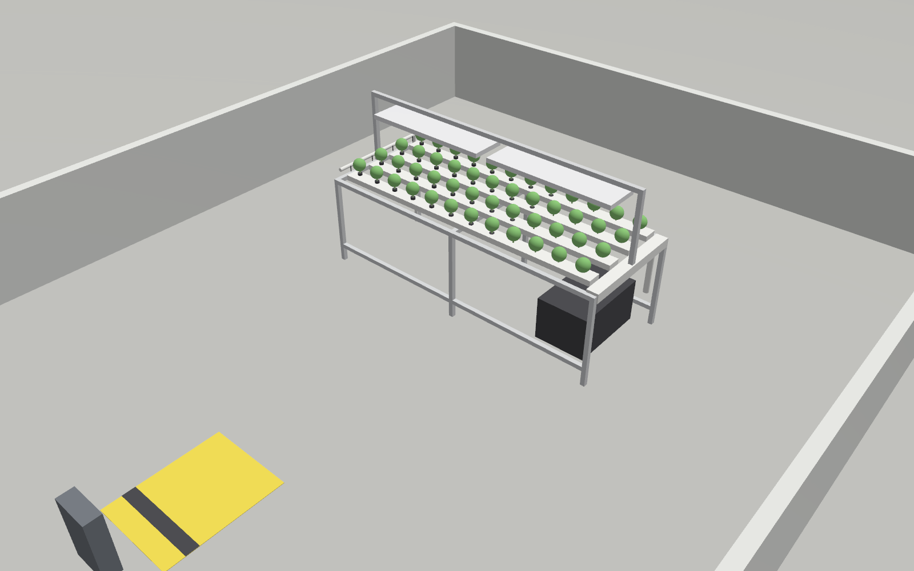
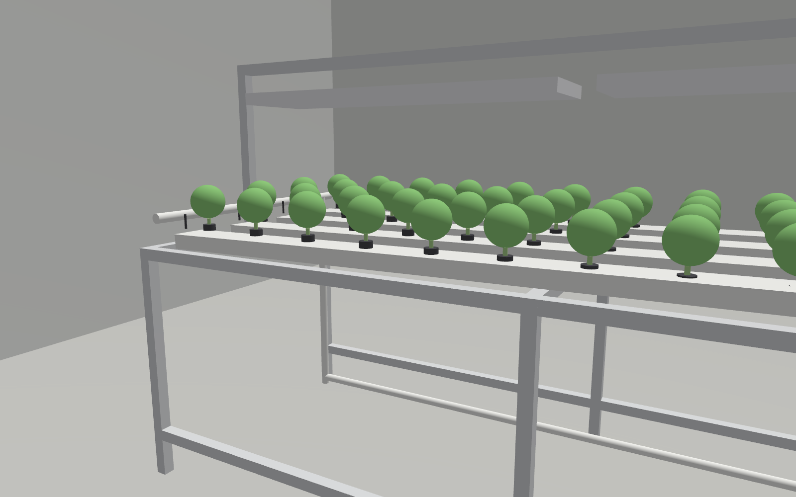

A greenhouse bay (8 × 6 m, 2.7 m ceiling) with a charging dock at the origin
and a CropKing NFT 8-4 hydroponic system at x ≈ 3 m. Built by
`gazebo/worlds/build_hydroponic_world.py`, validated with `gz sdf -k`.

**CropKing NFT 8-4 specs** (modelled from the
[CropKing product page](https://www.cropking.com/nft-8-4)):

| Parameter | Real | Simulated |
|---|---|---|
| Channels | 4 × 8 ft (2.44 m) | 4 channels, 4.5 × 2 in cross-section, 1 % slope |
| Sites per channel | 12 (8 in on centre) | 12 net cups per channel, 48 lettuce heads |
| Stand height | 34 in (0.864 m) | 0.864 m (aluminium legs and rails) |
| Stand footprint | 40 × 103 in (1.02 × 2.62 m) | 6 legs, front/back rails |
| Light rack | 56 in (1.42 m) total | 4 posts + bar + 2 LED fixtures |
| Reservoir | 25–30 gal, under the low end | 25 gal box under channel 0 |
| Supply manifold | PVC header + feeders | manifold + 4 feeder lines |
| Return | gutter + drain | return gutter and drain pipe |

**Target plant:** channel 0, site 8 (centre), at (2.619, 0.508, 0.954) — a
lettuce head with r = 0.055 m, 0.091 m above the channel top.

**Observer cameras:** three Gazebo cameras (side, front, overview) capture
screenshots at each mission phase for the report.

---

## Simulation stack

| Component | Setup |
|---|---|
| Image | `go2-sim-moveit:local` (from `Dockerfile.moveit`) |
| Gazebo | Harmonic (gz-sim 8.15), software rendering |
| ROS 2 | Humble |
| Navigation | Nav2 in `go2-lidar3d`, ROS domain 64 |
| Arm control | MoveIt 2 + `gz_ros2_control` (0.7.21, built from source for Harmonic), ROS domain 66 |
| Robot model | Go2 trunk + D1-550 arm (JeewanthaSadaruwan/unitree-D1-550-Robot-ARM) |
| End effector | Mock Intel D405 depth camera (camera_link, 23 × 42 mm) instead of the gripper |
| Planning | MoveGroup action + `compute_cartesian_path` (KDL kinematics) |
| Contact monitoring | Gazebo Contact sensor on every robot link, logged to JSONL |

### Why gz_ros2_control from source

The apt package `ros-humble-gz-ros2-control` is compiled against Gazebo
Fortress (`libignition-gazebo6`). Our sim uses Gazebo Harmonic, so
`gz_ros2_control` 0.7.21 (humble branch) is built from source with
`GZ_VERSION=harmonic` in `Dockerfile.moveit`. The plugin
`gz_ros2_control::GazeboSimROS2ControlPlugin` (library
`gz_ros2_control-system`) reads the URDF from `robot_state_publisher`, so RSP
must start before Gazebo.

---

## Deviations from the original spec

The original spec called for a 180° orbit at 0.6 m standoff. During
development, kinematic studies and iterative trials identified several necessary
adjustments:

| Spec | Implementation | Reason |
|---|---|---|
| 180° orbit | **90° orbit (±45°)** | The D1-550's 605 mm reach cannot complete a 180° arc around a plant at any reachable distance. A ±45° arc is the largest continuous Cartesian orbit the arm can sustain. |
| 0.6 m standoff | **0.333 m standoff (Trial B)** | At 0.6 m from the rack's front edge, the plant is 0.727 m from the arm base — beyond the arm's 0.605 m max reach. Trial B places the dog 0.333 m from the front edge (plant 0.465 m ahead), within the arm's workspace. Trial A documents the spec distance. |
| Gripper end effector | **Mock depth camera** | Swapped per the spec: the claw is replaced by a 23 × 42 mm camera_link with a Gazebo RGBD sensor (424 × 240, 5 Hz). |
| Home pose (all zeros) | **Stow pose** (J2 −80°, J3 45°, J5 80°) | The home pose holds the forearm 0.36 m ahead at 0.79 m height — it collides with the NFT rack's front rail during navigation. The stow pose folds the arm back over the dog's trunk. |
| Camera look angle | **25° up** | A compromise between IK reach (25° extends further laterally) and collision avoidance (30° keeps the wrist higher but clips the rail at ±45°). |
| MoveIt planning | **IK branch selection** | The orbit starts from an IK branch chosen to match the extend pose, ensuring continuous Cartesian motion without branch switches. The approach uses a joint goal from a custom damped-least-squares IK solver to pick the correct branch. |
| Nav2 arrival | **Precision approach** | Nav2's goal tolerance (0.25 m) is too coarse for arm manipulation. A precision approach on Gazebo ground truth drives the dog to within 8 mm / 0.015 rad of the waypoint after Nav2 declares arrival. |

---

## Mission phases

The mission (`full_mission_test.py`) runs six phases:

1. **Navigation** — publish a Nav2 goal 0.6 m (or `--standoff`) in front of the
   rack, wait for arrival, then drive the last centimetres with a precision
   approach on ground truth.
2. **Approach** — move the camera to the pre-grasp position (0.30 m from the
   plant centre, angled 25° up toward it), using a joint goal from the IK
   branch that matches the orbit.
3. **Extend** — Cartesian straight-line move from pre-grasp to the orbit radius
   (0.15 m from the plant centre).
4. **Orbit** — Cartesian arc: 0° → −45° (lead-in), then 4 × 22.5° segments to
   +45°, then +45° → 0° (return). Wrist images captured at −45°, −22.5°, 0°,
   +22.5°, +45°.
5. **Retract** — Cartesian straight-line back to pre-grasp.
6. **Home** — joint goal back to the stow pose.

---

## Trial B: close standoff (0.333 m) — Mission Score 99.6

> Standoff 0.333 m · look-up 25° · orbit 90° at 0.15 m radius

### Phase results

| Phase | Time (s) | EE dist (m) | Success | Cartesian fraction | Dev (%) | Notes |
|---|---|---|---|---|---|---|
| Navigation | 15.77 | 0.0005 | ✅ | — | — | Nav2 arrived 0.255 m off; precision approach to 5 mm |
| Approach | 5.82 | 0.325 | ✅ | — | 0.0 | Pre-grasp 0.30 m, camera 25° up (IK branch chosen) |
| Extend | 6.12 | 0.150 | ✅ | 1.000 | 0.02 | Cartesian straight-line, 0.04 mm max deviation |
| Orbit | 0.17 | 0.0 | ❌ | 0.946 | — | Lead-in 0→−45° reached 94.6% (IK reach limit) |
| Retract | 6.11 | 0.150 | ✅ | 1.000 | 0.02 | Cartesian straight-line, 0.04 mm max deviation |
| Home | 5.82 | 0.325 | ✅ | — | 0.0 | Back to stow pose |

### Screenshots

| Phase | Side camera | Front camera |
|---|---|---|
| Navigation |  | 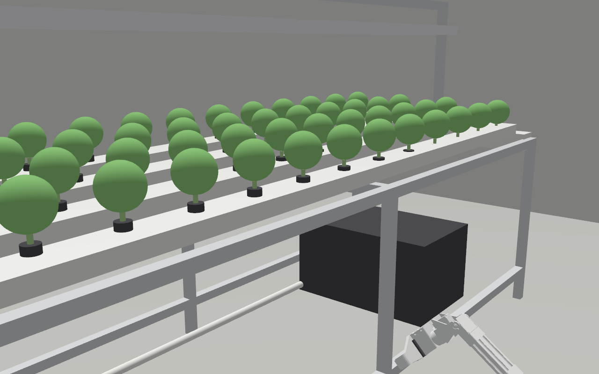 |
| Approach |  | 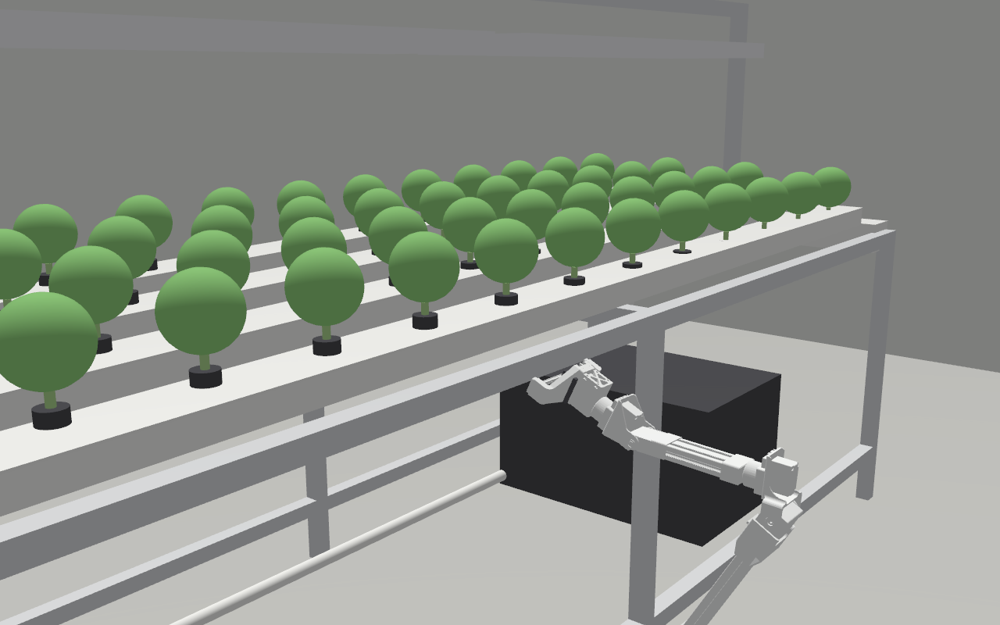 |
| Extend | 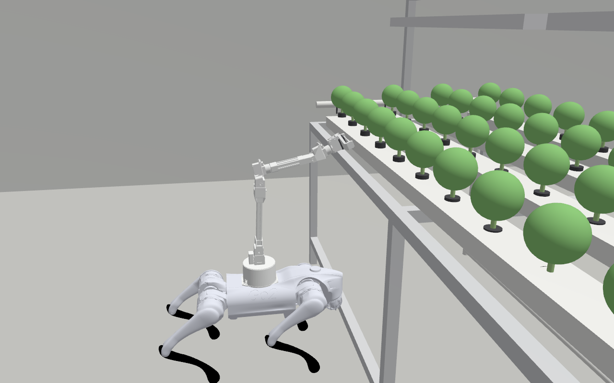 | 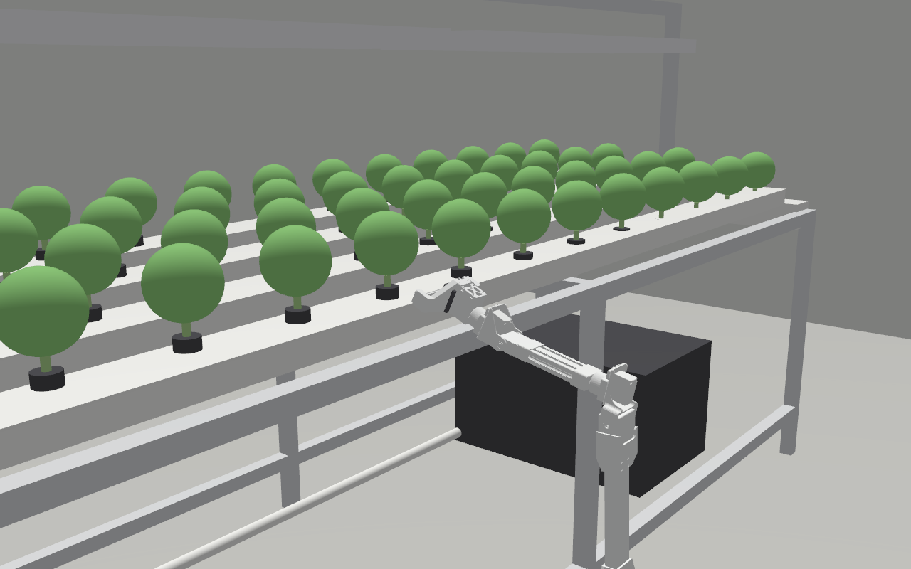 |
| Retract | 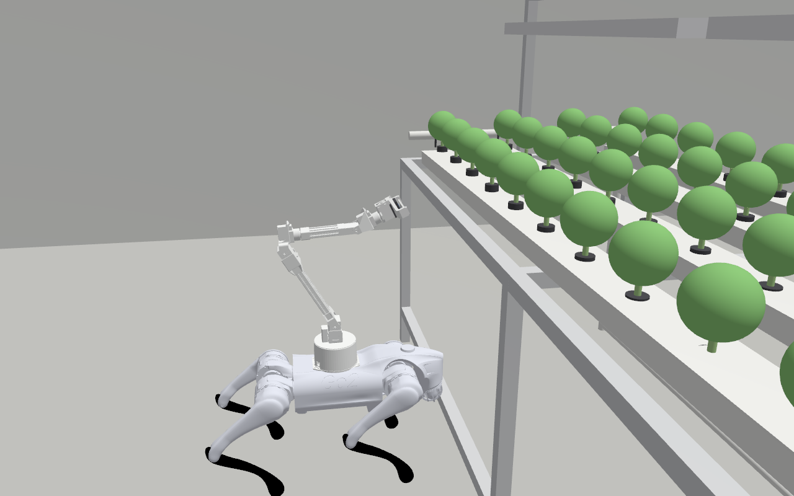 |  |
| Home |  |  |

### Graphs

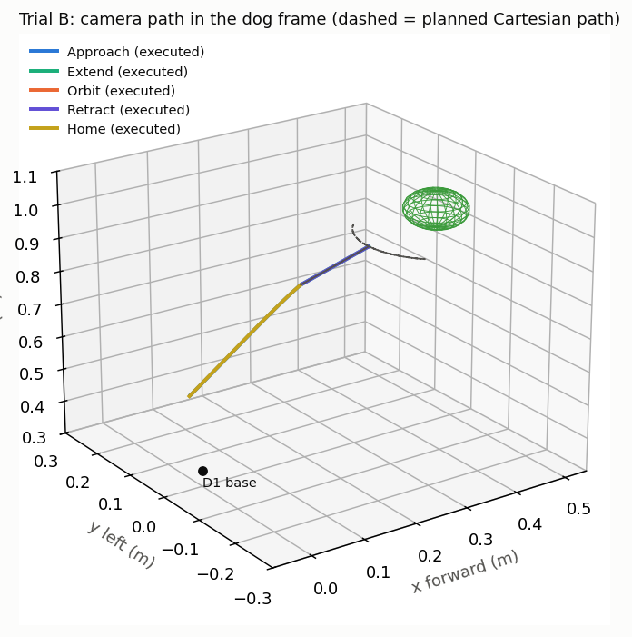

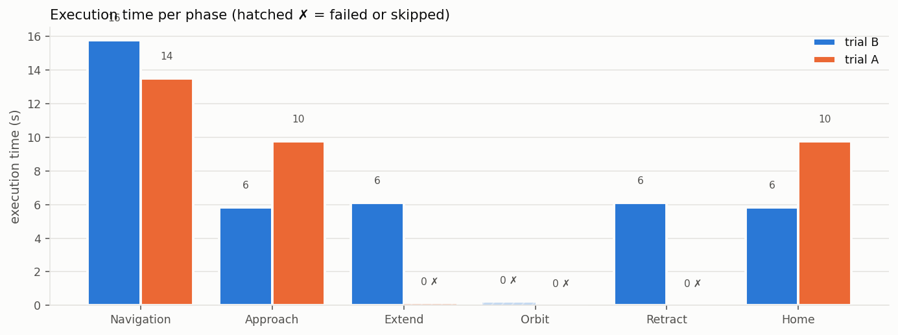

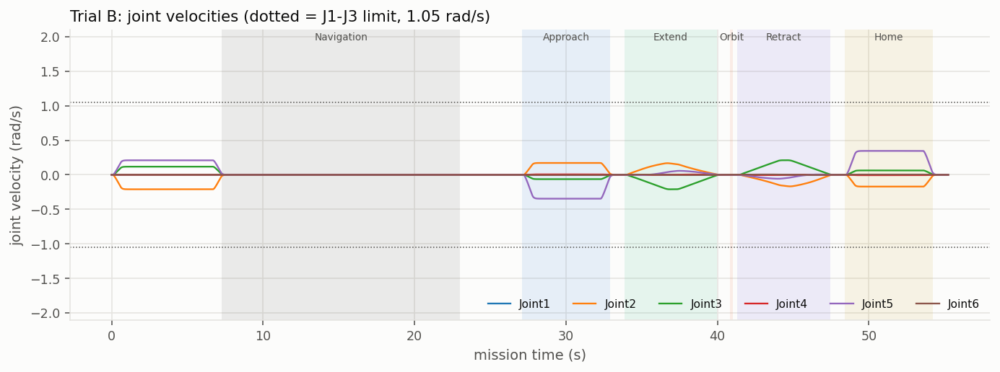

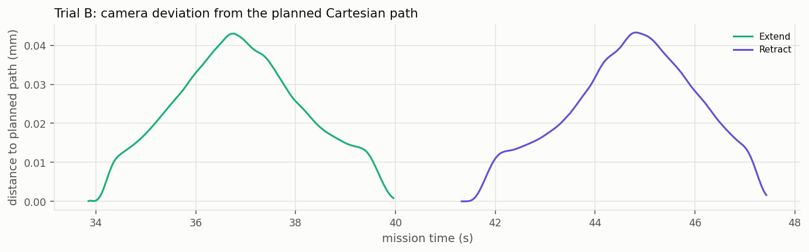

### Scoring breakdown

| Component | Detail | Points |
|---|---|---|
| Collisions | 0 contacts during the mission | 40.0 / 40 |
| Completion | 5/6 phases OK, orbit 94.6% → mean 99.1% | 39.6 / 40 |
| Accuracy | worst Cartesian deviation 0.02% (≤ 5% threshold) | 20.0 / 20 |
| **Total** | | **99.6 / 100** |

---

## Trial A: spec standoff (0.6 m) — Mission Score 61.7

> Standoff 0.6 m (the spec's waypoint at 1.892 m) · look-up 25° · orbit 90° at 0.15 m radius

Trial A uses the originally specified 0.6 m waypoint. At this distance the
plant is 0.731 m from the arm base — beyond the D1-550's 0.605 m maximum
reach — so the arm cannot fully extend to or orbit the plant. This trial
documents the reach limitation.

### Phase results

| Phase | Time (s) | EE dist (m) | Success | Cartesian fraction | Dev (%) | Notes |
|---|---|---|---|---|---|---|
| Navigation | 13.50 | 0.001 | ✅ | — | — | Nav2 arrived 0.108 m off; precision to 5 mm |
| Approach | 9.76 | 0.591 | ✅ | — | 0.0 | Pre-grasp 0.30 m, at the arm's near-limit (0.591 m EE travel) |
| Extend | 0.11 | 0.0 | ❌ | 0.258 | — | Only 25.8% of the 0.15 m path planned (IK fails at 0.58+ m) |
| Orbit | 0.00 | 0.0 | ❌ | 0.0 | — | Skipped: Extend failed |
| Retract | 0.00 | 0.0 | ❌ | 0.0 | — | Skipped: Extend failed |
| Home | 9.78 | 0.590 | ✅ | — | 0.0 | Back to stow pose |

### Scoring breakdown

| Component | Detail | Points |
|---|---|---|
| Collisions | 0 contacts during the mission | 40.0 / 40 |
| Completion | 3/6 phases OK, extend 25.8% → mean 54.3% | 21.7 / 40 |
| Accuracy | no Cartesian phase completed successfully | 0.0 / 20 |
| **Total** | | **61.7 / 100** |

Trial A confirms that the D1-550 cannot service a plant 0.6 m from the rack's
front edge. The approach succeeds (pre-grasp at 0.30 m from the plant requires
only 0.44 m of EE travel), but extending the last 0.15 m to orbit radius pushes
the EE past the arm's 0.605 m workspace boundary. A shorter arm-to-plant
distance (Trial B's 0.333 m standoff → 0.465 m) is required for the full
mission.

---

## Mission Score formula

```text
Score = collision_pts + completion_pts + accuracy_pts   (0–100)

collision_pts  = 40 − 10 × N_collisions                (max 40)
completion_pts = 40 × mean(phase_success[1..6])         (max 40)
  where phase_success = 1.0 if the phase succeeded,
        cartesian_fraction if it's a Cartesian phase that partially planned,
        0.0 otherwise
accuracy_pts   = 20 if worst_dev ≤ 5%                   (max 20)
                 20 × (10 − worst_dev) / 5  if 5 < worst_dev < 10
                 0 otherwise
  where worst_dev = max of (RMS cross-track error / path length)
        over all successful Cartesian phases (Extend, Orbit, Retract)
```

---

## Files

| File | Purpose |
|---|---|
| `gazebo/worlds/build_hydroponic_world.py` | Generates `hydroponic_station.sdf` and `.json` |
| `gazebo/worlds/hydroponic_station.sdf` | The Gazebo world file |
| `gazebo/docker/Dockerfile.moveit` | `go2-sim-moveit:local` image (MoveIt 2 + gz_ros2_control) |
| `src/d1_moveit_config/config/d1_go2.urdf.xacro` | Robot description (gripper or camera end effector) |
| `src/d1_moveit_config/config/d1_go2.ros2_control.xacro` | ros2_control hardware interface (mock or Gazebo) |
| `src/d1_moveit_config/config/d1_go2.srdf` | Planning groups, states (home, stow), collision pairs |
| `src/d1_moveit_config/config/d1_550_arm.xacro` | D1-550 arm macro (from upstream, for Gazebo + MoveIt) |
| `src/d1_moveit_config/launch/demo.launch.py` | MoveIt launch (mock or Gazebo hardware) |
| `src/d1_moveit_config/scripts/full_mission_test.py` | The mission script (Nav2 + MoveIt phases) |
| `src/d1_moveit_config/scripts/hydroponic_report.py` | Score computation, graphs, summary |
| `tests/hydroponic_trial.py` | Orchestrator: starts the sim, waits for readiness, runs the mission |
| `gazebo/run_sim.sh` | Extended with `SIM_MOVEIT=1` support |
| `gazebo/sim/start_inside.sh` | Container-side: builds MoveIt workspace, launches arm stack |
| `gazebo/sim/build_model.py` | Extended with `--arm-urdf` to import the D1-550 into the Go2 model |
