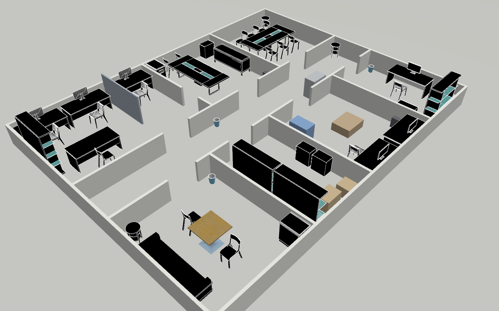
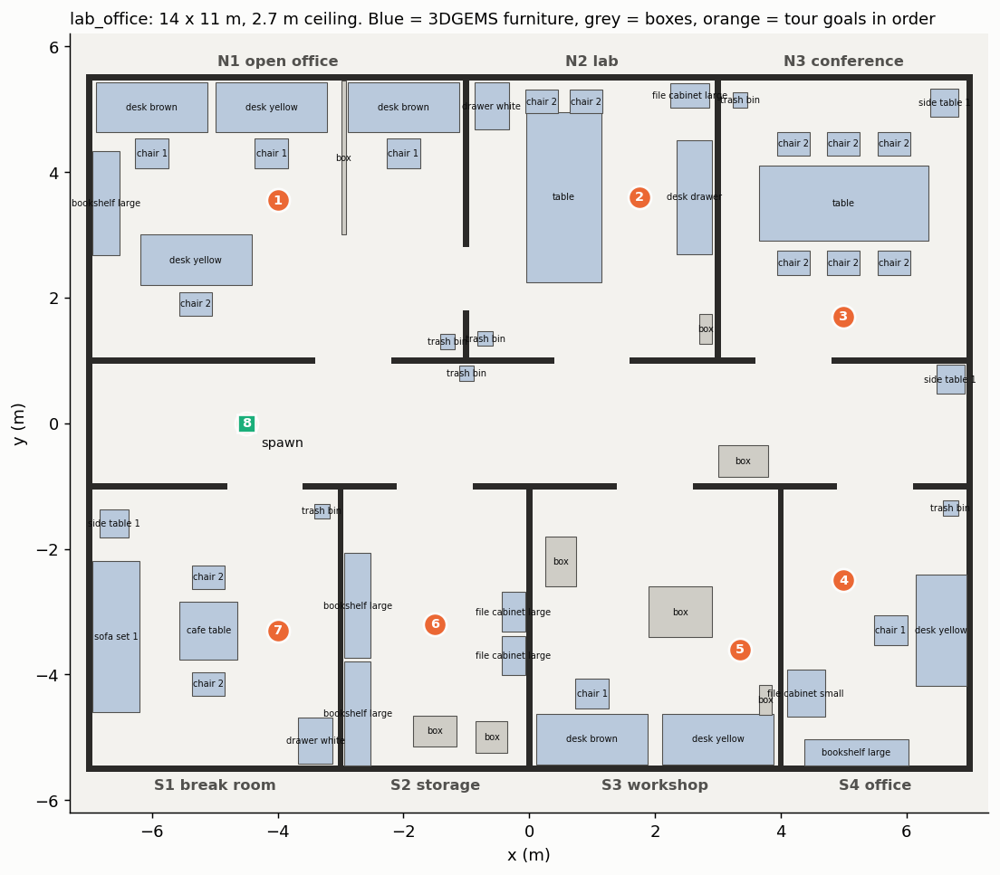
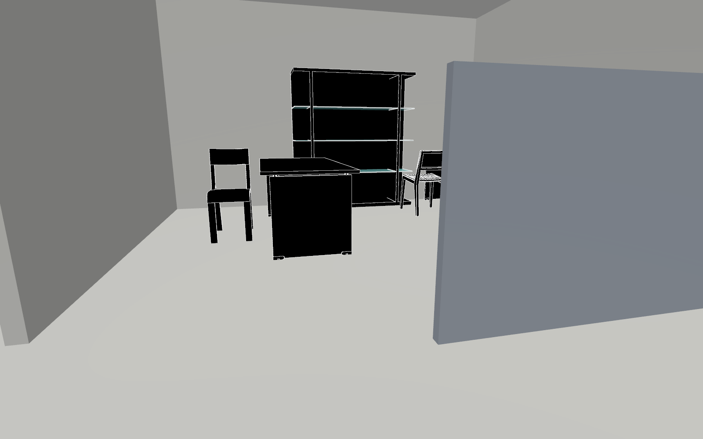
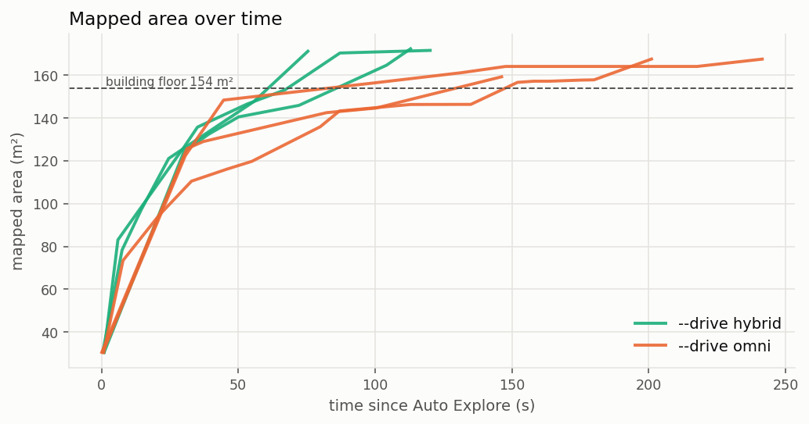
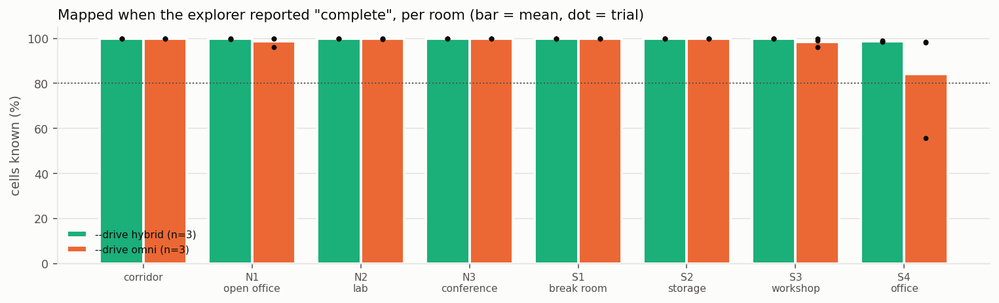
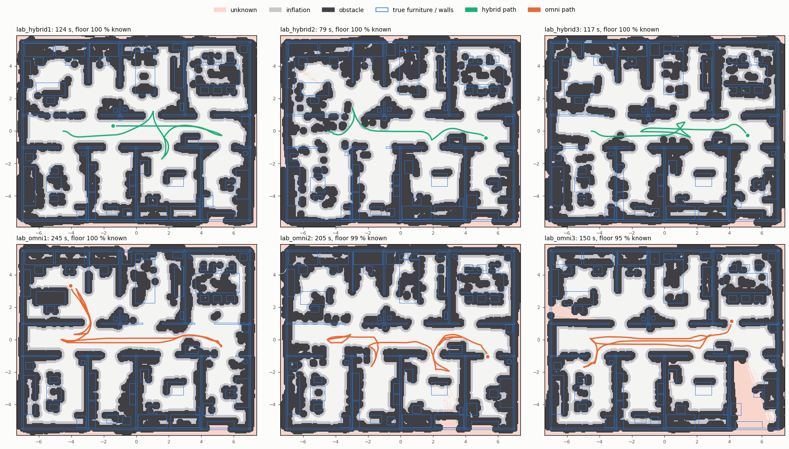
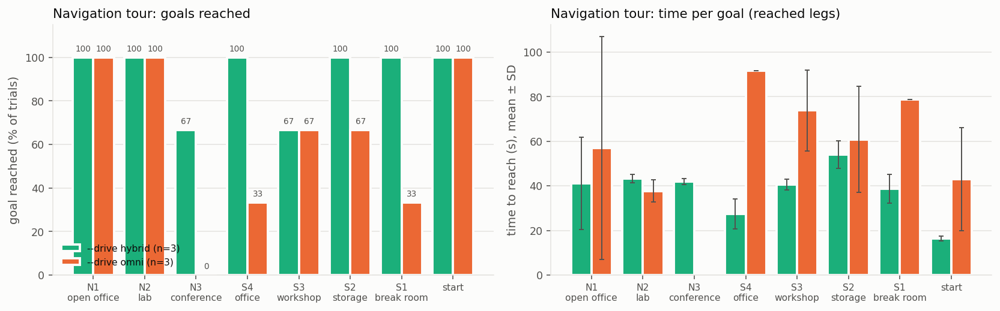
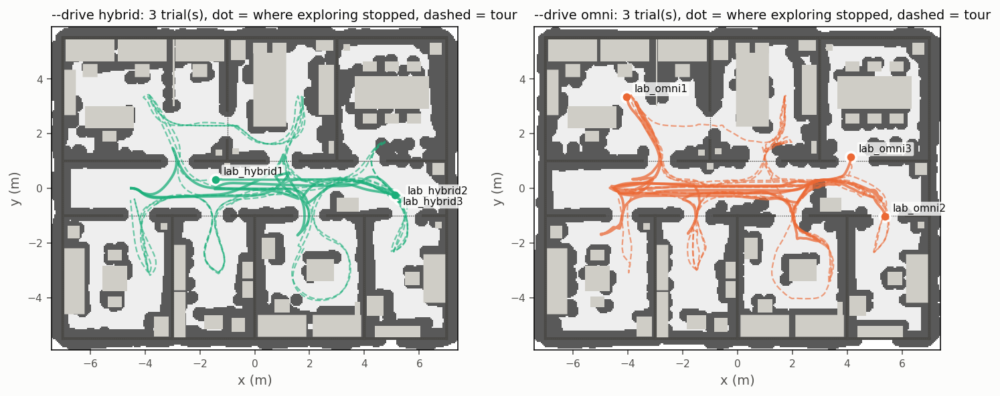
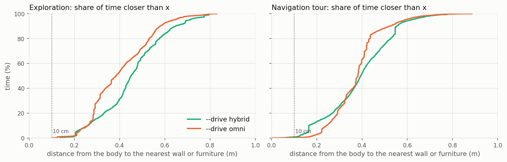
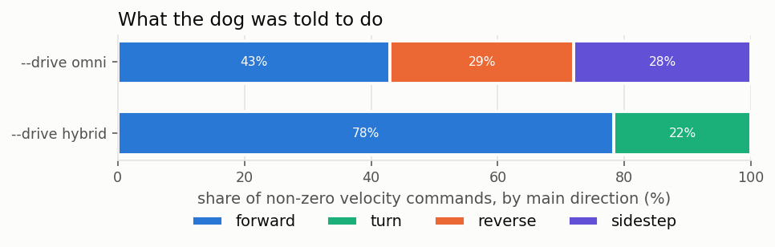

# Indoor Lab World (`lab_office`): Mapping and Navigation, Hybrid vs Omni

[← Back to README](../../README.md) · [Gazebo sim](gazebo.md) · [Drive modes compared](../navigation/locomotion_comparison.md) · [Status](../STATUS.md)

A Gazebo world of a furnished indoor research lab, built to test the Go2's
exploration and obstacle avoidance in clutter, and the results of running
mapping and navigation in it with `--drive hybrid` and `--drive omni`
(3 trials each, 2026-11-01).

## Results at a glance

| | `hybrid` (n = 3) | `omni` (n = 3) | p |
|---|---|---|---|
| Exploration: time to "complete" | **107 ± 24 s** | 200 ± 48 s | 0.057 |
| Exploration: floor mapped at "complete" | **100 %** | 98 % (one trial left the office at 56 %) | 0.32 |
| Exploration: distance walked | **17 ± 5 m** | 29 ± 4 m | 0.032 |
| Navigation tour: goals reached (8 per trial) | **22 / 24** | 15 / 24 | 0.036 (Fisher, per leg) |
| Navigation tour: time per reached goal (median) | **41 s** | 62 s | 0.007 (Mann-Whitney, per leg) |
| Navigation tour: SPL (1 = shortest path, every goal) | **0.83 ± 0.11** | 0.55 ± 0.13 | 0.043 |
| Closest approach to furniture or a wall | 0.04 m | −0.06 m (one 6 cm overlap) | 0.60 |
| Commands mainly forward | 78 % | 43 % (29 % reverse, 28 % sideways) | 0.017 |

Mean ± SD over trials; p from Welch's t-test unless noted. With 3 trials per
mode, only the tour results are clearly significant. Every metric is in
[Full statistics](#full-statistics), each trial in
[Per-trial results](#per-trial-results), and the numbers behind each graph in
[Graph data](#graph-data).

**In short: `hybrid` was faster, walked less and reached more goals; `omni`
was slower and failed most often in the tightest spaces.** Both mapped the
whole floor, mostly from the corridor. Details, graphs and caveats below.

---

## The world



*Rendered by Gazebo (`./gazebo/worlds/render_world.sh`). Cutaway for the
picture: no ceiling, walls cut to 0.9 m. In the sim the walls reach a
2.7 m ceiling.*



*Floor plan from the world's own layout tables
(`build_lab_world.py --plan`). Blue: 3DGEMS furniture (footprints from the
meshes), grey: SDF boxes, orange: the navigation tour's goals in order,
green: spawn.*

- **14 × 11 m, 7 rooms off a 2 m corridor.** North: open office, lab,
  conference room. South: break room, storage, workshop, office.
- **Doors** are 1.2 m wide; the one between the open office and the lab is 1.0 m.
- **Aisles** are 0.9 to 1.6 m wide. Some corners are closed off on purpose:
  the conference table's ends are 0.6 m from the walls, and the break room's
  sofa side is too. The dog has to map those corners from a distance.
- **53 furniture pieces:**
  - 3DGEMS models from the
    [Gazebo Models & Worlds Collection](https://github.com/leonhartyao/gazebo_models_worlds_collection):
    desks, office and conference chairs, the conference table, bookshelves,
    file cabinets, a drawer unit, a sofa, side and café tables, monitors
    and bins;
  - SDF boxes: the cubicle wall (1.3 m), cardboard boxes, a pallet
    (0.35 m, low), two carts and PC towers.
- **2.7 m ceiling and full-height walls.** The sim LiDAR looks up to 32.5°,
  so a ceiling keeps it from seeing anything beyond the room it is in, as
  in a real building.
- **Spawn** is at (−4.5, 0) facing +x, the same as `agri_rooms`, so nothing
  else needs changing.
- **Free space:** 115 m² of the 154 m² floor is free of furniture and
  walls; 56 m² of it is reachable by the dog's centre with a 0.3 m margin.
  `build_lab_world.py` checks that every room and every tour goal is
  reachable before it writes the world.



*Inside the open office, full walls and ceiling. The furniture is untextured:
Gazebo Harmonic does not read the models' Gazebo Classic material scripts.
The LiDAR sees the shapes all the same.*

**What was left out, and why.** The LiDAR is rendered in software, so
triangle count sets the sim speed. With the first furniture set the sim ran
at 0.67× real time, against 1.0× for `agri_rooms`. These models were
dropped or replaced:

- `plant_1` (532k triangles), `shelves_high` (a 4.4 m warehouse rack) and
  `table_conference_1`;
- `kitchen_chair` (30k triangles), `office_chair` (44k) and `computer_case` (14k).

With them gone, the trials ran at 0.89–0.98×.

### Use it

```bash
./gazebo/setup_gazebo.sh --furniture        # once: the 15 models, pinned commit (gazebo/models/furniture, not in git)
SIM_WORLD=lab_office ./scripts/runtime/wifi_nav.sh --sim --host-ip 127.0.0.1 --no-camera
SIM_WORLD=lab_office ./scripts/runtime/wifi_3d_nav.sh --sim     # with the 3D twin
```

To change the layout, edit the tables in
[`gazebo/worlds/build_lab_world.py`](../../gazebo/worlds/build_lab_world.py)
and rerun it. It writes `lab_office.sdf` and `lab_office.json`; the JSON
holds the rooms, every footprint and the tour, for the analysis.

## How it was tested

Each trial is run unattended by
[`sim_trial.sh`](../../scripts/tools/nav_compare/sim_trial.sh), with:

- `SIM_WORLD=lab_office LIMIT=900`;
- `wifi_nav.sh --sim --no-camera` (no 3D twin);
- 5 Hz LiDAR.

Trials alternated: hybrid1, omni1, hybrid2, and so on.

1. **Mapping.** Auto Explore (the frontier explorer) runs until it reports
   "Exploration complete", or 900 s. The costmap is saved at that moment.
2. **Navigation tour.** Once the map exists, a fixed tour of 8 goals: one in
   each room, then back to the spawn
   ([`nav_tour.py`](../../scripts/tools/nav_compare/nav_tour.py)). Each goal
   goes to `/goal_pose`, the same path the dashboard and RViz use. A leg is:
   - **reached** within 0.4 m;
   - **timeout** after 60 s + 6 s per metre;
   - **stuck** with less than 0.15 m of progress in 45 s.

   A failed leg moves on to the next goal from wherever the dog stopped.

[`analyze.py`](../../scripts/tools/nav_compare/analyze.py) then computes the
metrics. The sim's map frame is its world frame, so ground truth is exact:

| Metric | How |
|---|---|
| Floor mapped, per room | Known costmap cells inside the building (or a room) when exploration ended |
| Closest approach, contacts | The dog's body (0.70 × 0.31 m around `base_link`) against every wall and furniture footprint, at 5 Hz. A contact is an episode under 2 cm. Footprints are mesh bounding boxes, so chairs and tables count as solid: this errs towards "too close" |
| Path efficiency | Shortest path on the floor plan (0.3 m margin) ÷ the distance walked, on reached legs |
| SPL | Success weighted by path length (Anderson et al., 2018): mean over all legs of reached × shortest ÷ max(walked, shortest). Failed legs count 0 |

Rerun the analysis with:

```bash
./scripts/tools/nav_compare/run_analysis.sh --out docs/images/lab_office --rooms lab_office \
    ~/files/go2-nav2-wifi/ws/log/nav_compare/lab_{hybrid,omni}{1,2,3}
```

All numbers: [`stats.md`](../images/lab_office/stats.md) (mean ± SD, min–max, p)
and [`trials.csv`](../images/lab_office/trials.csv) (per trial).

## Results

### Mapping



*Mapped area from the explorer's log. The curves end above the 154 m² floor
because the costmap also counts the walls' inflation just outside the
building.*





*The map each trial had when the explorer reported "complete" (global
costmap, 0.05 m cells), with the true walls and furniture outlined in blue and
the path walked while exploring. Pink is still unknown: omni3 never looked
into the office (bottom right), omni2 missed a strip of the workshop. Every
other room was mapped from the corridor and doorways.*

| | `hybrid` | `omni` |
|---|---|---|
| Time to "complete" | 107 ± 24 s [79–124] | 200 ± 48 s [150–245] |
| Time to 90 % of the final map | 89 ± 15 s | 117 ± 30 s |
| Rooms ≥ 80 % mapped at "complete" (of 7) | 7.0 | 6.7 |
| Rooms walked into | 0.7 | 1.3 |
| Distance walked | 17.4 ± 4.6 m | 28.8 ± 4.0 m |
| Standing still | 11 % | 23 % (5–35 %) |
| Explorer goals sent / dropped for no progress | 7.7 / 0 | 11.3 / 1.7 |

- **Both modes mapped the floor, mostly without entering the rooms.** The 3D
  LiDAR sees through the doorways and over the 0.72 m desks, so the explorer
  ran out of frontiers after one or two rooms. The maps match the real
  furniture positions; unseen space stays unknown, as in omni3's office (56 %).
- **omni took about twice as long and walked 65 % further** for the same map.
  MPPI sidesteps and reverses (57 % of its commands) and wanders between
  frontiers. Two omni trials dropped goals for no progress; hybrid dropped none.

### Navigation tour



| Goal | `hybrid` reached · mean time | `omni` reached · mean time |
|---|---|---|
| N1 open office | 3/3 · 41 s | 3/3 · 57 s |
| N2 lab | 3/3 · 43 s | 3/3 · 38 s |
| N3 conference | 2/3 · 42 s | **0/3** (stuck, timeouts) |
| S4 office | 3/3 · 27 s | 1/3 · 92 s |
| S3 workshop | 2/3 · 41 s | 2/3 · 74 s |
| S2 storage | 3/3 · 54 s | 2/3 · 61 s |
| S1 break room | 3/3 · 39 s | 1/3 · 79 s |
| Back to start | 3/3 · 16 s | 3/3 · 43 s |

- **hybrid:** 22 of 24 legs, path efficiency 0.92, SPL 0.83. Both failures
  were in hybrid1:
  - the conference aisle: RPP stopped for *collision ahead*, and stuck
    recovery found no free space behind or beside the dog;
  - the workshop: *no valid path*, with the goal area inside furniture
    inflation.
- **omni:** 15 of 24 legs, path efficiency 0.85, SPL 0.55. Of its 9
  failures, 7 were timeouts: MPPI kept re-orienting in the narrow aisles,
  and Nav2 aborted with *Failed to make progress*. It never reached the
  conference room's 1.3 m aisle between the chairs and the wall.
- **Per leg, the difference is significant.** Success rate: Fisher exact
  p = 0.036. Time per reached leg, median 41 s vs 62 s: Mann-Whitney
  p = 0.007.



*Solid: exploration; dashed: tour; dot: where exploration stopped. The furniture
(light) is drawn from the world file over the final costmap.*

### Obstacle avoidance



- **No contacts while exploring, in either mode.** The closest approach was
  0.18 m (hybrid) against 0.12 m (omni).
- **On the tour, both came close:**
  - hybrid to 0.04 m, in the hybrid3 workshop leg, for 7 s within 10 cm;
  - omni overlapped one footprint by 6 cm, once, in omni3.

  Footprints are bounding boxes, so a chair's or table's open space counts
  as solid; a real contact there is possible but not certain.
- **omni spends more of its time between 0.25 and 0.45 m** from obstacles while
  exploring (left plot): it sidesteps along furniture instead of keeping to
  the middle of the aisle.



## What this says

1. **For this indoor clutter, `hybrid` (the default) is the better mode.**
   It reached 92 % of goals against 63 %, in about two-thirds of the time,
   and explored twice as fast. The same conclusion as on `agri_rooms`
   ([locomotion_comparison.md](../navigation/locomotion_comparison.md)), now
   with furniture and with significance at the leg level.
2. **omni's freedom costs more than it gives here.** In 1.0–1.3 m aisles MPPI
   keeps choosing reverse and sideways moves. That is slow, and Nav2's
   progress checker gives up on it. In the sim, sidesteps cost nothing; on the
   real dog they are slower and less steady, so the gap would likely grow.
3. **The tight spots are the conference aisle and the workshop.** Both modes
   failed there at least once. These are good places to tune the costmap
   inflation (Settings tab: Tight preset) or the goal tolerance.
4. **"Exploration complete" does not mean "walked through".** The explorer
   stops once every cell is known, which happens from the corridor. For a
   survey that must visit each room (the arm scanning plants), add room
   goals after exploring, as the tour does.

## Limits

- **Sim only.** The body glides with no gait, localization is perfect, and
  there is no camera (`--no-camera`) and no 3D twin. See
  [gazebo.md → Simulation differences](gazebo.md#simulation-differences).
- **3 trials per mode in one world, from one spawn.** At the trial level only
  the tour time, SPL, distance and command mix reach p < 0.05.
- **Clearance uses bounding boxes,** which is conservative for chairs and tables.
- **Coverage counts known cells,** not how well they were seen. Costmap
  inflation (0.55 m) hides small gaps.

## Automated benchmark (tests/sim_benchmark.py)

One command runs an unattended exploration in this world with real Gazebo
contact detection on every robot link (body, legs, head, D1 arm;
`SIM_CONTACTS=1`) and prints `SCORE: X/100`: −10 per collision with a wall
or piece of furniture, −5 per room under 90 % mapped.

```bash
python3 tests/sim_benchmark.py              # --drive hybrid (default), up to 300 simulated s
```

| Date | Explorer | Runs (hybrid) | Scores | Collisions |
|---|---|---|---|---|
| 2026-11-01 | as before | 3 | 100, 95, 95 | 0 |
| 2026-11-01 | 8-connected frontier clusters | 3 | 100, 100, 100 | 0 |

The two 95s lost 5 points each for the open office: only 82 % mapped when
the explorer reported "complete". The rays it had seen through the doorway
at an angle left diagonal streaks of free cells; their frontier cells touch
only at corners, so the explorer's 4-connected grouping split them into
pieces under `min_frontier_size` (4 cells) and found **no** frontier.
Replaying its detection on the saved maps: 0 frontiers as before, 2–3 in the
open office with 8-connected grouping. The explorer now groups frontier
cells 8-connected, the usual choice (`explore_lite` does the same).
Exploring takes longer (98–132 s instead of 50–75 s) because it no longer
skips those pockets. No Nav2 or costmap setting needed changing: no run
touched a table leg, chair or wall.

## Found along the way

- **Mapped areas had been reported 4× too large.** `analyze.py` turned cell
  counts into m² with 0.1 m cells; go2-nav2-wifi's global costmap uses
  0.05 m. The cell size now comes from the saved costmap. The earlier
  `agri_rooms` comparison is corrected: 206 m², not 822.
- **The upstream RViz Speed panel does nothing with the lab fixes.** It sets
  `FollowPath.max_vel_x`, a DWB parameter that RPP and MPPI do not declare:
  every 2 s the controller logs *Failed to set parameters atomically*. Use
  the dashboard's Settings tab (driving speed) instead.
- **A world without a ceiling is optimistic for indoor tests:** the sim
  LiDAR then sees beyond the rooms, which a real building does not allow.

## Full statistics

Every metric, per drive mode, over the 3 trials:
[`stats.md`](../images/lab_office/stats.md), generated by `analyze.py`.

Per drive mode over trials: mean ± SD [min–max]; p from Welch's t-test.

| Metric | `hybrid` (n=3) mean ± SD [min–max] | `omni` (n=3) mean ± SD [min–max] | p (Welch t) |
|---|---|---|---|
| Exploration time (s) | 107 ± 24 [79–124] | 200 ± 48 [150–245] | 0.057 |
| Reported "complete" (share) | 1.00 ± 0.00 [1.00–1.00] | 1.00 ± 0.00 [1.00–1.00] |  |
| Mapped area (m²) | 172 ± 1 [171–172] | 165 ± 5 [159–168] | 0.127 |
| Coverage of the floor (%) | 100 ± 0 [100–100] | 98 ± 3 [95–100] | 0.321 |
| Rooms ≥ 80 % mapped at "complete" (of 7) | 7.0 ± 0.0 [7.0–7.0] | 6.7 ± 0.6 [6.0–7.0] | 0.423 |
| Time to 90 % of the final map (s) | 89 ± 15 [75–104] | 117 ± 30 [100–152] | 0.237 |
| Rooms walked into | 0.7 ± 0.6 [0.0–1.0] | 1.3 ± 0.6 [1.0–2.0] | 0.230 |
| Distance walked (m) | 17.37 ± 4.62 [12.50–21.70] | 28.80 ± 3.97 [25.10–33.00] | 0.032 |
| Time standing still (%) | 10.7 ± 0.6 [10.0–11.0] | 23 ± 16 [5–35] | 0.311 |
| Explorer goals sent | 7.7 ± 1.5 [6.0–9.0] | 11.3 ± 4.0 [7.0–15.0] | 0.253 |
| Nav2 aborts | 0.0 ± 0.0 [0.0–0.0] | 0.3 ± 0.6 [0.0–1.0] | 0.423 |
| Stuck-recovery retries | 0.0 ± 0.0 [0.0–0.0] | 0.3 ± 0.6 [0.0–1.0] | 0.423 |
| Goals dropped: no progress | 0.0 ± 0.0 [0.0–0.0] | 1.7 ± 1.5 [0.0–3.0] | 0.199 |
| Exploration: closest approach (m) | 0.18 ± 0.03 [0.14–0.20] | 0.12 ± 0.02 [0.10–0.13] | 0.065 |
| Exploration: contacts (< 2 cm) | 0.0 ± 0.0 [0.0–0.0] | 0.0 ± 0.0 [0.0–0.0] |  |
| Exploration: time within 10 cm (s) | 0.0 ± 0.0 [0.0–0.0] | 0.0 ± 0.0 [0.0–0.0] |  |
| Tour: goals reached | 7.3 ± 1.2 [6.0–8.0] | 5.0 ± 1.0 [4.0–6.0] | 0.058 |
| Tour: total time (s) | 309 ± 13 [296–322] | 516 ± 77 [429–572] | 0.039 |
| Tour: time per reached goal (s) | 37 ± 4 [33–40] | 57 ± 8 [47–63] | 0.040 |
| Tour: path efficiency | 0.92 ± 0.04 [0.88–0.95] | 0.85 ± 0.08 [0.76–0.92] | 0.321 |
| Tour: SPL | 0.83 ± 0.11 [0.71–0.91] | 0.55 ± 0.13 [0.44–0.69] | 0.043 |
| Tour: Nav2 aborts | 4.0 ± 1.0 [3.0–5.0] | 5.7 ± 1.5 [4.0–7.0] | 0.200 |
| Tour: closest approach (m) | 0.10 ± 0.06 [0.04–0.15] | 0.06 ± 0.10 [-0.06–0.13] | 0.599 |
| Tour: contacts (< 2 cm) | 0.0 ± 0.0 [0.0–0.0] | 0.3 ± 0.6 [0.0–1.0] | 0.423 |
| Tour: time within 10 cm (s) | 2.3 ± 4.0 [0.0–7.0] | 1.0 ± 1.7 [0.0–3.0] | 0.639 |
| Commands mainly forward (%) | 78 ± 4 [74–81] | 43 ± 10 [32–52] | 0.017 |
| Commands mainly reverse (%) | 0.0 ± 0.0 [0.0–0.0] | 29 ± 8 [24–38] | 0.023 |
| Commands mainly sideways (%) | 0.0 ± 0.0 [0.0–0.0] | 28 ± 17 [10–43] | 0.101 |

Per tour leg: reached 22/24 (`hybrid`) vs 15/24 (`omni`), Fisher exact p = 0.036; time per reached leg, median 41 s (n=22) vs 62 s (n=14), Mann-Whitney U p = 0.0074.

| Room: mapped when exploration ended | `hybrid` mean % [min–max] | `omni` mean % [min–max] |
|---|---|---|
| corridor | 100 [100–100] | 100 [100–100] |
| N1 open office | 100 [100–100] | 99 [96–100] |
| N2 lab | 100 [100–100] | 100 [100–100] |
| N3 conference | 100 [100–100] | 100 [100–100] |
| S1 break room | 100 [100–100] | 100 [100–100] |
| S2 storage | 100 [100–100] | 100 [100–100] |
| S3 workshop | 100 [100–100] | 98 [96–100] |
| S4 office | 99 [99–99] | 84 [56–98] |

| Tour goal | `hybrid` reached · mean time | `omni` reached · mean time |
|---|---|---|
| N1 open office | 3/3 · 41 s | 3/3 · 57 s |
| N2 lab | 3/3 · 43 s | 3/3 · 38 s |
| N3 conference | 2/3 · 42 s | 0/3 (stuck, timeout) |
| S4 office | 3/3 · 27 s | 1/3 · 92 s |
| S3 workshop | 2/3 · 41 s | 2/3 · 74 s |
| S2 storage | 3/3 · 54 s | 2/3 · 61 s |
| S1 break room | 3/3 · 39 s | 1/3 · 79 s |
| start | 3/3 · 16 s | 3/3 · 43 s |

## Per-trial results

All columns: [`trials.csv`](../images/lab_office/trials.csv),
[`summary.md`](../images/lab_office/summary.md).

| Trial | Explore s | Floor % | Rooms ≥ 80 % | t90 s | Dist m | Still % | Goals | No prog. | Min clear m | Tour reached | Tour s | s / goal | Eff. | SPL | Tour aborts | Tour min clear m | Contacts | Fwd % | Rev % | Side % |
|---|---|---|---|---|---|---|---|---|---|---|---|---|---|---|---|---|---|---|---|---|
| lab_hybrid1 | 124 | 100 | 7 | 87 | 21.7 | 10 | 9 | 0 | 0.2 | 6/8 | 296 | 32.7 | 0.95 | 0.71 | 3 | 0.15 | 0 | 81 | 0 | 0 |
| lab_hybrid2 | 79 | 100 | 7 | 75 | 12.5 | 11 | 6 | 0 | 0.19 | 8/8 | 308 | 38.5 | 0.88 | 0.88 | 5 | 0.11 | 0 | 74 | 0 | 0 |
| lab_hybrid3 | 117 | 100 | 7 | 104 | 17.9 | 11 | 8 | 0 | 0.14 | 8/8 | 322 | 40.3 | 0.92 | 0.91 | 4 | 0.04 | 0 | 80 | 0 | 0 |
| lab_omni1 | 245 | 100 | 7 | 100 | 33 | 29 | 12 | 3 | 0.1 | 5/8 | 429 | 47 | 0.76 | 0.51 | 4 | 0.11 | 0 | 32 | 25 | 43 |
| lab_omni2 | 205 | 99 | 7 | 152 | 25.1 | 35 | 15 | 2 | 0.12 | 4/8 | 572 | 60.3 | 0.88 | 0.44 | 7 | 0.13 | 0 | 45 | 24 | 31 |
| lab_omni3 | 150 | 95 | 6 | 100 | 28.3 | 5 | 7 | 0 | 0.13 | 6/8 | 548 | 62.7 | 0.92 | 0.69 | 6 | -0.06 | 1 | 52 | 38 | 10 |

## Graph data

The numbers behind each graph above, also as CSV in
[`docs/images/lab_office/data/`](../images/lab_office/data/)
([`graph_data.md`](../images/lab_office/graph_data.md)).

### Mapped area over time (coverage.png)

[`data/coverage_curves.csv`](../images/lab_office/data/coverage_curves.csv)

<details><summary>Every explorer log sample</summary>

| trial | drive | t_s | area_m2 |
|---|---|---|---|
| lab_hybrid1 | hybrid | 1.0 | 30.6 |
| lab_hybrid1 | hybrid | 6.0 | 83.1 |
| lab_hybrid1 | hybrid | 30.1 | 126.2 |
| lab_hybrid1 | hybrid | 35.1 | 135.7 |
| lab_hybrid1 | hybrid | 53.1 | 146.4 |
| lab_hybrid1 | hybrid | 67.1 | 153.1 |
| lab_hybrid1 | hybrid | 87.2 | 170.3 |
| lab_hybrid1 | hybrid | 120.1 | 171.5 |
| lab_hybrid2 | hybrid | 0.5 | 30.6 |
| lab_hybrid2 | hybrid | 7.5 | 78.3 |
| lab_hybrid2 | hybrid | 14.6 | 97.2 |
| lab_hybrid2 | hybrid | 24.6 | 121.0 |
| lab_hybrid2 | hybrid | 55.6 | 147.5 |
| lab_hybrid2 | hybrid | 75.4 | 171.1 |
| lab_hybrid3 | hybrid | 1.0 | 30.6 |
| lab_hybrid3 | hybrid | 30.1 | 124.1 |
| lab_hybrid3 | hybrid | 39.1 | 132.3 |
| lab_hybrid3 | hybrid | 50.1 | 140.5 |
| lab_hybrid3 | hybrid | 72.2 | 145.8 |
| lab_hybrid3 | hybrid | 104.1 | 164.6 |
| lab_hybrid3 | hybrid | 112.9 | 172.2 |
| lab_omni1 | omni | 0.5 | 30.6 |
| lab_omni1 | omni | 30.6 | 122.4 |
| lab_omni1 | omni | 44.6 | 148.3 |
| lab_omni1 | omni | 99.7 | 156.3 |
| lab_omni1 | omni | 131.6 | 161.1 |
| lab_omni1 | omni | 147.7 | 164.0 |
| lab_omni1 | omni | 172.7 | 164.0 |
| lab_omni1 | omni | 194.7 | 164.0 |
| lab_omni1 | omni | 217.7 | 164.0 |
| lab_omni1 | omni | 241.5 | 167.4 |
| lab_omni2 | omni | 0.8 | 30.6 |
| lab_omni2 | omni | 7.9 | 73.4 |
| lab_omni2 | omni | 20.9 | 94.3 |
| lab_omni2 | omni | 32.9 | 110.5 |
| lab_omni2 | omni | 45.9 | 116.1 |
| lab_omni2 | omni | 54.9 | 119.7 |
| lab_omni2 | omni | 79.9 | 135.8 |
| lab_omni2 | omni | 87.0 | 143.2 |
| lab_omni2 | omni | 112.9 | 146.2 |
| lab_omni2 | omni | 135.0 | 146.3 |
| lab_omni2 | omni | 152.0 | 156.6 |
| lab_omni2 | omni | 158.0 | 157.1 |
| lab_omni2 | omni | 164.0 | 157.1 |
| lab_omni2 | omni | 175.0 | 157.6 |
| lab_omni2 | omni | 180.0 | 157.7 |
| lab_omni2 | omni | 201.0 | 167.5 |
| lab_omni3 | omni | 0.1 | 30.6 |
| lab_omni3 | omni | 31.2 | 125.7 |
| lab_omni3 | omni | 37.2 | 129.0 |
| lab_omni3 | omni | 82.3 | 142.4 |
| lab_omni3 | omni | 100.3 | 144.6 |
| lab_omni3 | omni | 146.2 | 159.2 |

</details>

### Command mix per drive, % of non-zero commands (commands.png)

[`data/commands.csv`](../images/lab_office/data/commands.csv)

| drive | forward | turn | reverse | sidestep |
|---|---|---|---|---|
| hybrid | 78.3 | 21.7 | 0.0 | 0.0 |
| omni | 43.0 | 0.0 | 29.0 | 28.0 |

### Explorer goal outcomes per trial (outcomes.png)

[`data/outcomes.csv`](../images/lab_office/data/outcomes.csv)

| trial | drive | reached | dropped_early | nav2_aborts | no_progress | recovery_retries |
|---|---|---|---|---|---|---|
| lab_hybrid1 | hybrid | 0 | 7 | 0 | 0 | 0 |
| lab_hybrid2 | hybrid | 1 | 5 | 0 | 0 | 0 |
| lab_hybrid3 | hybrid | 0 | 8 | 0 | 0 | 0 |
| lab_omni1 | omni | 4 | 5 | 0 | 3 | 0 |
| lab_omni2 | omni | 5 | 5 | 0 | 2 | 0 |
| lab_omni3 | omni | 4 | 3 | 1 | 0 | 1 |

### Floor known per room when exploration ended, % (room_coverage.png)

[`data/room_coverage.csv`](../images/lab_office/data/room_coverage.csv)

| trial | drive | corridor | N1 open office | N2 lab | N3 conference | S1 break room | S2 storage | S3 workshop | S4 office |
|---|---|---|---|---|---|---|---|---|---|
| lab_hybrid1 | hybrid | 100.0 | 100.0 | 100.0 | 100.0 | 100.0 | 100.0 | 100.0 | 98.7 |
| lab_hybrid2 | hybrid | 100.0 | 99.5 | 99.9 | 99.9 | 99.8 | 99.9 | 100.0 | 98.6 |
| lab_hybrid3 | hybrid | 100.0 | 100.0 | 100.0 | 100.0 | 99.9 | 100.0 | 100.0 | 98.9 |
| lab_omni1 | omni | 100.0 | 100.0 | 99.5 | 100.0 | 100.0 | 100.0 | 100.0 | 98.3 |
| lab_omni2 | omni | 100.0 | 99.9 | 100.0 | 100.0 | 99.9 | 99.9 | 96.0 | 98.1 |
| lab_omni3 | omni | 100.0 | 95.9 | 100.0 | 100.0 | 99.9 | 100.0 | 99.0 | 55.7 |

### Every tour leg (tour.png)

[`data/tour_legs.csv`](../images/lab_office/data/tour_legs.csv)

<details><summary>All 48 legs</summary>

| trial | drive | goal | result | time_s | path_m | shortest_m | efficiency | spl | nav2_aborts |
|---|---|---|---|---|---|---|---|---|---|
| lab_hybrid1 | hybrid | N1 open office | reached | 17.3 | 4.22 | 4.23 | 1.0 | 1.0 | 0 |
| lab_hybrid1 | hybrid | N2 lab | reached | 42.6 | 8.08 | 7.16 | 0.89 | 0.89 | 1 |
| lab_hybrid1 | hybrid | N3 conference | stuck | 54.4 | 0.77 | 6.62 |  | 0.0 | 1 |
| lab_hybrid1 | hybrid | S4 office | reached | 34.9 | 8.58 | 7.9 | 0.92 | 0.92 | 0 |
| lab_hybrid1 | hybrid | S3 workshop | stuck | 45.1 | 0.0 | 8.16 |  | 0.0 | 1 |
| lab_hybrid1 | hybrid | S2 storage | reached | 50.8 | 11.36 | 10.82 | 0.95 | 0.95 | 0 |
| lab_hybrid1 | hybrid | S1 break room | reached | 34.4 | 7.55 | 6.8 | 0.9 | 0.9 | 0 |
| lab_hybrid1 | hybrid | start | reached | 16.4 | 2.8 | 2.97 | 1.06 | 1.0 | 0 |
| lab_hybrid2 | hybrid | N1 open office | reached | 52.7 | 11.82 | 10.51 | 0.89 | 0.89 | 0 |
| lab_hybrid2 | hybrid | N2 lab | reached | 41.8 | 8.02 | 7.2 | 0.9 | 0.9 | 1 |
| lab_hybrid2 | hybrid | N3 conference | reached | 40.9 | 7.53 | 6.62 | 0.88 | 0.88 | 1 |
| lab_hybrid2 | hybrid | S4 office | reached | 22.3 | 4.5 | 4.29 | 0.95 | 0.95 | 0 |
| lab_hybrid2 | hybrid | S3 workshop | reached | 38.8 | 8.99 | 8.16 | 0.91 | 0.91 | 0 |
| lab_hybrid2 | hybrid | S2 storage | reached | 49.9 | 11.84 | 8.49 | 0.72 | 0.72 | 1 |
| lab_hybrid2 | hybrid | S1 break room | reached | 46.0 | 8.79 | 6.8 | 0.77 | 0.77 | 2 |
| lab_hybrid2 | hybrid | start | reached | 15.4 | 2.89 | 3.04 | 1.05 | 1.0 | 0 |
| lab_hybrid3 | hybrid | N1 open office | reached | 53.2 | 10.84 | 10.3 | 0.95 | 0.95 | 0 |
| lab_hybrid3 | hybrid | N2 lab | reached | 45.2 | 7.68 | 7.2 | 0.94 | 0.94 | 1 |
| lab_hybrid3 | hybrid | N3 conference | reached | 42.8 | 7.36 | 6.62 | 0.9 | 0.9 | 1 |
| lab_hybrid3 | hybrid | S4 office | reached | 24.8 | 4.46 | 4.24 | 0.95 | 0.95 | 0 |
| lab_hybrid3 | hybrid | S3 workshop | reached | 42.3 | 8.91 | 8.16 | 0.92 | 0.92 | 0 |
| lab_hybrid3 | hybrid | S2 storage | reached | 61.1 | 12.09 | 8.49 | 0.7 | 0.7 | 2 |
| lab_hybrid3 | hybrid | S1 break room | reached | 35.4 | 7.44 | 6.85 | 0.92 | 0.92 | 0 |
| lab_hybrid3 | hybrid | start | reached | 17.4 | 2.77 | 2.9 | 1.05 | 1.0 | 0 |
| lab_omni1 | omni | N1 open office | reached | 0.2 | 0.0 | 0.0 |  | 1.0 | 0 |
| lab_omni1 | omni | N2 lab | reached | 40.3 | 9.74 | 7.36 | 0.76 | 0.76 | 0 |
| lab_omni1 | omni | N3 conference | stuck | 57.4 | 1.97 | 6.62 |  | 0.0 | 1 |
| lab_omni1 | omni | S4 office | stuck | 61.3 | 1.43 | 6.77 |  | 0.0 | 0 |
| lab_omni1 | omni | S3 workshop | reached | 86.7 | 6.46 | 5.87 | 0.91 | 0.91 | 2 |
| lab_omni1 | omni | S2 storage | reached | 44.0 | 9.62 | 8.54 | 0.89 | 0.89 | 0 |
| lab_omni1 | omni | S1 break room | timeout | 75.2 | 6.87 | 6.64 |  | 0.0 | 1 |
| lab_omni1 | omni | start | reached | 63.7 | 14.24 | 7.13 | 0.5 | 0.5 | 0 |
| lab_omni2 | omni | N1 open office | reached | 75.5 | 11.82 | 10.91 | 0.92 | 0.92 | 0 |
| lab_omni2 | omni | N2 lab | reached | 40.7 | 9.69 | 7.25 | 0.75 | 0.75 | 0 |
| lab_omni2 | omni | N3 conference | timeout | 82.0 | 2.75 | 6.62 |  | 0.0 | 1 |
| lab_omni2 | omni | S4 office | timeout | 91.7 | 5.55 | 7.05 |  | 0.0 | 3 |
| lab_omni2 | omni | S3 workshop | timeout | 82.2 | 10.46 | 5.88 |  | 0.0 | 0 |
| lab_omni2 | omni | S2 storage | reached | 77.6 | 8.22 | 7.37 | 0.9 | 0.9 | 1 |
| lab_omni2 | omni | S1 break room | timeout | 75.5 | 5.12 | 6.64 |  | 0.0 | 1 |
| lab_omni2 | omni | start | reached | 47.2 | 3.32 | 3.2 | 0.97 | 0.97 | 1 |
| lab_omni3 | omni | N1 open office | reached | 94.8 | 10.53 | 9.21 | 0.88 | 0.88 | 1 |
| lab_omni3 | omni | N2 lab | reached | 31.9 | 7.49 | 7.2 | 0.96 | 0.96 | 0 |
| lab_omni3 | omni | N3 conference | timeout | 82.2 | 3.16 | 6.62 |  | 0.0 | 1 |
| lab_omni3 | omni | S4 office | reached | 91.6 | 8.26 | 6.87 | 0.83 | 0.83 | 2 |
| lab_omni3 | omni | S3 workshop | reached | 61.0 | 9.21 | 8.16 | 0.89 | 0.89 | 0 |
| lab_omni3 | omni | S2 storage | timeout | 89.5 | 6.47 | 8.49 |  | 0.0 | 1 |
| lab_omni3 | omni | S1 break room | reached | 78.6 | 11.7 | 11.0 | 0.94 | 0.94 | 1 |
| lab_omni3 | omni | start | reached | 18.1 | 2.84 | 2.88 | 1.02 | 1.0 | 0 |

</details>

### Distance from the body to the nearest wall or furniture, m (clearance.png)

[`data/clearance.csv`](../images/lab_office/data/clearance.csv)

| drive | phase | samples | min | p1 | p5 | p10 | p25 | p50 | p75 | p90 | pct_below_0.10m | pct_below_0.25m |
|---|---|---|---|---|---|---|---|---|---|---|---|---|
| hybrid | explore | 1602 | 0.135 | 0.195 | 0.209 | 0.26 | 0.372 | 0.451 | 0.555 | 0.647 | 0.0 | 8.7 |
| hybrid | tour | 4863 | 0.044 | 0.111 | 0.163 | 0.165 | 0.296 | 0.394 | 0.498 | 0.554 | 0.72 | 17.7 |
| omni | explore | 3004 | 0.102 | 0.143 | 0.22 | 0.259 | 0.291 | 0.384 | 0.514 | 0.579 | 0.0 | 9.1 |
| omni | tour | 7979 | -0.058 | 0.168 | 0.221 | 0.243 | 0.307 | 0.382 | 0.421 | 0.522 | 0.16 | 10.9 |
