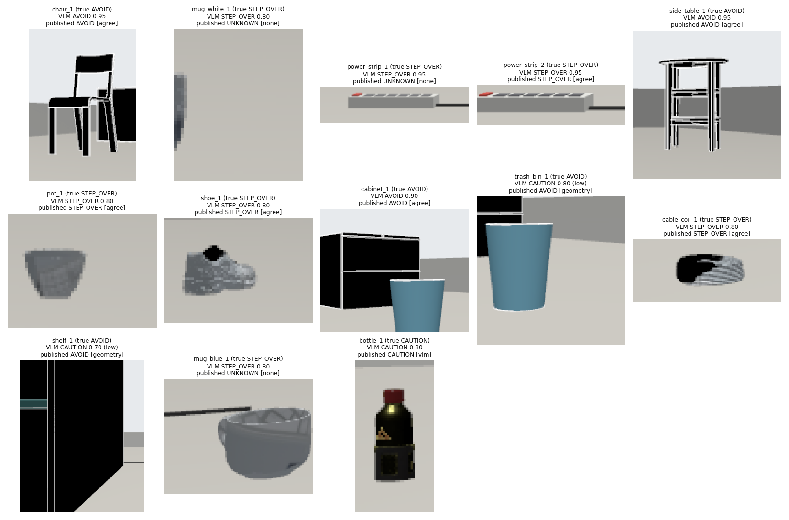
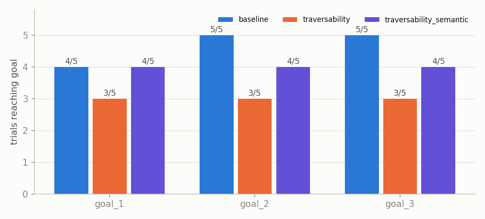
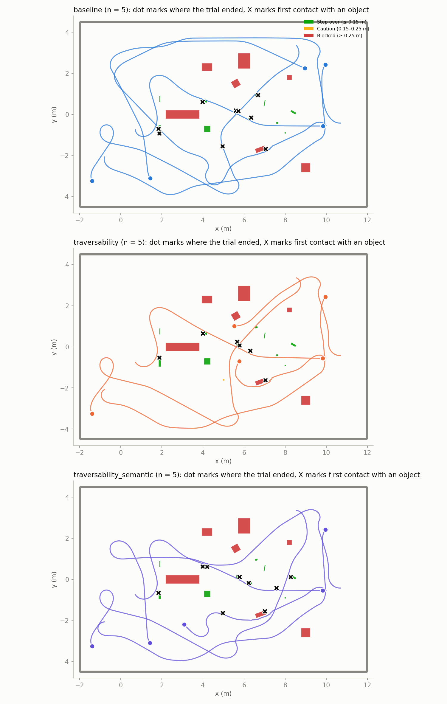
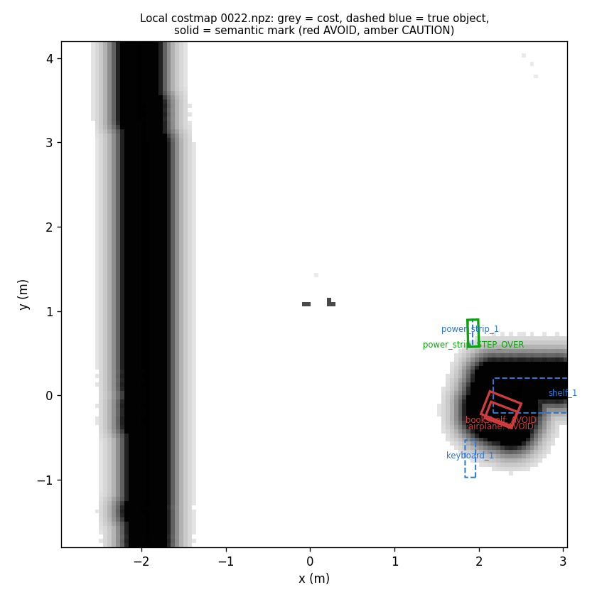

# Semantic Traversability: VLM Labels in the Local Costmap

[← Back to README](../../README.md) · [Items world](cluttered_items.md) · [Gazebo sim](gazebo.md) · [Camera–LiDAR fusion](../ai_and_vision/camera_lidar_fusion.md)

The Go2 asks a vision-language model (VLM) what each object in front of it is and
how to treat it: step over it, pass with care, or go around. The answer is
combined with the LiDAR height of the object's 3D box, marked in Nav2's local
costmap, and used to choose the gait. Simulation only (Gazebo, `cluttered_items`
world), 2026-11-08.

## Results at a glance

| | Value |
|---|---|
| Published labels that called a tall object (≥ 0.25 m) low | **0** of 58 trial-objects (live) · **0** of 28 crops (offline) |
| Raw VLM answers that called a tall object low | 5 of 45 (live) · 3 of 28 (offline) |
| Label accuracy, offline (30 frames, 13 objects) | VLM alone 0.89 · LiDAR height alone 0.79 · published 0.82 |
| VLM requests in the live trials | 104, **0 failed**, median 3.2 s each (1.1 s with the sim idle) |
| Legs reached, 5 seeded trials per mode | baseline 14/15 · traversability 9/15 · **traversability_semantic 12/15** |

The VLM is useful but not safe on its own: it underestimates heights, and twice
called the 0.30 m toolbox STEP_OVER. The combination rule below caught every one
of those answers. Differences in goals reached between modes are not significant
at n = 5 (Fisher exact per leg: p = 0.08 traversability vs baseline,
p = 0.60 semantic vs baseline).

## How it works

```
camera ─► YOLO11s ─┐
                   ├─► object_box_fusion ─► /objects/boxes_json (3D box per track: size, height)
LiDAR ─────────────┘                              │
                                                  ▼
camera image ─► vlm_heuristic_node: crop the track's 2D detection ─► Ollama qwen2.5vl
                                                  │  label + confidence
                                                  ▼
             combine with LiDAR height band ─► /semantic/obstacles ─► SemanticCostmapLayer (local costmap)
                                           └─► /semantic/labels_json ─► gait_supervisor (use_semantic)
```

| Piece | File |
|---|---|
| Crop, prompt, answer parsing, combination rule | [scripts/nodes/semantic_labeler.py](../../scripts/nodes/semantic_labeler.py) |
| ROS node (one request in flight, re-ask every 5 s) | [scripts/nodes/vlm_heuristic_node.py](../../scripts/nodes/vlm_heuristic_node.py) |
| Costmap plugin: label → cost, oriented footprint | [src/semantic_traversability_layer/src/semantic_costmap_layer.cpp](../../src/semantic_traversability_layer/src/semantic_costmap_layer.cpp) |
| Message (`label`, `track_id`, `size_x`, `size_y`, `yaw` added) | [src/go2_semantic_msgs/msg/SemanticObstacle.msg](../../src/go2_semantic_msgs/msg/SemanticObstacle.msg) |
| Gait from labels, `backend`, `backstop_enabled` | [scripts/nodes/gait_supervisor.py](../../scripts/nodes/gait_supervisor.py) |
| Ollama address and model | [scripts/config/ollama.yaml](../../scripts/config/ollama.yaml) |
| Local costmap with the semantic layer (global costmap unchanged) | [tests/traversability/controller_traversability_semantic.yaml](../../tests/traversability/controller_traversability_semantic.yaml) |

### Labels and costs

| Label | Meaning | Local costmap | Gait |
|---|---|---|---|
| `STEP_OVER` | under 15 cm, flat, solid | nothing added (the height band layer already marks it) | from box height |
| `CAUTION` | 15–25 cm, or low but may tangle, roll, tip or break | 200 | at least `CAREFUL` |
| `AVOID` | over 25 cm, furniture, a person or animal | 254 (lethal), the box's oriented footprint + 5 cm | `STOP` |
| `UNKNOWN` | no usable answer | nothing | from box height |

### The combination rule (the safety part)

1. A VLM answer below `confidence_min` (0.7) counts as `UNKNOWN`.
2. The VLM's label is raised to the band of its own height estimate
   ("side table, 20 cm, STEP_OVER" becomes `CAUTION`).
3. The published label is never less severe than the LiDAR height band. The VLM
   can raise a cost (a low cable that tangles) but never lower one.
4. With no LiDAR height for the track, only a VLM `AVOID` is used. A VLM that
   says "low" about an unmeasured object is not trusted.
5. If the request fails or times out, the LiDAR label stands
   (`fallback_on_timeout: geometry`).

### Prompt

The model is asked to name the object and estimate its height *before* it picks
a label. In the first version, which asked for the label first with JSON output
enforced, `qwen2.5vl` answered `STEP_OVER` (0.9) for all 28 crops, including a
chair. Raw VLM accuracy on the same frames went from 0.61 to 0.89 with the
reordered prompt.

### Ollama from the sim

Ollama runs on Windows (RTX 2080 Ti). The containers reach it at the WSL default
gateway (`172.30.160.1` on the development machine; the trial script looks it up
at start). Windows side: `OLLAMA_HOST=0.0.0.0` and an inbound firewall rule for
TCP 11434 from `172.30.160.0/20` only.

The proposal named `llava:7b`; the implementation uses `qwen2.5vl`, which
follows instructions better. See the [llava:7b comparison](#llava7b-comparison).

## Offline accuracy (Phase 2d)

`eval_vlm_frames.py` runs the node's own code over 30 saved camera frames from
five earlier trials (28 crops of 13 objects) and scores against the world's true
heights. Data: [semantic/vlm_eval.md](semantic/vlm_eval.md),
[csv](semantic/vlm_eval.csv).

| true \ published | STEP_OVER | CAUTION | AVOID | UNKNOWN |
|---|---|---|---|---|
| STEP_OVER | 13 | 0 | 0 | 4 |
| CAUTION | 0 | 1 | 0 | 1 |
| AVOID | 0 | 0 | 9 | 0 |

VLM alone: accuracy 0.89; 3 tall objects (trash bin, file cabinet, bookshelf)
called `CAUTION`; 0 called `STEP_OVER`. Published: 0 unsafe; the 5 `UNKNOWN` are
low objects LiDAR never measured.



## Navigation trials (Phase 3)

Five trials per mode, alternating modes, seeds 1234–1238 (random spawn and three
goals each), 90 s per leg, RPP collision detection on. Full tables:
[stats.md](semantic/trials/stats.md), [per_trial.md](semantic/trials/per_trial.md),
[semantic.md](semantic/trials/semantic.md).

| Per trial, mean ± SD | `baseline` | `traversability` | `traversability_semantic` |
|---|---|---|---|
| Goals reached (of 3) | 2.80 ± 0.45 | 1.80 ± 1.30 | 2.40 ± 0.89 |
| SPL | 0.88 ± 0.15 | 0.57 ± 0.41 | 0.75 ± 0.29 |
| Nav2 collision aborts | 0.2 ± 0.4 | 5.0 ± 10.6 | 2.6 ± 4.7 |
| Trunk hits | 0.6 ± 0.9 | 0.2 ± 0.4 | 1.0 ± 2.2 |
| Foot strikes on step-over items | 3.8 ± 4.2 | 2.6 ± 4.8 | 3.4 ± 4.1 |
| Step-over cells entered by the body centre (median) | 4 | 0 | 0 |





Labels published during the trials, one vote per object per trial (the label it
held longest):

| true \ published | STEP_OVER | CAUTION | AVOID | UNKNOWN |
|---|---|---|---|---|
| STEP_OVER | 20 | 0 | 0 | 7 |
| CAUTION | 0 | 0 | 0 | 3 |
| AVOID | 0 | 0 | 17 | 3 |
| no object (false detection) | 0 | 1 | 2 | 5 |



*Local costmap during a semantic trial. Solid red: semantic `AVOID` marks as
oriented rectangles; dashed blue: true objects. `STEP_OVER` marks add no cost.*

## Findings and limits

- **Disc marks blocked passages (fixed).** The first semantic trial got stuck
  between the file cabinet and the wall: RPP aborted 9 times ("detected
  collision ahead"). `AVOID` objects were marked as a lethal disc of the box's
  half-diagonal, much larger than a long object. Marks are now the box's oriented
  rectangle; the same seed then reached all three goals with 0 aborts. The batch
  above ran after the fix.
- **The toolbox (0.30 m) is missed by every mode.** In seed 1235 the body hit
  `toolbox_1` in all three modes (baseline included). LiDAR never measured its
  height, so the fused track had no band; the VLM saw it 6 s before contact but
  said `CAUTION` ("20 cm"), which rule 4 rejects for an unmeasured object. This
  is a perception gap in the shared stack, not in the semantic layer, and is open.
- **The VLM echoes the detector's class.** A false YOLO "person" on the floor was
  confirmed by the VLM as a person (`AVOID`, 0.95). A false "airplane" got 0.10
  confidence and was ignored. Wrong detections lead to over-caution, not to
  unsafe labels, in these trials.
- **Many low objects stay `UNKNOWN`.** The VLM's `STEP_OVER` is not trusted
  without a LiDAR height; those objects still get the height band layer's cost.
- **n = 5 per mode** is enough to find failures, not to rank the modes.

## llava:7b comparison

Raw `qwen2.5vl` failed the "0 unsafe labels" check in the live trials (5 tall
objects called low, 2 of them `STEP_OVER`), so `llava:7b` was tried on the same
30 offline frames. Data: [semantic/llava/vlm_eval.md](semantic/llava/vlm_eval.md).

| Same 28 crops | `qwen2.5vl` | `llava:7b` |
|---|---|---|
| VLM alone: accuracy | **0.89** | 0.39 |
| VLM alone: tall called low | 3 (`CAUTION`) | **0** |
| VLM alone: true step-over items called `STEP_OVER` | **17 of 17** | 0 of 17 (16 `CAUTION`) |
| Published label: accuracy | **0.82** | 0.36 |
| Published label: tall called low | 0 | 0 |
| Median latency | **1.1 s** | 1.8 s |

`llava:7b` is safe only because it calls everything low `CAUTION`. Published,
every walkable item would cost 200 and the robot would route around all of them.
Since the published `qwen2.5vl` labels are already at 0 unsafe, `qwen2.5vl`
stays the default. `model: llava:7b` in `ollama.yaml` switches it.

## Reproduce

```bash
# WSL; sim and Nav2 containers as in gazebo.md
python3 tests/traversability/eval_vlm_frames.py --world gazebo/worlds/cluttered_items.json \
    --out /tmp/vlm_eval --frames 30 RUN_DIR [RUN_DIR ...]
MODES="baseline traversability traversability_semantic" SEED=1234 TIMEOUT=90 \
    tests/traversability/run_all.sh RESULTS "1 2 3 4 5"
python3 tests/traversability/analyze.py RESULTS OUT gazebo/worlds/cluttered_items.json
python3 tests/traversability/analyze_semantic.py RESULTS OUT gazebo/worlds/cluttered_items.json
```

Hardware: none of this runs on the robot yet. `gait_supervisor` and
`vlm_heuristic_node` take `backend: gazebo` only; `sport_client` raises
`NotImplementedError` (Phase 2 hardware work).
