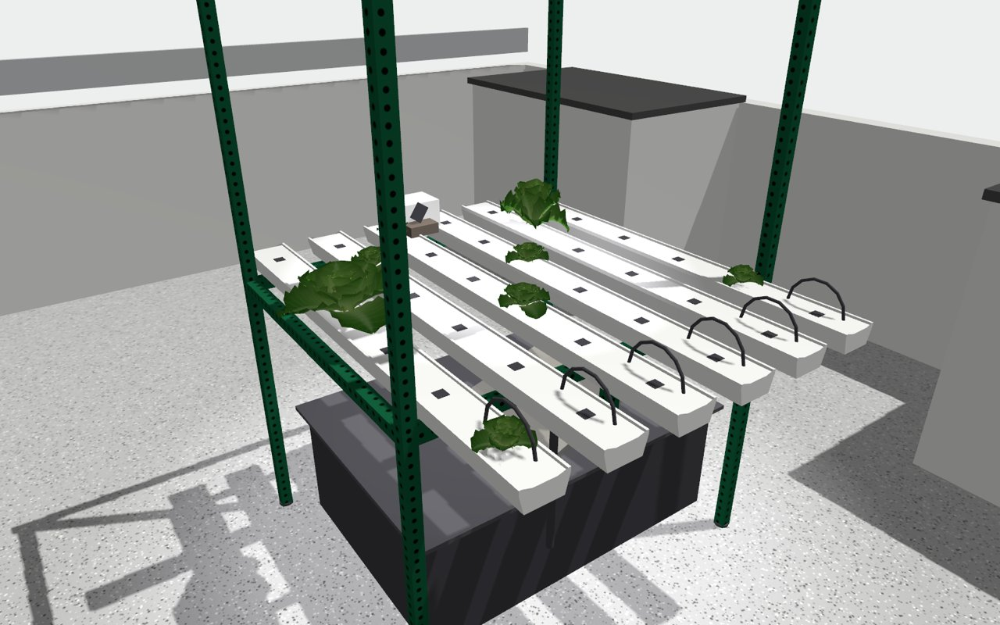
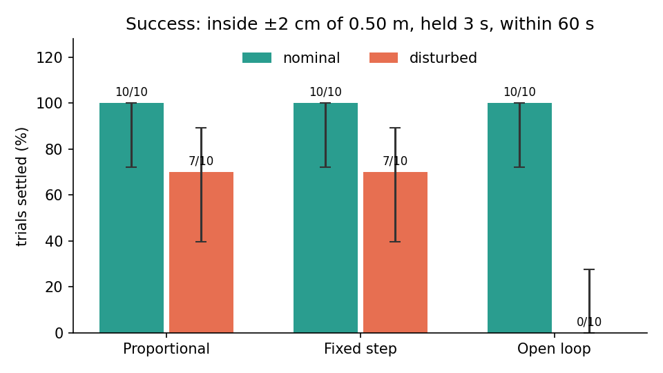
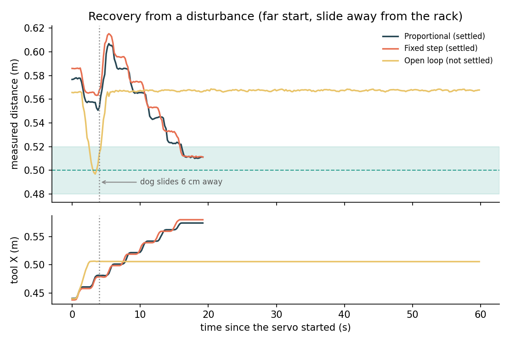
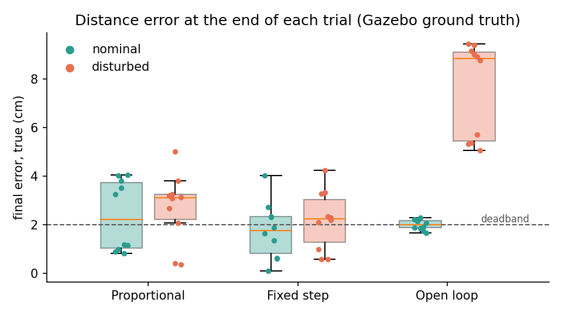
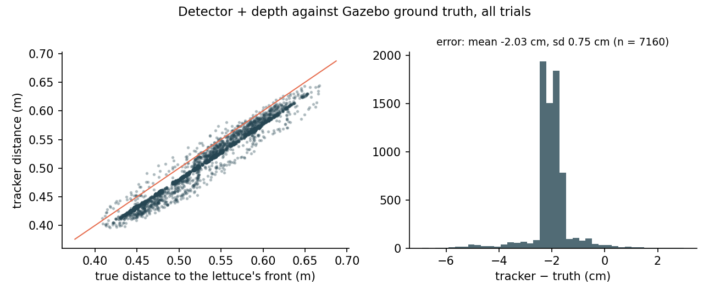
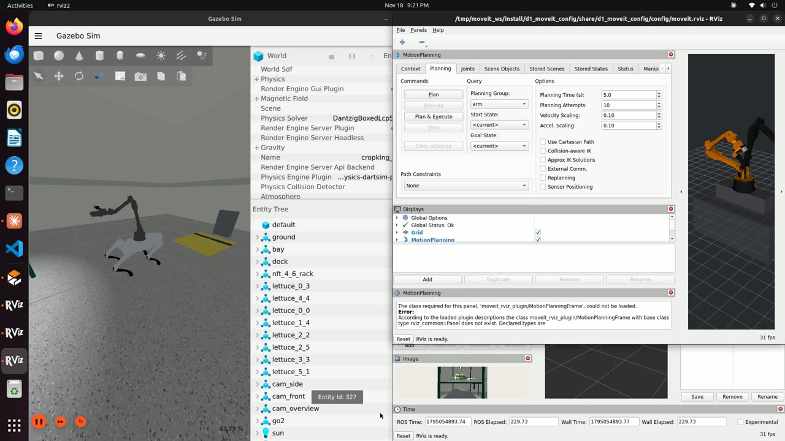
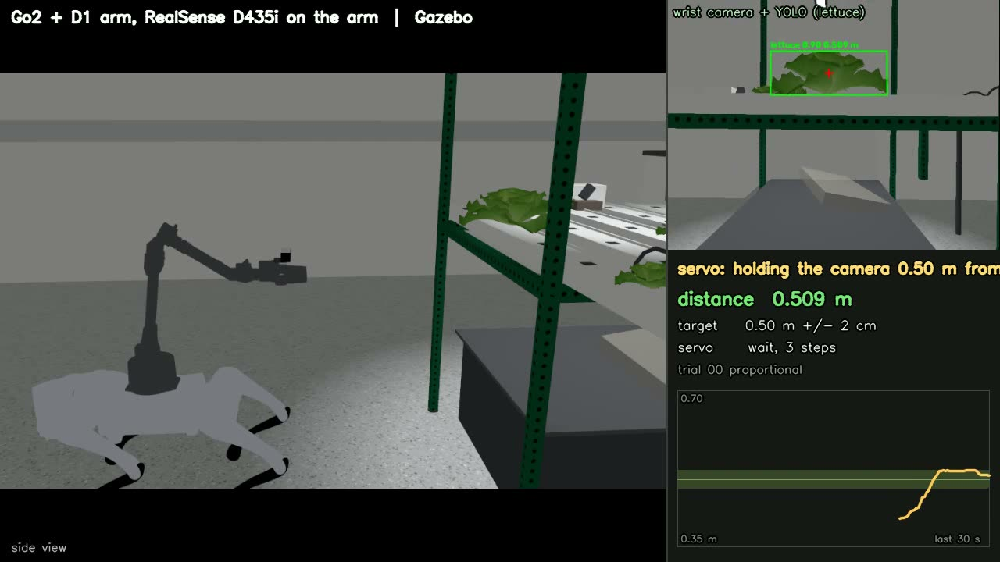

# Final demo in Gazebo: NFT 4-6, lettuce, RealSense on the arm, distance servo

[← README](../../README.md) · [Docs index](../README.md) · [Gazebo sim](gazebo.md) · [Arm servo on the real arm](../hardware/arm_servo_test.md)

```bash
./run_sim_demo.sh                            # 3 policies x 5 trials, headless, about 30 min
./run_sim_demo.sh --gui --rviz --video --trials 1 --policies proportional   # the showcase
./run_sim_demo.sh --trials 3 --policies proportional
./run_sim_demo.sh --skip-nav --keep          # straight to the rack; leave the sim up afterwards
./run_sim_demo.sh --reuse --trials 2         # more trials in a sim left up by --keep
./gazebo/run_sim.sh gui                      # reopen a closed Gazebo window (the sim keeps running)
```

| Option | What it adds |
|---|---|
| `--gui` | the Gazebo window (closing it no longer stops the simulation) |
| `--rviz` | two RViz windows: the arm (MoveIt MotionPlanning: planning scene, planned and real arm) and the wrist camera through the RGB-D plant detector from the `test` branch (`plant_detection.sh`, `config/plant_detection.rviz`: YOLO view, 3D lettuce boxes, the lettuce's points), on the lettuce model (`config/detection/object_detection_sim.yaml`) |
| `--video` | `demo.mp4`: overview / side view, the wrist camera with the tracker's box, the live distance |

One command runs the whole demo headless and leaves the data and graphs in
`~/files/go2-nav2-wifi/ws/log/servo_demo/<date-time>/`:

1. Gazebo (server only) with our CropKing NFT 4-6, lettuce, the Go2 and the D1 arm with
   a RealSense D435i at its end;
2. Nav2 drives the dog to the rack, and it parks tail-first (the arm faces the tail);
3. the arm goes to the start pose (J2 0.25, J3 0.30, J5 −0.55);
4. YOLO finds the lettuce in the wrist camera, the depth at its box centre is the
   distance (`yolo_depth_tracker.py`);
5. `distance_servo.py` steps the camera along the arm's X until it is 0.50 m from the
   lettuce, logging every tick and every step;
6. the report: `distance_over_time.png`, `results.md` and the figures below.

## The world: our NFT 4-6



`build_nft46_assets.py` makes the meshes and textures (`model://nft46`): the frame's green
slotted steel tube with a hole every inch (one mesh per length, so the pattern is not
stretched), the NFT channel's profile (lipped cover, tapered sides, closed ends), a
speckled vinyl floor. The LED bar glows; the sun casts shadows; the D1 is black, as the
real one.

`gazebo/worlds/build_cropking_nft46_world.py` writes `cropking_nft46.sdf` and `.json`,
modelled on photos of the rack in the lab:

- six white 4 ft NFT channels (CropKing NFT 4-6: 6 × 4 ft, 36 sites 8 in on centre),
  square planting holes, side by side with a ~2.5 in gap on two green cross rails,
  sticking out past the frame at the feed end, where a black feeder tube loops into each;
- a green perforated square-steel frame, four posts ~1.68 m high, a top frame with a
  black Spider Farmer LED bar and a white light bar;
- a black reservoir tub on the floor with a clear tray, a sensor box on the channels;
- a few plants, as on the real rack: the target lettuce (front channel), a romaine
  head and seedlings; the other holes are empty.

Sizes are estimated from the photos against the 4 ft channels and the listing's 31 in
height. The lettuce is generated, not downloaded (Gazebo Fuel has none):
`build_lettuce_model.py` writes a butterhead mesh (22 cupped, ruffled leaves on a
golden-angle spiral, outer dark to inner pale, a generated leaf texture) as
`gazebo/worlds/models/lettuce/` (`model://lettuce`).

## The camera on the claw

`SIM_ARM_EE=claw` (the demo's default) keeps the D1's gripper and puts a RealSense D435i on
a bracket on top of the claw's end, looking along it, as on the lab arm. The camera is
modelled to Intel's drawing: a 90 × 25 × 25 mm aluminium body with rounded ends, a black
front glass with the two IR imagers 50 mm apart, the IR projector between them and the
RGB lens, USB-C and the tripod mount (72 g). Its sensor is the D435i colour camera
(640×480, 69°, 10 Hz, RGB-D) republished under the real driver's names
(`/camera/color/image_raw`, `/camera/aligned_depth_to_color/image_raw` and their
`camera_info`; the camera support for the simulation is from the `test` branch), so the
tracker and the plant detector run unchanged. In the start pose the lens is 0.43 m ahead
of the arm base and 0.72 m above the floor, looking level; the fingers stay below its
field of view. `SIM_ARM_EE=camera` is the older camera-instead-of-gripper model.
`d1_go2.urdf.xacro claw_camera:=true` adds the same camera in MoveIt and RViz.

## Physics: gravity, lag, a walking dog

`SIM_REALISM=1` and `SIM_GAIT=1` (the demo's defaults; 0 for the plain kinematic sim):

| | Before | Now |
|---|---|---|
| Arm | position commands: the joints were placed exactly, no weight | effort (torque) control through the trajectory controller with servo-like PID gains (`config/ros2_controllers_effort.yaml`), gearbox damping and friction on every joint, gravity on every link: the arm sags ~1° holding still and its integral pulls it back, overshoots a little and lags its trajectory |
| Dog's speed | velocity steps instantly to the command | first-order lag (τ 0.25 s) with acceleration limits |
| Dog's body | glides level at a fixed height | bobs ~8 mm twice per stride, pitches with it and rolls once per stride as the diagonal pairs alternate (scaled by speed); pitches nose-up when speeding up, down when braking; breathes ±1.5 mm, ±0.15° when standing |
| Legs | fixed in a standing pose | trot (`leg_gait.py`), the body's bob in phase with it |

The body motion is in `gazebo/sim/sim_robot_bridge.py` (`BodyMotion`, `realism_cmd`; tests
in `tests/test_sim_realism.py`). The arm stays a MoveIt arm: only Gazebo's side changes,
and only with `SIM_REALISM=1`; the real and mock arms are unchanged.

This makes the camera move like a real one: it bobs with the dog and rings briefly after
each arm move. Three changes keep the measurement and the servo stable with that:

- the tracker follows one lettuce (`select:=track`): the box that overlaps the last one,
  starting from the largest box, the nearest plant. Taking the most confident box each
  frame jumped between the target and the plants behind it once the higher claw camera saw
  several; starting from the box nearest the image centre picked a seedling further back,
  which sits nearer the horizon than the target when the camera is below the channel top;
- the distance is the front of the plant (`depth_mode:=box`): the 25th percentile of the
  depths in the middle half of the box. The box centre often fell between leaves onto the
  channel behind (0.83 m read for a lettuce 0.69 m away);
- the servo steps on the median of 5 distances measured at least 0.6 s after the arm
  stopped (`median_of`, `measure_after_move_s`), not on one reading taken while the arm
  still rang.

## Why a lettuce model had to be trained

COCO, which `yolo11s.pt` was trained on, has no lettuce: it found nothing on the rack.
Open-vocabulary YOLO (YOLO-World, YOLOE with text prompts) needs the CLIP package, and
YOLOE's prompt-free vocabulary called the whole row a "vegetable garden". So
`scripts/tools/lettuce_dataset.py` makes a labelled dataset from the world itself: a camera
model with a Gazebo `boundingbox_camera` (every lettuce carries the Label system) and an
`rgbd_camera` side by side is moved to random poses around the rack; Gazebo gives the
visible part of each lettuce's box and the image. 60 % of the poses copy the claw camera at
the rack (0.62-0.82 m high, level, 0.28-0.90 m in front of a planted site, mostly the
target). 1000 frames, then yolo11s is trained on the host GPU (~15 min) to
`~/.cache/go2-yolo/lettuce_yolo11s.pt`. `run_sim_demo.sh` does this by itself when the
weights are missing.

Two lessons from getting this to work, both about the training images matching what the
arm's camera sees:

- the image must come from an `rgbd_camera`, the wrist camera's sensor type: the
  `boundingbox_camera`'s own image renders the lettuce much brighter (mean RGB ~(60, 87, 34)
  on the wrist camera), and a model trained on it missed the target on the arm;
- the wrist views must aim at planted sites from the claw camera's height: from below the
  channel top the lettuce looks different from the views around the rack.

This detector is for the simulation: it has only seen the generated lettuce. For the real
rack the same tool chain works with real photos labelled by hand, or the sim data mixed
with them.

## Data collection

The trial structure follows the evaluation protocol of Zhang & Gupta, *Push Past Green:
Learning to Look Behind Plant Foliage by Moving It* (CoRL 2023,
[arXiv:2307.03175](https://arxiv.org/abs/2307.03175)), which also moves an arm with a
wrist RealSense around plants: every action is logged as an interaction with the views
before and after it, labels come automatically from colour and depth, methods are
compared against simple baselines over several trials in shuffled order with the scene
reset in between, and results are reported as mean with a 95 % confidence interval and
as curves against the step index.

Here:

| Paper | This demo |
|---|---|
| push action (x, y, θ, d) | servo step: commanded and achieved tool X, plan and execution time, outcome |
| RGB-D before / after each push | wrist RGB + depth saved when the arm starts and stops moving |
| revealed space from colour / height | visible lettuce pixels: green leaf hue within 1.2 m depth, near the target's projected centre |
| hand-crafted baselines | `fixed_step` (always the largest step) and `open_loop` (one move of the first error, no feedback) against `proportional` (the servo) |
| ≥ 10–20 trials per method, interleaved, scene reset | N trials per policy, shuffled; each trial resets the arm to the start pose and parks the dog at a random offset (lettuce 0.55–0.72 m from the camera) |
| mean, 95 % CI, curves vs time step | `results.md`, `error_over_time.png`, `error_vs_step.png` |
| manual check of automatic labels | Gazebo ground truth instead: the true distance to the front of the target lettuce (the rendered depth, exact in Gazebo, over the lettuce's projected outline, no YOLO), camera pose from the dog's Gazebo pose + joints + kinematics |

Per trial (`trial_NN_<policy>/`):

| File | Contents |
|---|---|
| `servo_log.csv` | every servo tick (5 Hz): time, measured distance, tool X, error, step, state |
| `servo_steps.csv` | every step: distance before/after, commanded/achieved move, planned points, outcome |
| `ground_truth.csv` | 10 Hz: true axial distance and depth at the lettuce, camera X, lettuce pixel, dog pose, joints |
| `frames.csv`, `frames/` | wrist RGB (`.jpg`) and depth (`.npz`, float16 m) at start, before/after each move, end; visible lettuce pixels |
| `trial.json` | policy, offset, settled or not, durations, start/end ground truth |

The run folder adds `trials.json`, `results.csv` (one row per trial), `results.md` (table
per policy), the session, MoveIt and tracker logs, and the figures:

- `distance_over_time.png`: measured distance against time for one proportional trial,
  with the target, the deadband and the steps; tool X below;
- `error_over_time.png`: |error| against time per policy, mean and 95 % CI;
- `error_vs_step.png`: |error| after each move, per policy;
- `measured_vs_true.png`: tracker against the true depth (detector + depth accuracy);
- `visible_plant.png`: visible target lettuce in the wrist view, frame by frame.

`scripts/tools/plot_distance.py servo_log.csv` plots any single servo log, also one from
the real arm (`distance_servo.py -p csv_path:=...`).

## Results (2026-11-18, 60 trials)

Two runs of 3 policies × 10 trials (balanced far/near starts, shuffled), SIM_REALISM=1,
trot, claw D435i, Gazebo-trained YOLO11s. Full tables: [summary.md](../images/servo_demo/summary.md),
every trial: [all_trials.csv](../images/servo_demo/all_trials.csv). Reproduce:
`./run_sim_demo.sh --trials 10` and `./run_sim_demo.sh --trials 10 --disturb 0.06`, then
`python3 scripts/tools/servo_paper_figures.py NOMINAL_RUN DISTURB_RUN --out DIR`.

| | Proportional | Fixed step | Open loop |
|---|---|---|---|
| Success, nominal | 10/10 | 10/10 | 10/10 |
| Success, disturbed (±6 cm slide at 4 s) | 7/10 [40–89 %] | 7/10 [40–89 %] | 0/10 [0–28 %] |
| Final error true, disturbed (cm) | 2.70 [1.85, 3.51] | 2.18 [1.46, 2.87] | 7.61 [6.44, 8.75] |
| Arm moves, nominal | 3.7 | 3.8 | 1.0 |
| Time to settle, nominal (s) | 7.5 | 8.1 | 3.0 |

- Without disturbance all three reach the target; open loop is fastest (one move, p < 0.001)
  because the measurement is accurate and the arm's response linear.
- With the disturbance only the closed-loop servos recover (success p = 0.003, final error
  p < 0.001 against open loop). Every closed-loop failure is the arm's travel limit (start
  offset + slide beyond the 15 cm forward / 10 cm back the servo allows), not the control.
- The tracker reads 2.0 cm short of the true front of the lettuce (bias −2.04 cm, sd 0.41,
  n = 60): the final accuracy is limited by detection and depth, not by the servo.






Showcase (Gazebo, MoveIt RViz, plant-detection RViz; composed video still):




The videos are not in git (size): `~/files/go2-nav2-wifi/ws/log/servo_demo/showcase_take2/`
`demo.mp4` (composed) and `desktop_recording.mp4` (screen); the raw data of every trial
is in `paper_final/` and `paper_disturb/` beside them.

## Files

| File | What |
|---|---|
| `run_sim_demo.sh` → `scripts/runtime/run_sim_demo.sh` | the whole demo |
| `gazebo/worlds/build_cropking_nft46_world.py`, `cropking_nft46.sdf/.json` | the rack world |
| `gazebo/worlds/build_lettuce_model.py`, `gazebo/worlds/models/lettuce/` | the lettuce model |
| `scripts/tools/lettuce_dataset.py` | Gazebo-labelled lettuce dataset, YOLO fine-tuning |
| `src/d1_moveit_config/scripts/servo_demo_trials.py` | navigation, trials, ground truth, frames (in go2-sim) |
| `scripts/nodes/distance_servo.py` | the servo: policies, CSV logs, stop when settled |
| `scripts/nodes/yolo_depth_tracker.py` | YOLO + depth; raw `Image` depth for the sim |
| `scripts/tools/servo_trials_report.py`, `scripts/tools/plot_distance.py` | the report and graphs |
