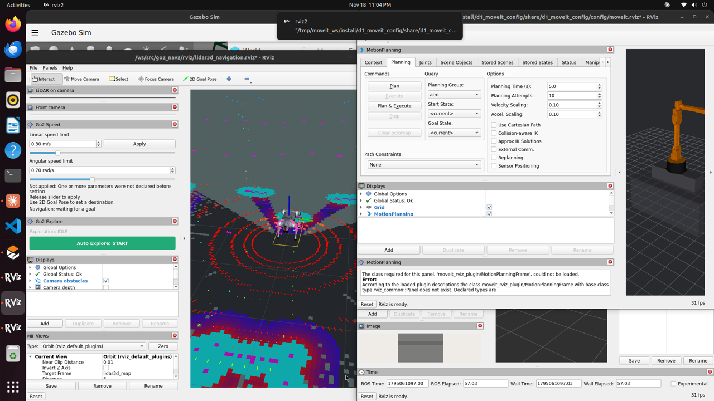
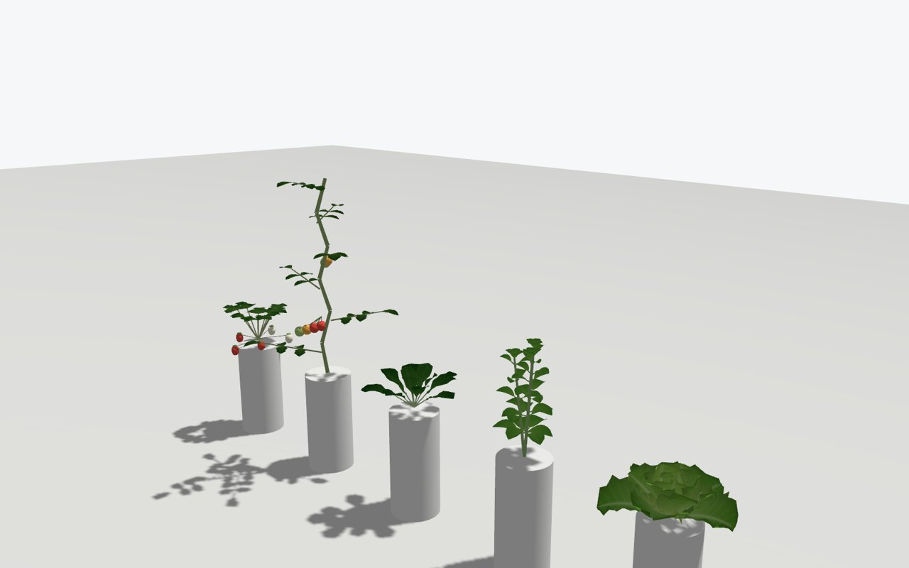

# Simulation health check and the species ladder's plants

[← README](../../README.md) · [Docs index](../README.md) · [Servo demo](servo_demo.md)

## Health check

```bash
./run_sim_demo.sh --health --gui --rviz --out DIR
```

Brings up the whole demo stack (Gazebo, Nav2, MoveIt with the D435i on the claw, the YOLO
tracker, the RViz windows), then checks and stops:

| Check | Gate | 2026-11-18 |
|---|---|---|
| Wrist D435i colour (`/camera/color/image_raw`) | ≥ 10 Hz | 13.9 Hz |
| Wrist D435i aligned depth | ≥ 10 Hz | 11.7 Hz |
| Tracker colour+depth pairs (host GPU) | ≥ 4 /s | 12 /s |
| Windows | Gazebo, Nav2 RViz, MoveIt RViz, camera RViz | all four |

`DIR/health.json` holds the numbers and checks, `DIR/health.png` the desktop (tiled 2×2 by
`scripts/tools/desktop_capture.py tile`, which needs python-xlib).



`wifi_nav.sh --sim --arm` alone starts the older D1 emulator, not MoveIt; the MoveIt arm, the
claw camera, the tracker and the extra RViz windows come from `run_sim_demo.sh`, which
starts `wifi_nav.sh --sim` underneath. The sim D435i runs at 15 Hz (the real one streams
15 or 30 fps); at 10 Hz the measured rate was 9.97-9.99 Hz.

## Plants

Only the lettuce existed as a plant model (`gazebo/worlds/models/lettuce`, the control). The
other four are geometric stand-ins from `gazebo/worlds/build_species_models.py`, in
`gazebo/models/<species>_plant/` (`model://<species>_plant`), each with a README saying so.
Sizes and per-species notes: [`config/species_config.yaml`](../../config/species_config.yaml).

| Species | Model | Height | Canopy radius | Label |
|---|---|---|---|---|
| lettuce (control) | `model://lettuce` | 0.117 m | 0.137 m | 1 |
| basil | `model://basil_plant` | 0.288 m | 0.083 m | 2 |
| spinach | `model://spinach_plant` | 0.120 m | 0.158 m | 3 |
| tomato | `model://tomato_plant` | 0.601 m | 0.246 m | 4 |
| strawberry | `model://strawberry_plant` | 0.135 m | 0.116 m | 5 |


