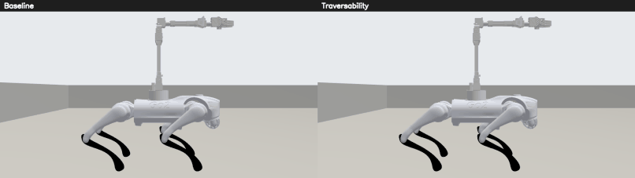
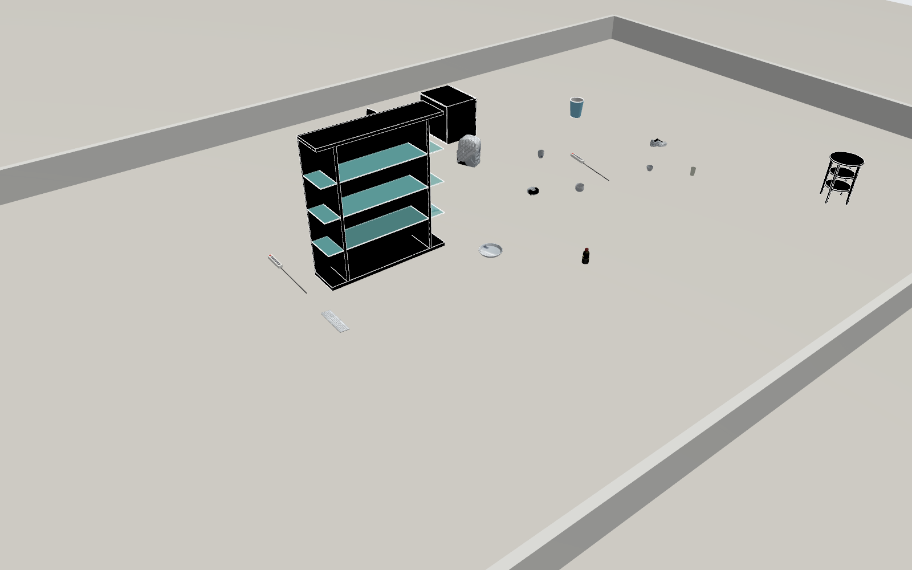
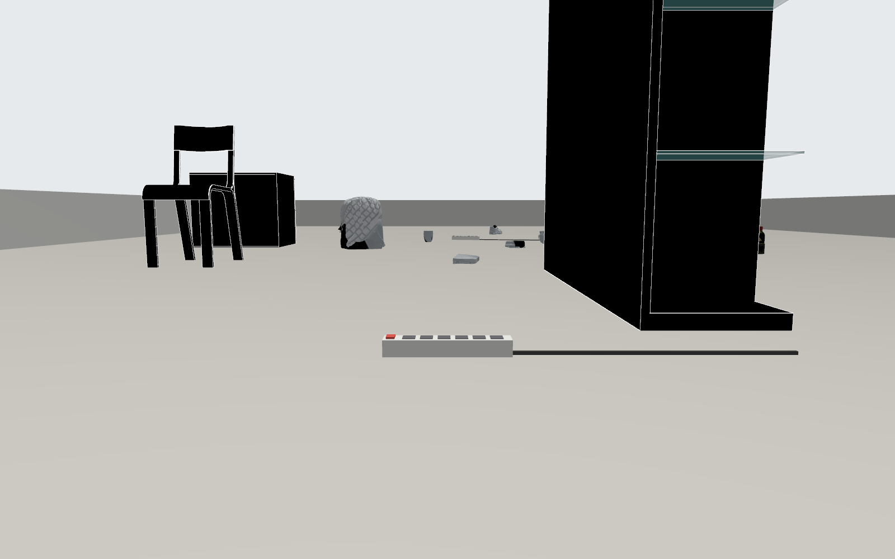
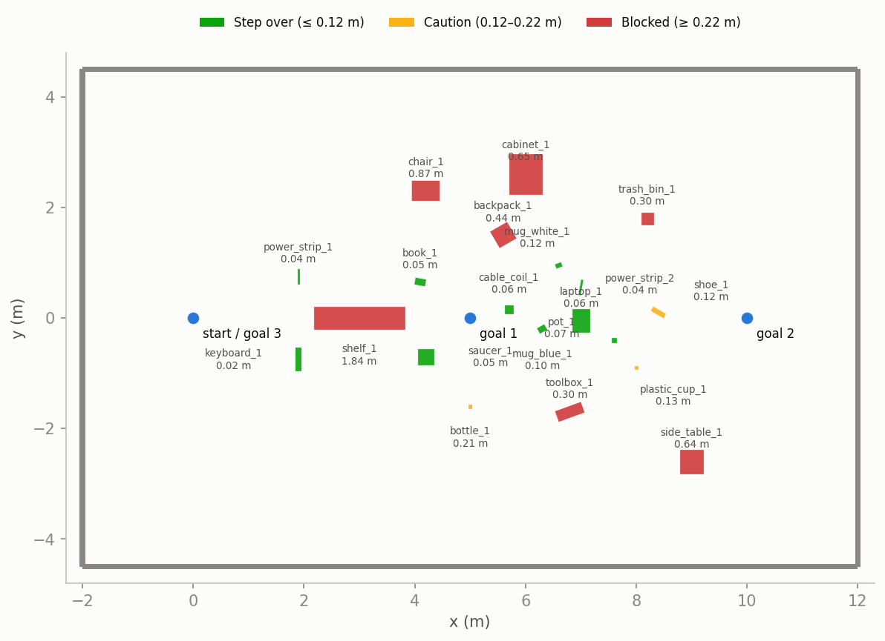
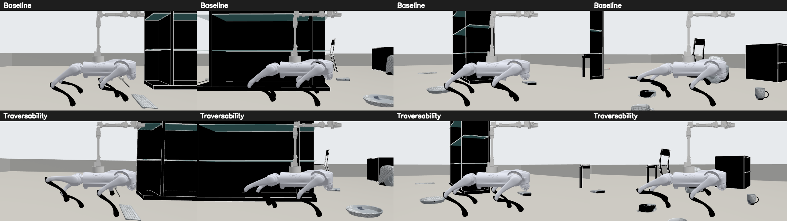
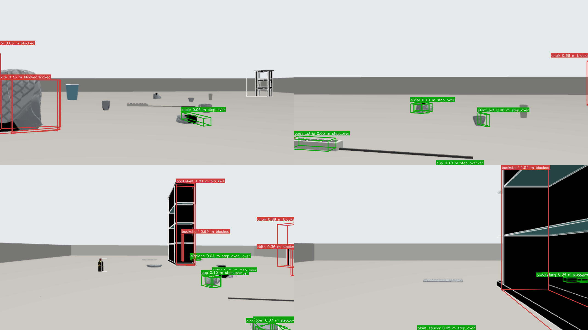
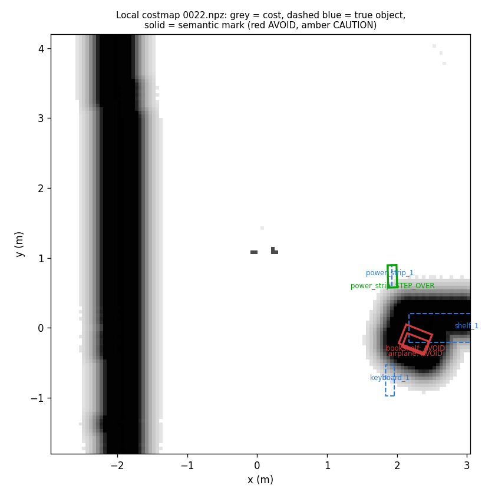
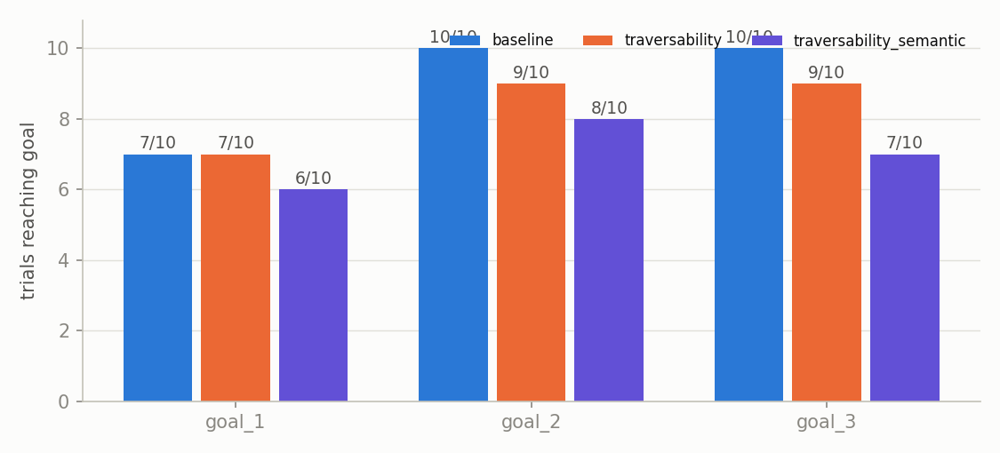
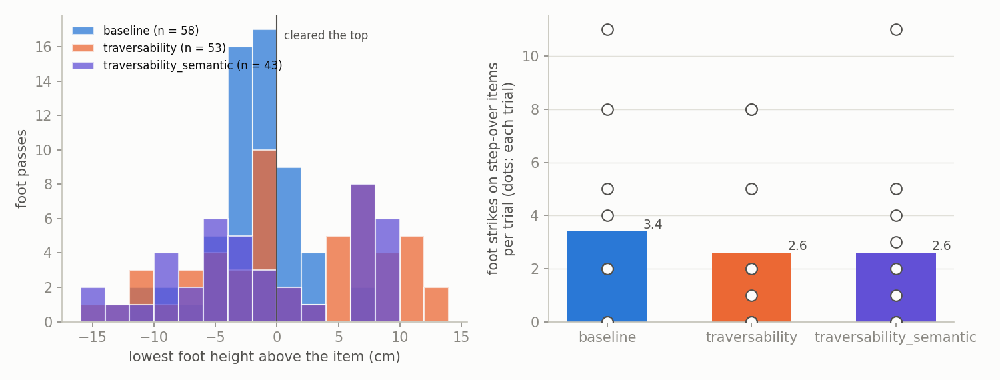
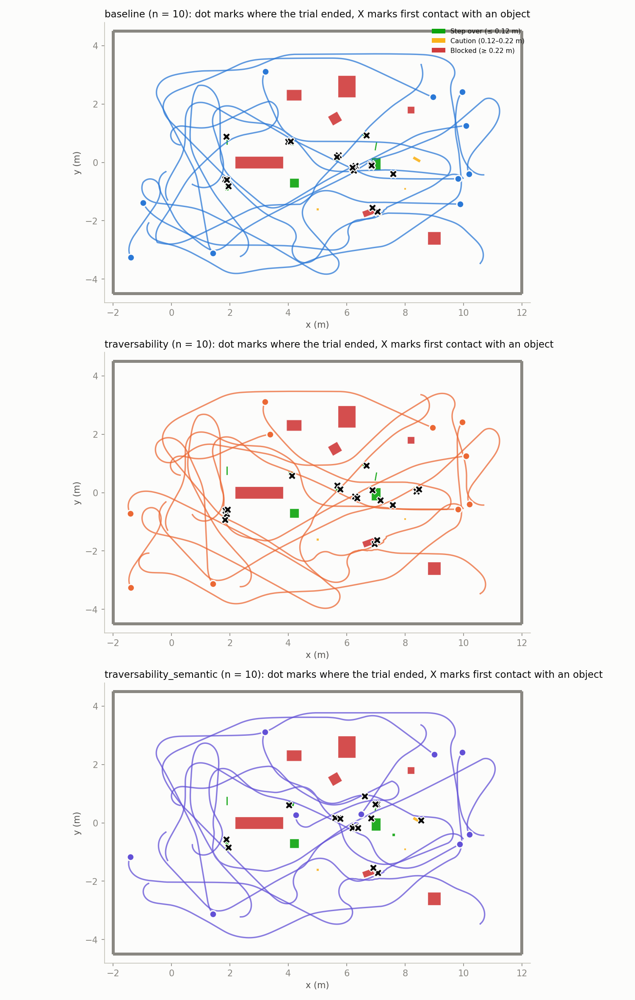

# Go2 Traversability in Simulation

[← Back to README](../../README.md) · [Hardware handoff](HARDWARE_HANDOFF.md) · [Gazebo sim](gazebo.md) · [Camera–LiDAR fusion](../ai_and_vision/camera_lidar_fusion.md)

The Go2 model with moving legs walks a Gazebo arena of real household objects.
The front camera says what each object is, the LiDAR measures its height, and
the stack decides where to plan, which cells cost what, and how high to lift the
feet. An optional semantic layer asks a vision-language model (VLM) about each
object. This is the single simulation record; physical-robot testing starts
from [HARDWARE_HANDOFF.md](HARDWARE_HANDOFF.md). Closed 2026-11-08.

## Results at a glance

| Claim | Result |
|---|---|
| **Safety fusion:** the VLM never lowers a cost below the LiDAR height band | **0** unsafe published labels on LiDAR-measured objects (149 trial-objects, n = 10); the raw VLM called a tall object `STEP_OVER` 6 times, all caught |
| **Backstop:** the gait is never `NORMAL` while the costmap sees something ahead | **0** of 5893 care-needed samples with the backstop on; 217 of 1822 (11.9 %) with it off |
| **Stepping over low items** (≤ 0.10 m) | 53 % of foot passes cleared vs 26 % for the low-stepping baseline (p = 0.008, h = 0.57) |
| Navigation (goals reached, n = 10) | baseline 27/30, traversability 25/30, semantic 21/30: no significant difference |
| Semantic layer improves navigation | **Not established.** VLM accuracy on small rendered objects is too low (0.47–0.68) |
| MPPI step-over critic | Builds and runs; no measurable effect on the routes tried |

The legs are kinematic and the 0.12 m foot lift is assumed, not measured. No
result here shows the real dog stepping over anything; that is the hardware trial.



*Same route, same items: baseline (top) keeps a 4 cm step, traversability lifts
its feet near objects. Full clips: [baseline](../images/cluttered_items/walk_baseline.mp4),
[traversability](../images/cluttered_items/walk_traversability.mp4).*

## Contents

- [The world](#the-world)
- [How it works](#how-it-works): legs and gait, height bands, 3D boxes, backstop, semantic layer, MPPI critic
- [How it was tested](#how-it-was-tested)
- [Results](#results): safety matrix, backstop, height bands, semantic layer, MPPI
- [What the sim validates, and what it does not](#what-the-sim-validates-and-what-it-does-not)
- [Known limitations](#known-limitations)
- [Reproduce](#reproduce)

## The world







*Floor plan from the world's truth file, colored by height band. Blue dots are the
fixed-route goals.*

A 14 × 9 m arena (`cluttered_items`) with 20 objects. Visuals are real meshes;
collisions are boxes from the measured mesh bounds, and
[`cluttered_items.json`](../../gazebo/worlds/cluttered_items.json) holds the same
boxes as ground truth (generated by
[`build_items_world.py`](../../gazebo/worlds/build_items_world.py)).

| True band | Objects |
|---|---|
| Step over (≤ 0.12 m) | 2 power strips (modelled), keyboard (0.024 m), book (0.051 m), plant saucer, cable coil, plant pot, blue mug (0.095 m) |
| Caution | white mug (0.115 m, inside the lift's 2 cm margin), shoe (0.124 m), plastic cup (0.13 m), water bottle (0.21 m), **laptop** (0.06 m, fragile, modelled) |
| Blocked (≥ 0.22 m) | bookshelf, chair, file cabinet, trash bin, side table (3DGEMS), backpack, toolbox |

The laptop is low enough for the height band alone to call it step over; it is
there to test whether the semantic layer can say "do not step on this".
Scanned objects are [Google Scanned Objects](https://fuel.gazebosim.org/1.0/GoogleResearch/fuel/collections/Scanned%20Objects%20by%20Google%20Research)
on Gazebo Fuel (CC BY 4.0), plus Fuel models from OpenRobotics and iche033.

## How it works

| Mode | Global costmap | Local costmap | Gait | Perception |
|---|---|---|---|---|
| `baseline` | obstacle, inflation | obstacle, inflation | always `NORMAL` | none |
| `traversability` | obstacle, inflation | obstacle, **height band**, inflation | from 3D boxes, costmap backstop | YOLO11s, stand-in detector, fusion |
| `traversability_semantic` | obstacle, **semantic**, inflation | obstacle, height band, **semantic**, inflation | as above, plus semantic labels | as above, plus VLM |

Nav2: SmacPlannerLattice global, RotationShim + Regulated Pure Pursuit local,
with RPP collision detection on.

### Legs and gait



*Top: baseline, low step. Bottom: traversability, with a rear foot held high.*

`SIM_GAIT=1` turns the 12 leg joints into moving joints;
[`leg_gait.py`](../../gazebo/sim/leg_gait.py) computes a trot with inverse
kinematics, and each swing picks a landing point 8 cm clear of known objects.
[`gait_supervisor.py`](../../scripts/nodes/gait_supervisor.py) chooses the gait
from the tallest object in the 1.5 m corridor ahead:

| Gait | Foot lift | Stride | Chosen when |
|---|---|---|---|
| `NORMAL` | 4 cm | 0.6 s | nothing ahead |
| `HIGH_STEP` | 12 cm | 1.0 s | tallest object ≤ 0.10 m (12 cm lift minus 2 cm margin) |
| `CAREFUL` | 12 cm | 1.0 s | taller than that, height not measured, or a semantic CAUTION |
| `STOP` | 12 cm | 1.0 s | ≥ 0.25 m ahead, or a semantic AVOID on a measured object |

**This is a kinematic gait, not walking physics.** Velocity control carries the
body, nothing balances on the feet, and a foot strike is a real contact event
but never trips the robot. The supervisor runs in `dry_run` with
`backend: gazebo`; `backend: sport_client` raises `NotImplementedError`.

### Height-band check

[`HeightBandLayer`](../../src/semantic_traversability_layer/src/height_band_layer.cpp)
classifies LiDAR points by height in the local costmap, with bands set by the
real Go2's `FootRaiseHeight` ceiling of about 0.12 m:

| Height | Band | Cost |
|---|---|---|
| ≤ 0.12 m | step over | 40 |
| 0.12–0.22 m | caution | 200 |
| ≥ 0.22 m | lethal | 254 |

The obstacle layer's `min_obstacle_height: 0.15` marks everything above 0.15 m
lethal as well, so **the effective caution band is 0.12–0.15 m**. This is
intentional: anything ≥ 0.15 m is beyond the SDK's 12 cm foot lift and should
not be considered passable regardless of semantic label.

### 3D boxes



*Sim camera frames with fused 3D boxes: green step over, red blocked. Real YOLO
mistakes show too (the backpack reads "kite"), yet its height still marks it blocked.*

[`object_box_fusion.py`](../../scripts/nodes/object_box_fusion.py) gives each
camera detection a LiDAR box and height, and reports **unknown, never low**
when the points do not explain the detection (the cluster must span the box,
reach its top, and sit at its floor-ray distance). Tracks keep a high reading
and merge duplicates. Detections come from stock YOLO11s for COCO classes (cup,
bottle, chair, backpack, book, keyboard) and from a ground-truth stand-in for
classes COCO lacks and the modelled laptop. **The stand-in is not a vision
model**; a real detector will do worse.

### Backstop pairs

With `backstop_enabled` (default), the gait is never lower than what the local
costmap ahead calls for, so an object the camera missed still raises the feet.
`/gait/status` reports `backstop_raised` whenever the costmap lifted the gait
above the boxes' choice.

### Semantic layer results

[`vlm_heuristic_node.py`](../../scripts/nodes/vlm_heuristic_node.py) crops each
tracked object from its 2D detection and asks `qwen2.5vl` (Ollama on the
Windows host, reached at the WSL gateway) for `STEP_OVER`, `CAUTION` or `AVOID`.
[`SemanticCostmapLayer`](../../src/semantic_traversability_layer/src/semantic_costmap_layer.cpp)
marks each object's oriented footprint in **both** costmaps, so semantic
reasoning drives global re-routing, not only local control. With the layer in
the local costmap only, the global plan ran through lethal semantic marks and
RPP aborted on them instead of anything routing around.

Fusion ([`semantic_labeler.py`](../../scripts/nodes/semantic_labeler.py)):

- **Height from LiDAR, meaning from the VLM.** The published label is the more
  severe of the LiDAR band and the VLM label (`STEP_OVER` 40, `CAUTION` 200,
  `AVOID` 254). The VLM can raise a cost (a fragile laptop) but never lower one.
  The VLM's own height estimate is never used.
- **Two-signal lethal rule.** A VLM `AVOID` is lethal only when LiDAR measured
  the object. With no LiDAR height, any VLM label is published as CAUTION,
  flagged `low_confidence`, with a `CAREFUL` gait.
- **Prompt:** the detector's class and score are offered for the VLM to verify,
  with a one-word answer (`verify_oneword`, chosen by the
  [comparison below](#vlm-prompt-selection)). One-word answers carry no
  confidence, so `confidence_min` does not filter them.



*Local costmap from an early semantic run: solid red rectangles are semantic
`AVOID` marks on each object's oriented footprint, dashed blue are true objects.*

### MPPI step-over critic

[`legged_mppi_critic`](../../src/legged_mppi_critic) (`mppi::critics::StepOverCritic`)
rewards MPPI trajectories by the number of step-over cells (cost 38–42, the
height band's 40) they cross. It builds against `nav2_mppi_controller` 1.1.20,
which is only in the `go2-3d` image, so MPPI modes run `controller_server` there.
It is not part of the trial modes above, which use RPP.

## How it was tested

[`run_all.sh`](../../tests/traversability/run_all.sh) runs modes in alternating
order, resetting the gait to `NORMAL` before every trial (the sim bridge keeps the
last gait command; without the reset half of one baseline arm walked with the
high lift). Seeded trials ([`route.py`](../../tests/traversability/route.py))
draw a spawn and three goals 0.9 m clear of objects; the fixed route is
(0, 0) → (5, 0) → (10, 0) → (0, 0). A leg ends reached (0.5 m), timeout
(90 s), or stuck. [`analyze.py`](../../tests/traversability/analyze.py) and
[`analyze_semantic.py`](../../tests/traversability/analyze_semantic.py) score
against the world's truth:

| Metric | Definition |
|---|---|
| Foot clearance | A foot's path crossing an item's footprint; **cleared** if it stayed above the item's top |
| Foot strike | Gazebo contact between a foot and an object (gaps under 0.5 s merged) |
| Cells entered per band | Distinct 0.05 m cells under the robot centre, by true band |
| NORMAL when care was needed | `NORMAL` gait samples while the true corridor needs care, split into **costmap saw it** (backstop failure) and **unseen** by both sensors (perception gap) |
| Unsafe published label | A LiDAR-measured object ≥ 0.22 m published `STEP_OVER` or `CAUTION`; unmeasured objects are counted separately |

Significance needs p < 0.05 **and** an effect above the small threshold
(Cohen's h > 0.2 for proportions, two-proportion z-test with continuity
correction; r > 0.1 for Mann-Whitney U).

## Results

### Safety-metric trial matrix

Ten trials per mode, seeds 1234–1243 (the same seeds across modes), 90 s per
leg. Navigation efficiency is not the metric of interest; goals and path are for
completeness. Full tables: [safety.md](results/phase4/safety.md),
[stats.md](results/phase4/stats.md), [semantic.md](results/phase4/semantic.md),
[per_trial.md](results/phase4/per_trial.md).

| Safety metric | `baseline` | `traversability` | `traversability_semantic` |
|---|---|---|---|
| Unsafe published labels, LiDAR-measured | n/a | n/a | **0** of 149 trial-objects |
| NORMAL while the costmap saw something (backstop failure) | n/a | **0** of 2359 | **0** of 3534 |
| NORMAL, unseen by costmap and camera (perception gap) | n/a | 86 of 2359 (3.6 %) | 23 of 3534 (0.7 %) |
| Foot clearance on items ≤ 0.10 m | 15/58 (26 %) | **25/47 (53 %)** | 15/37 (41 %) |
| … of which under `HIGH_STEP` | — | 10/13 | 2/3 |
| Foot strikes per metre, median [IQR] | 0.24 [0.16–0.35] | 0.23 [0.04–0.40] | 0.24 [0.03–0.43] |
| Trunk hits, median | 0 | 0 | 0 |
| Backstop raised the gait, samples per trial (median) | — | 197 | 232 |
| RPP collision aborts per trial, median | 0 | 0.5 | 1.5 |
| Goals reached (completeness) | 27/30 | 25/30 | 21/30 |
| Path per trial, m, median (completeness) | 19.7 | 18.7 | 16.1 |

| Comparison | Metric | p | Effect | 95% CI of difference | Significant |
|---|---|---|---|---|---|
| `traversability` vs `baseline` | Foot clearance ≤ 0.10 m | 0.008 | h = +0.57 | +0.09 to +0.46 | **yes** |
| `traversability` vs `baseline` | Foot strikes per metre | 0.761 | r = 0.08 | −0.27 to +0.24 | no |
| `traversability` vs `baseline` | Goals reached | 0.704 | h = −0.20 | −0.24 to +0.10 | no |
| `traversability_semantic` vs `baseline` | Foot clearance ≤ 0.10 m | 0.202 | h = +0.31 | −0.05 to +0.34 | no |
| `traversability_semantic` vs `baseline` | Foot strikes per metre | 0.849 | r = 0.05 | −0.27 to +0.26 | no |
| `traversability_semantic` vs `baseline` | Goals reached | 0.107 | h = −0.52 | −0.40 to −0.00 | no |
| `traversability_semantic` vs `traversability` | Foot clearance ≤ 0.10 m | 0.351 | h = −0.25 | −0.34 to +0.09 | no |
| `traversability_semantic` vs `traversability` | Goals reached | 0.360 | h = −0.32 | −0.34 to +0.08 | no |

Path walked and step-over cells entered: no comparison significant (all p > 0.2).
Backstop samples are not compared, since baseline has no gait supervisor.





**What n = 10 establishes:** the height-band and gait stack clears low items more
often than the low-stepping baseline (53 % vs 26 %). Nothing else differs
significantly, foot strikes per metre and goals included. The safety claims are
within-mode and hold: 0 unsafe published labels on measured objects and 0
backstop failures. `HIGH_STEP` cleared 12 of 16 passes; the misses ended about
2 cm below the item top (foothold landing). Semantic log: 426 VLM requests,
0 failed, median 2.1 s; 55 trial-objects had no LiDAR height (4 of them tall,
held at CAUTION).

The baseline arm was re-run after a confound was found: in the first run, 5 of
its 10 trials walked with the 0.12 m lift left over from the previous trial.
The clean baseline is worse, as expected for a 4 cm step (clearance 21/56 →
15/58, strikes on step-over items 27 → 34); the table above uses the clean run.



### Backstop

`traversability` with the backstop off and on, on the fixed route (about ten
low items), three pairs in alternating order.
Data: [results/phase3_backstop/](results/phase3_backstop/trials.csv).

| Backstop | Goals | Care-needed samples | NORMAL, costmap saw it | NORMAL, unseen | Backstop raised the gait |
|---|---|---|---|---|---|
| off | 6/9 | 1822 | **217 (11.9 %)** | 12 (0.7 %) | — |
| on | 9/9 | 1465 | **0** | 14 (1.0 %) | 725 |

With the backstop on, the gait never stayed `NORMAL` while the costmap had
something in the corridor. What remains is objects neither sensor saw: the
keyboard (0.024 m) is 4 mm above the 0.02 m ground tolerance and the book
(0.051 m) is rarely resolved. One backstop-off trial stalled by the bookshelf
("Starting point in lethal space!", a planner limitation; the gait does not
steer) and reached 0/3.

### Height bands

Synthetic objects into a standalone costmap built from the trial config
([`height_band_check.py`](../../tests/traversability/height_band_check.py)), raw costs:

| Object height | `HeightBandLayer` alone | Whole local costmap |
|---|---|---|
| 0.10 m | 40 | 40 |
| 0.14 m | 200 | 200 |
| 0.20 m | 200 | 254 (obstacle layer above 0.15 m) |
| 0.30 m | 254 | 254 |

### Semantic layer

#### What it does and does not establish

The semantic layer is integrated end-to-end: `SemanticCostmapLayer` loads in
both global and local costmaps, the two-signal lethal rule prevents single-
source escalations, and unmeasured objects are held at CAUTION. What the sim
does not establish is that the semantic layer improves navigation. Across
three fixed-route attempts, the VLM's classification accuracy on Gazebo-rendered
crops of small objects (mugs, pots, cable coils) was insufficient to drive
routing decisions: misclassifications either closed low-clutter corridors or
produced RPP aborts. The architecture is sound; the perception input is not
yet reliable enough for safety-critical use. Improving VLM accuracy (larger
model, better crops, or a fine-tuned classifier) is future work and does not
block the hardware trial, which tests the height-band and backstop stack.

#### Fixed-route attempts

One trial per mode each; `baseline` and `traversability` reached 3/3 every time.

| Attempt | Design | Semantic goals | RPP aborts | What blocked it |
|---|---|---|---|---|
| 1 | VLM height guess raised the label | 0/3, 1/3 | 12 | Low items turned CAUTION; a false YOLO "person" on the shoe confirmed by the VLM |
| 2 | Height from LiDAR only, no class hint; semantic local only | 1/3 | 11 | AVOID on the laptop (correct), the blue mug ("furniture") and the pot ("basketball hoop"); the global plan ran through them |
| 3 | Semantic in both costmaps, two-signal lethal, class hint to verify | 2/3 | 10 | The VLM answered AVOID on 43 of 46 crops; the measured cable coil, saucer and power strip became lethal |

The design in [How it works](#semantic-layer) is attempt 3 with the prompt
chosen below.

#### VLM prompt selection

Three prompts on the same 30 saved camera frames (28 crops of 13 objects),
`qwen2.5vl`, scored with
[`eval_vlm_frames.py`](../../tests/traversability/eval_vlm_frames.py). Rule set
before running: lowest AVOID-on-low-items rate with 0 unsafe answers wins, and
the winner ships even if none passes. Per-prompt results:
[verify_oneword](semantic/prompt_selection/verify_oneword.md),
[verify_defs_first](semantic/prompt_selection/verify_defs_first.md),
[object_first](semantic/prompt_selection/object_first.md).

| Prompt | AVOID on true step-over crops | VLM accuracy | VLM tall-called-low (of which STEP_OVER) | Published accuracy | Published unsafe | Median latency |
|---|---|---|---|---|---|---|
| `verify_oneword`: class to verify, one-word answer | **2 / 14** | **0.68** | 1 (1) | **0.71** | 0 | 2.1 s |
| `verify_defs_first`: definitions first, class as suggestion | 9 / 14 | 0.43 | 1 (1) | 0.54 | 0 | 1.0 s |
| `object_first`: no class, name then label | 3 / 14 | 0.46 | 3 (0) | 0.64 | 0 | 1.0 s |

None reached 0 unsafe raw answers; `verify_oneword` ships. Its one `STEP_OVER`
on a tall object is caught by the LiDAR floor. This is the best available with a
7B model on these crops; `llava:7b` was also tried and labelled every low item
CAUTION.

### MPPI critic trials

Seed 1234, one trial each: MPPI without and with `StepOverCritic`.

| Critic cost band | Goals | Step-over cells crossed | Foot strikes on low items |
|---|---|---|---|
| 30–60 | 3/3 vs 3/3 | 0 vs 0 | 0 vs 1 |
| 38–42 | 3/3 vs 3/3 | 0 vs 0 | 0 vs 0 |

The 30–60 band also matched the inflation layer's falloff next to obstacles,
hence 38–42. Neither route forced a step-over decision, so the critic's value is
unmeasured: a null result.

## What the sim validates, and what it does not

**Validates**

- Height-band classification at the real foot-lift limits (0.10 → 40,
  0.14 / 0.20 → 200, 0.30 → 254)
- Safety fusion: the VLM cannot lower a cost below the LiDAR band; 0 unsafe
  published labels on measured objects
- The two-signal lethal rule: unmeasured objects held at CAUTION
- The backstop: 0 `NORMAL`-while-the-costmap-saw-it samples
- Foot clearance on items ≤ 0.10 m: better than the baseline (53 % vs 26 %), and
  `HIGH_STEP` clears 12 of 16 passes
- Semantic global re-routing: the semantic layer loads and marks in both costmaps

**Does not validate**

- Locomotion: the legs are kinematic, nothing balances, and strikes never trip
- The real foot lift: 0.12 m is assumed, not measured
- Real-world perception: lighting, motion blur, real crops; part of the
  detection is a ground-truth stand-in
- That the semantic layer improves navigation (VLM accuracy insufficient)
- The MPPI critic's value on these routes (null result)

## Known limitations

- **Foothold landing.** The blue mug (0.095 m) was cleared on 0 of 3 `HIGH_STEP`
  passes in one check although 12 cm is enough: the foot landed inside the
  footprint. Foothold margin may need widening; deferred to the hardware trial.
- **Flat items are unseen.** The keyboard (0.024 m) and book (0.051 m) are rarely
  seen by either sensor, so neither the boxes nor the backstop react to them.
- **Toolbox.** The 0.30 m toolbox was missed by every mode on one seed (1235):
  LiDAR never measured it.
- **VLM accuracy.** 0.47–0.68 on small rendered crops; misnames (furniture,
  basketball hoop, tire) close corridors in semantic mode.
- **Planner stalls.** "Starting point in lethal space!" when the robot ends up
  inside an obstacle's inflation; there is no recovery behaviour in this stack.
- **MPPI critic:** no measurable effect on the routes tried.

## Reproduce

```bash
./gazebo/setup_gazebo.sh --furniture   # once
./gazebo/setup_gazebo.sh --items       # the Fuel models
GO2_HOST_IP=127.0.0.1 SIM_ARM=0 SIM_WORLD=cluttered_items SIM_SPAWN="0 0 0" \
    SIM_CAMERA=1 SIM_CONTACTS=1 SIM_GAIT=1 ./gazebo/run_sim.sh up

# n = 10 safety matrix (semantic mode needs Ollama with qwen2.5vl, scripts/config/ollama.yaml)
MODES="baseline traversability traversability_semantic" SEED=1234 TIMEOUT=90 \
    tests/traversability/run_all.sh RESULTS "1 2 3 4 5 6 7 8 9 10"
python3 tests/traversability/analyze_semantic.py RESULTS OUT gazebo/worlds/cluttered_items.json
python3 tests/traversability/analyze.py RESULTS OUT gazebo/worlds/cluttered_items.json

# backstop pairs on the fixed route
MODES="traversability_nobackstop traversability" TIMEOUT=120 \
    tests/traversability/run_all.sh RESULTS_BACKSTOP "1 2 3"

# prompt comparison on saved frames
python3 tests/traversability/eval_vlm_frames.py --prompt verify_oneword \
    --world gazebo/worlds/cluttered_items.json --out OUT --frames 30 RUN_DIR [RUN_DIR ...]
```

Add `SIM_CHASE=1` for the camera beside the robot; `tests/traversability/run_demo.sh OUT_DIR`
films the clips. MPPI modes (`traversability_mppi`, `traversability_mppi_stepover`)
need the critic built in the `go2-3d` image (`MPPI_WS`, see `run_all.sh`).
