# Go2 Traversability in Simulation

[← Back to README](../../README.md) · [Gazebo sim](gazebo.md) · [Indoor lab world](lab_office.md) · [Camera–LiDAR fusion](../ai_and_vision/camera_lidar_fusion.md)

The one simulation record for the traversability feature: the Go2 model with
moving legs walking a Gazebo arena of real objects, the camera + LiDAR 3D boxes
and height costmap that choose each step, the VLM semantic layer, and the work
to make all of it match the real robot. Physical-robot testing is documented
separately.

- [Part 1: Items world, the Go2 stepping over real objects](#part-1-items-world-the-go2-stepping-over-real-objects)
- [Part 2: Semantic layer, VLM labels in the local costmap](#part-2-semantic-layer-vlm-labels-in-the-local-costmap)
- [Part 3: Hardware readiness (in progress)](#part-3-hardware-readiness-in-progress)
- [Appendix: First version on plain shapes](#appendix-first-version-on-plain-shapes-cluttered_nav_test)

Parts 1 and 2 were run with the earlier bands (step over ≤ 0.15 m, lethal ≥ 0.25 m);
Part 3 has the current ones.

## Part 1: Items world, the Go2 stepping over real objects

The Go2 model with moving leg joints, walking through a Gazebo arena of real
objects: mugs, a power strip, a shoe, a keyboard, a chair and more. The front
camera says what each object is, the LiDAR measures it, and the 3D box picks how
high to step. Compared with a low-stepping baseline over 5 trials each,
2026-11-06.


*Same route, same items. Full clips:
[baseline](../images/cluttered_items/walk_baseline.mp4),
[traversability](../images/cluttered_items/walk_traversability.mp4). Traversability
lifts its feet higher and takes longer strides near objects.*

### Results at a glance

| | `baseline` (n = 5) | `traversability` (n = 5) |
|---|---|---|
| Foot passes that cleared the item | 16 of 73 (**22 %**) | 55 of 90 (**61 %**) |
| Items the raised foot can clear (≤ 0.10 m) | 16 of 57 (28 %) | 50 of 76 (66 %) |
| Foot strikes on items, per metre walked | 0.75 | **0.58** |
| Goals reached (3 per trial) | 9 / 15 | 12 / 15 (p = 0.43, Fisher) |

| Fusion, traversability trials only | Before the fix (first version) | Now |
|---|---|---|
| **Unsafe labels** (a taller object marked lower than it is) | 13 tracks, in all 5 trials | **0** |
| Measured tracks in the wrong height band | 46 of 139 | **1 of 106** |
| Height error of the best track per object (median) | 1.8 cm | 1.1 cm |
| Objects known before first contact | 12 of 14 | 18 of 22, median 15 s ahead |

**In short: the fix worked for the unsafe labels, and feet cleared items almost
three times as often. It is not finished.** A stricter fusion misses more objects,
39 % of the feet still touched the item they crossed, and the stepping here is
kinematic, not walking physics. No result here shows the real dog stepping over
anything.

---

### The world


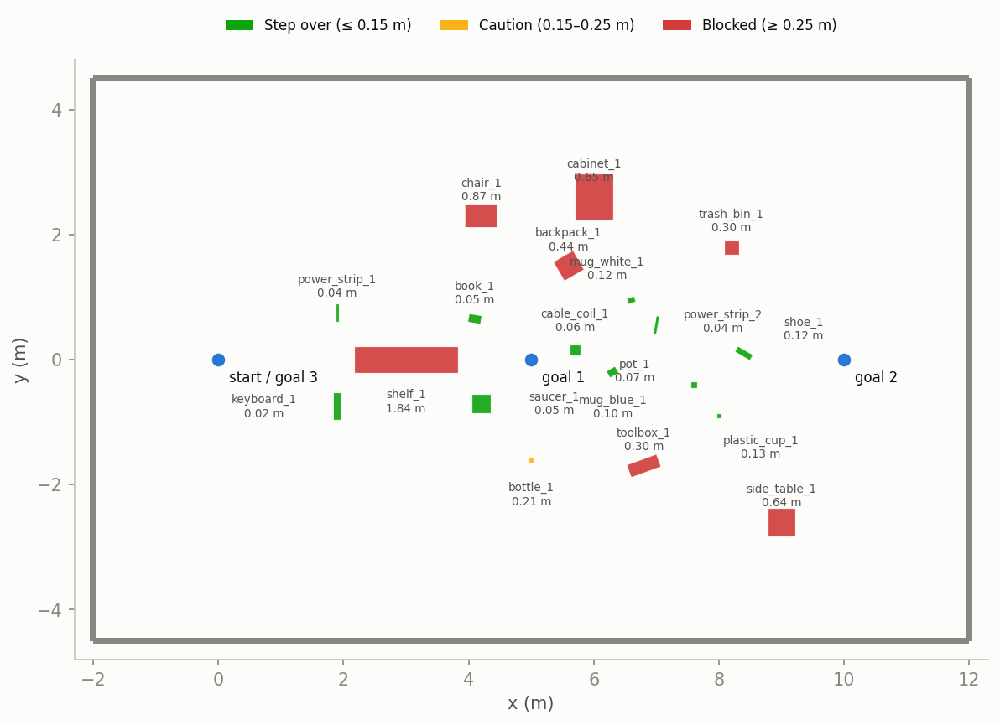

*Floor plan from the world's truth file. Color is the height band, also named in
the legend. Blue dots are the goals.*

The same 14 × 9 m arena and goals as the [first version](#appendix-first-version-on-plain-shapes-cluttered_nav_test), with
every plain shape replaced:

| Band | Objects | Source |
|---|---|---|
| Step over (≤ 0.15 m) | 2 power strips | **Modelled here:** Gazebo Fuel has none |
| | keyboard, book, plant saucer, cable coil, plant pot, 2 mugs, running shoe | [Google Scanned Objects](https://fuel.gazebosim.org/1.0/GoogleResearch/fuel/collections/Scanned%20Objects%20by%20Google%20Research) on Gazebo Fuel, CC BY 4.0 |
| | plastic cup | Fuel, OpenRobotics, CC0 |
| Caution (0.15–0.25 m) | water bottle (scaled to 0.21 m) | Fuel, iche033, CC BY 4.0 |
| Blocked (≥ 0.25 m) | bookshelf, chair, file cabinet, trash bin, side table | 3DGEMS models, as in `lab_office` |
| | backpack, toolbox | Fuel: Google Scanned Objects, OpenRobotics |

Visuals are the real meshes. Collisions are boxes from the measured mesh bounds, and
[`cluttered_items.json`](../../gazebo/worlds/cluttered_items.json) holds the same
boxes as ground truth.

#### Use it

```bash
./gazebo/setup_gazebo.sh --furniture   # once, if not done already
./gazebo/setup_gazebo.sh --items       # the Fuel models
GO2_HOST_IP=127.0.0.1 SIM_ARM=0 SIM_WORLD=cluttered_items SIM_SPAWN="0 0 0" \
    SIM_CAMERA=1 SIM_CONTACTS=1 SIM_GAIT=1 ./gazebo/run_sim.sh up
tests/traversability/run_all.sh RESULTS_DIR "1 2 3 4 5"   # trials
```

Add `SIM_CHASE=1` for the camera that rides beside the robot, then
`tests/traversability/run_demo.sh OUT_DIR` films the clips.

### How the legs move


*Top: baseline, low step. Bottom: traversability, with a rear foot held high in
the first frame.*

`SIM_GAIT=1` turns the Go2's 12 leg joints into real moving joints.
[`leg_gait.py`](../../gazebo/sim/leg_gait.py) computes them with inverse kinematics
as a trot: planted feet move back at the body's speed, and swinging feet rise,
cross, then come down.

| Gait | Foot lift | Stride cycle | Chosen when |
|---|---|---|---|
| `NORMAL` | 4 cm | 0.6 s | nothing ahead |
| `HIGH_STEP` | 12 cm | 1.0 s | the tallest object ahead is ≤ 10 cm |
| `CAREFUL` | 12 cm | 1.0 s | taller than that, or not measured |
| `STOP` | 12 cm | 1.0 s | ≥ 0.25 m ahead (Nav2 should route round it) |

Each swing also picks a landing point 8 cm clear of any object the fusion knows
about.

**This is a kinematic gait, not walking physics.** VelocityControl still carries the
body. Nothing balances on the feet, gravity is off for the robot, and the feet pass
through the floor. Feet do collide with objects, so strikes are real contact events,
but a strike does not trip the robot. The 12 cm lift is an assumption until the real
foot height is measured.

### The fusion and what changed

The front camera detects objects; the LiDAR gives each one a 3D box and a height.


*Sim camera frames from traversability1, with fused 3D boxes: green step over, red
blocked. The labels show real YOLO's mistakes too: the backpack reads "kite", yet
its height still marks it blocked.*

[`object_box_fusion.py`](../../scripts/nodes/object_box_fusion.py) now refuses to
measure when the LiDAR points do not explain the detection, and reports
**unknown, never low**:

| Check | Catches |
|---|---|
| Use the cluster spanning most of the box, not the nearest | A small object in front (the cone read as a barrel) |
| The cluster must reach near the top of the box | Seeing only the bottom of an object |
| The cluster must sit at the box's floor-ray distance | A far object's box catching a near one's points |
| Tracks keep a high reading and merge duplicates | A partial view lowering the estimate |

An unknown object still gets a floor position within 3 m, and the gait treats it as
`CAREFUL`.

#### Real YOLO this time

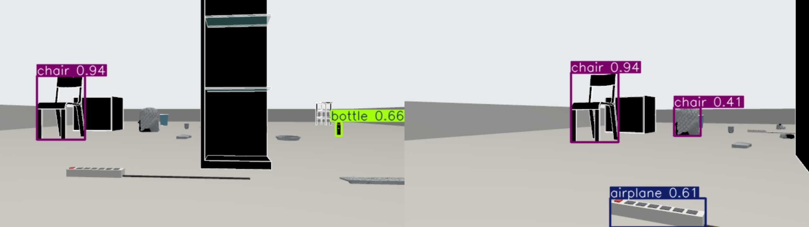

*Stock YOLO11s at confidence 0.40, the threshold the project's YOLO node uses.*

With real objects, **YOLO11s now detects things correctly**: on 154 frames it reported
chair 50, bottle 34, cup 9 and keyboard 4. It also added false labels: kite 11,
laptop 11, person 9. The power strip became "airplane" and the backpack "kite".

| Detector | Classes |
|---|---|
| Real YOLO11s (COCO) | cup, bottle, chair, backpack, book, keyboard |
| Stand-in, from the world file | power strip, saucer, cable, pot, shoe, toolbox, trash bin, side table, bookshelf, file cabinet |

**The stand-in is not a vision model.** COCO has no such classes, so it plays a
custom-trained detector, and these objects have perfect detections. A real model
will do worse.

### How it was tested

Trials alternated, baseline1, traversability1 and so on, from the spawn at (0, 0).

| | `baseline` | `traversability` |
|---|---|---|
| Global costmap | obstacles, inflation | the same (plugins stay local only) |
| Local costmap | obstacles, inflation | adds `HeightBandLayer` |
| Legs | always `NORMAL` | gait from the 3D boxes |
| Perception | none | YOLO11s, stand-in, fusion |

Nav2 uses the 3D stack's values with **collision detection on**. Goals are (5, 0),
(10, 0), then (0, 0), within 0.5 m. Legs end **reached**, **timeout** (120 s), or
**stuck** (0.15 m of progress in 45 s).

The gait node runs in `dry_run`, so nothing is sent to a sport client. The sim reads
`/gait/command` to move its legs, which is what makes the comparison possible.

[`analyze.py`](../../tests/traversability/analyze.py) scores both modes against
the world's truth:

| Metric | How |
|---|---|
| Foot pass | A foot's path crossing an item's footprint. **Cleared** if the foot stayed above the item's top the whole way |
| Foot strike | Gazebo contact between a foot and an object, with gaps under 0.5 s |
| Track audit | Every final track against the nearest true object |
| Right gait | The same rule applied to the true objects ahead |

### Results

#### Stepping over items

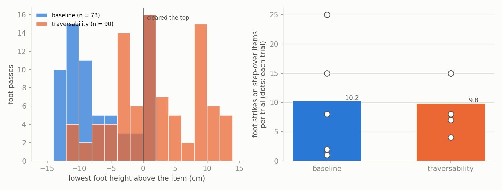

*Left: lowest foot height above the item on each pass; right of the line cleared it.
Right: strikes per trial. Stuck trials walked less, so they strike less: per metre is
the fairer figure.*

- **Feet cleared items on 61 % of passes, against 22 %.** Even 4 cm lifts clear the
  flattest items, which is why baseline is not zero.
- **Strikes per metre fell 23 %,** from 0.75 to 0.58. Per trial they look equal, 10.2
  and 9.8, because baseline walked less.
- **`HIGH_STEP` cleared 20 of 34 passes (59 %).** Fixing where feet land raised this
  from 45 %. The remaining failures were not broken down for this batch.

#### Navigation

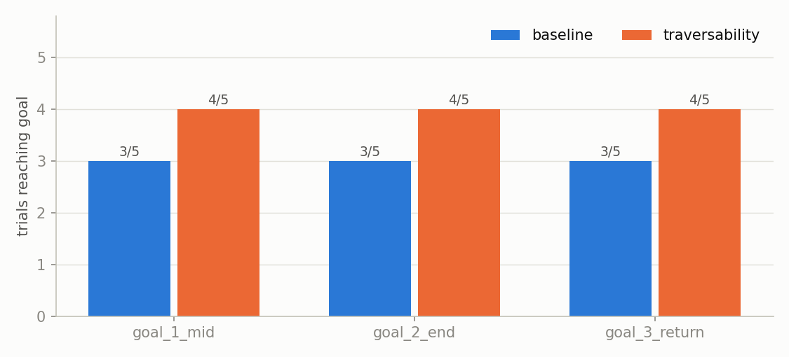

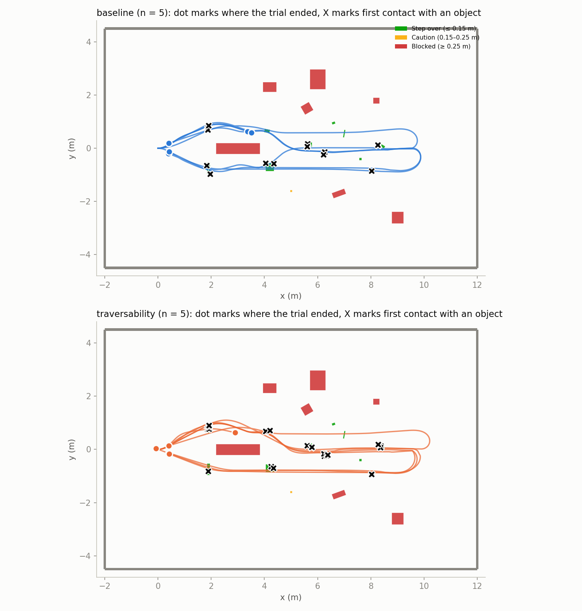

*Dot: where the trial ended. X: first contact with each object.*

- **No navigation claim can be made.** 12 of 15 against 9 of 15 is not significant
  (p = 0.43). In this sim the legs do not move the body, so the gait cannot cause it.
- **All failures are whole trials stuck near the shelf:** baseline3, baseline4 and
  traversability5, each ending with Nav2 refusing to plan: *Starting point in lethal
  space*. It is the same in both modes and is not understood yet.
- **Routes are the same in both modes,** because the global costmap is. The robot walks
  over step-over items instead of round them.

#### Perception

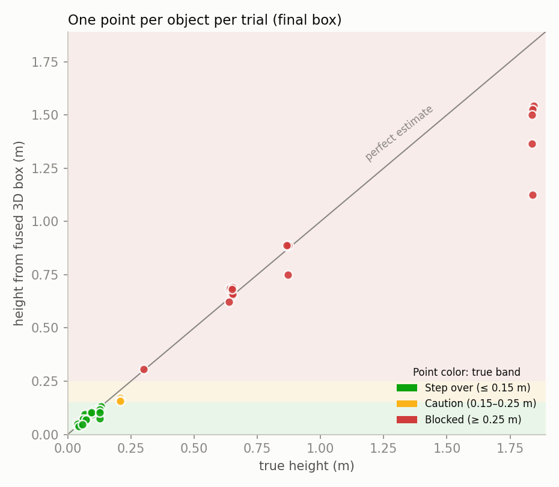

- **Measured boxes are reliable:** every one of the 57 best-match boxes has the right
  band, and 1 of 106 measured tracks overall is wrong. None is unsafe.
- **The cost is coverage.** Over 5 trials: backpack, book, keyboard and toolbox were
  never measured, the trash bin once, and the white mug once. The stricter checks and
  YOLO's misses both play a part.
- **False labels remain:** 47 of 124 tracks (38 %) carry a class that is not near them,
  almost all from YOLO. Their heights still came from real points, and none is unsafe.

#### Gait choice

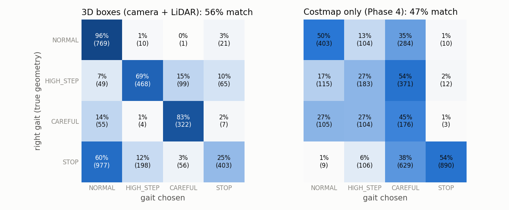

| | 3D boxes | Costmap only |
|---|---|---|
| Exact match, all samples (n = 3504) | 56 % | 47 % |
| Exact match at the 22 first contacts | 13 / 22 | 8 / 22 |
| `HIGH_STEP` when the foot would not clear (n = 2022) | 202 (10 %) | 210 (10 %) |
| `NORMAL` when more care was right (n = 2022) | **1032 (51 %)** | 114 (6 %) |

The boxes are ahead on matches, but **they leave the robot in `NORMAL` far too often**,
because an object it never detected cannot change the gait. That is the cost of the
stricter fusion. The costmap can use it as a backstop: if it reports something ahead
and the boxes do not, the gait should not stay `NORMAL`.

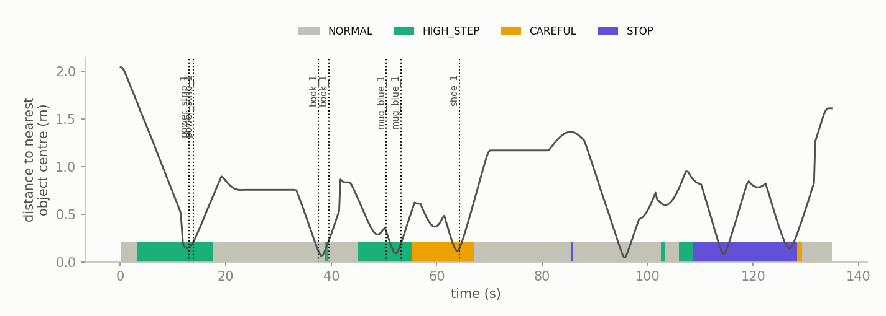

### What this says

1. **The unsafe-label problem is fixed in this sim.** Refusing to measure beats a wrong
   measurement.
2. **The concept works end to end here.** Real YOLO, LiDAR boxes, a gait choice and legs
   that visibly lift over real objects.
3. **Next: use the costmap as a backstop for what the camera misses.** 51 % `NORMAL` is
   the biggest remaining gap.
4. **A custom model is needed.** Stock YOLO cannot see the objects that matter most
   here, and it adds false labels.
5. **The stuck-near-the-shelf failure needs its own look,** since it ends whole trials.
6. **Real stepping needs the robot or a legged simulator** with a walking controller.

### Limits

- **Kinematic legs, as above.** Clearance here is geometry. It does not prove balance
  or a stable gait.
- **Tuned on this world.** The fusion and foothold changes were made after seeing an
  earlier batch of these same objects, so a new world will likely score lower.
- **The stand-in gives perfect detections** for 10 of the 16 classes.
- **5 trials per mode, one world, one spawn, 0.59× real time,** with Nav2 on wall-clock
  time. Most comparisons are not statistically significant.
- **12 cm foot lift is assumed.** It needs measuring on the robot.
- **Boxes stay JSON** on `/objects/boxes_json`; `SemanticObstacle.msg` has no size yet.
  `SemanticCostmapLayer`, `vlm_heuristic_node` and the critic node were not exercised.
- **The clips use a scripted route, not Nav2,** so the robot crosses the items in view.
  The D1 arm stands upright throughout.

### Found along the way

- **Footing, not lift, was failing.** In the batch before the last, feet peaked at 17 cm
  but only 45 % of `HIGH_STEP` passes cleared: 22 of 66 failed passes landed inside the
  item, and the rest clipped it on the way up or down. Hence the rise-first swing and
  the wider landing margin.
- **YOLO at 0.25 confidence produced 107 false tracks of 224.** The project's YOLO node
  uses 0.40. Matching it cut that to 47 of 124.
- **Fixing unsafe labels had a price.** The earlier batch matched the right gait 73 % of
  the time against this 56 %, with 13 unsafe tracks. Safety was chosen over that score.
- **The bookshelf was first too tight.** Set across the path, its corner left the 0.8 m
  long body in a lethal start position, so it was turned lengthwise.

### Full statistics

Generated by `analyze.py`: [`stats.md`](../images/cluttered_items/stats.md), [`trials.csv`](../images/cluttered_items/trials.csv).

Per mode over trials: mean ± SD [min–max]; p from Welch's t-test.

| Metric | `baseline` (n=5) | `traversability` (n=5) | p (Welch t) |
|---|---|---|---|
| Goals reached (of 3) | 1.80 ± 1.64 [0.00–3.00] | 2.40 ± 1.34 [0.00–3.00] | 0.545 |
| Total time (s) | 135.46 ± 19.71 [119.20–157.60] | 135.52 ± 14.56 [119.20–156.30] | 0.996 |
| Distance walked (m) | 13.51 ± 8.98 [3.60–20.16] | 16.77 ± 7.64 [3.13–20.81] | 0.554 |
| SPL | 0.60 ± 0.54 [0.00–1.00] | 0.80 ± 0.45 [0.00–1.00] | 0.542 |
| Foot strikes on step-over items | 10.20 ± 9.98 [1.00–25.00] | 9.80 ± 4.97 [4.00–15.00] | 0.939 |
| Foot strikes, all objects | 10.20 ± 9.98 [1.00–25.00] | 9.80 ± 4.97 [4.00–15.00] | 0.939 |
| Trunk hits | 0.40 ± 0.89 [0.00–2.00] | 0.00 ± 0.00 [0.00–0.00] | 0.374 |
| Objects touched | 3.60 ± 2.51 [1.00–6.00] | 4.40 ± 2.51 [1.00–8.00] | 0.628 |
| Nav2 collision aborts | 1.00 ± 0.00 [1.00–1.00] | 1.40 ± 1.14 [0.00–3.00] | 0.477 |
| Plans refused: start in lethal space | 5.60 ± 7.67 [0.00–14.00] | 2.80 ± 6.26 [0.00–14.00] | 0.545 |
| Goals re-sent | 5.40 ± 6.02 [1.00–12.00] | 3.60 ± 4.83 [0.00–12.00] | 0.617 |
| Closest to a tall object or wall (m) | 0.18 ± 0.04 [0.12–0.20] | 0.21 ± 0.02 [0.18–0.22] | 0.133 |
| Sim real-time factor | 0.59 ± 0.03 [0.56–0.62] | 0.59 ± 0.03 [0.54–0.60] | 0.759 |

`baseline` legs reached: 9/15

`traversability` legs reached: 12/15

Fisher exact, per leg: p = 0.427

### Per-trial results

| trial | mode | reached | time_s | walked_m | spl | foot_strikes | foot_strikes_low | body_hits | objects_hit | collision_aborts | start_in_lethal | resends | min_clear_tall_m | rtf |
|---|---|---|---|---|---|---|---|---|---|---|---|---|---|---|
| baseline1 | baseline | 3 | 119.2 | 20.16 | 0.991 | 25 | 25 | 2 | 6 | 1 | 0 | 1 | 0.2 | 0.622 |
| baseline2 | baseline | 3 | 121.5 | 19.9 | 1.0 | 8 | 8 | 0 | 4 | 1 | 0 | 1 | 0.2 | 0.616 |
| baseline3 | baseline | 0 | 156.4 | 3.6 | 0.0 | 2 | 2 | 0 | 1 | 1 | 14 | 12 | 0.16 | 0.558 |
| baseline4 | baseline | 0 | 157.6 | 3.76 | 0.0 | 1 | 1 | 0 | 1 | 1 | 14 | 12 | 0.12 | 0.557 |
| baseline5 | baseline | 3 | 122.6 | 20.14 | 0.992 | 15 | 15 | 0 | 6 | 1 | 0 | 1 | 0.2 | 0.617 |
| traversability1 | traversability | 3 | 130.4 | 19.81 | 1.0 | 7 | 7 | 0 | 4 | 2 | 0 | 2 | 0.2 | 0.602 |
| traversability2 | traversability | 3 | 119.2 | 20.81 | 0.993 | 8 | 8 | 0 | 4 | 0 | 0 | 0 | 0.215 | 0.598 |
| traversability3 | traversability | 3 | 128.0 | 19.91 | 1.0 | 15 | 15 | 0 | 8 | 1 | 0 | 1 | 0.22 | 0.597 |
| traversability4 | traversability | 3 | 143.7 | 20.21 | 0.993 | 15 | 15 | 0 | 5 | 3 | 0 | 3 | 0.22 | 0.604 |
| traversability5 | traversability | 0 | 156.3 | 3.13 | 0.0 | 4 | 4 | 0 | 1 | 1 | 14 | 12 | 0.18 | 0.538 |

### Graph data

The numbers behind each graph, also as CSV in [`docs/images/cluttered_items/data/`](../images/cluttered_items/data/), including every foot pass in `foot_passes.csv` and every track in `tracks.csv`.

#### Every leg (goals.png)

| trial | mode | goal | result | time_s | path_m | shortest_m | spl | resends |
|---|---|---|---|---|---|---|---|---|
| baseline1 | baseline | goal_1_mid | reached | 37.25 | 4.93 | 5.51 | 1.0 | 1 |
| baseline1 | baseline | goal_2_end | reached | 25.13 | 4.94 | 5.48 | 1.0 | 0 |
| baseline1 | baseline | goal_3_return | reached | 56.85 | 10.29 | 10.01 | 0.97 | 0 |
| baseline2 | baseline | goal_1_mid | reached | 40.83 | 4.96 | 5.51 | 1.0 | 1 |
| baseline2 | baseline | goal_2_end | reached | 25.38 | 4.95 | 5.52 | 1.0 | 0 |
| baseline2 | baseline | goal_3_return | reached | 55.28 | 10.0 | 10.06 | 1.0 | 0 |
| baseline3 | baseline | goal_1_mid | stuck | 66.36 | 3.6 | 5.51 | 0.0 | 4 |
| baseline3 | baseline | goal_2_end | stuck | 45.0 | 0.0 | 6.99 | 0.0 | 4 |
| baseline3 | baseline | goal_3_return | stuck | 45.02 | 0.0 | 3.69 | 0.0 | 4 |
| baseline4 | baseline | goal_1_mid | stuck | 67.54 | 3.76 | 5.51 | 0.0 | 4 |
| baseline4 | baseline | goal_2_end | stuck | 45.02 | 0.0 | 6.83 | 0.0 | 4 |
| baseline4 | baseline | goal_3_return | stuck | 45.01 | 0.0 | 3.93 | 0.0 | 4 |
| baseline5 | baseline | goal_1_mid | reached | 41.99 | 4.86 | 5.51 | 1.0 | 1 |
| baseline5 | baseline | goal_2_end | reached | 25.25 | 4.97 | 5.52 | 1.0 | 0 |
| baseline5 | baseline | goal_3_return | reached | 55.32 | 10.31 | 10.06 | 0.98 | 0 |
| traversability1 | traversability | goal_1_mid | reached | 41.66 | 5.27 | 5.51 | 1.0 | 1 |
| traversability1 | traversability | goal_2_end | reached | 26.29 | 4.67 | 5.24 | 1.0 | 0 |
| traversability1 | traversability | goal_3_return | reached | 62.44 | 9.87 | 10.01 | 1.0 | 1 |
| traversability2 | traversability | goal_1_mid | reached | 31.86 | 5.02 | 5.51 | 1.0 | 0 |
| traversability2 | traversability | goal_2_end | reached | 26.68 | 5.23 | 5.52 | 1.0 | 0 |
| traversability2 | traversability | goal_3_return | reached | 60.7 | 10.57 | 10.36 | 0.98 | 0 |
| traversability3 | traversability | goal_1_mid | reached | 44.35 | 4.95 | 5.51 | 1.0 | 1 |
| traversability3 | traversability | goal_2_end | reached | 25.9 | 4.96 | 5.52 | 1.0 | 0 |
| traversability3 | traversability | goal_3_return | reached | 57.79 | 10.01 | 10.01 | 1.0 | 0 |
| traversability4 | traversability | goal_1_mid | reached | 43.88 | 5.01 | 5.51 | 1.0 | 1 |
| traversability4 | traversability | goal_2_end | reached | 35.73 | 4.94 | 5.52 | 1.0 | 1 |
| traversability4 | traversability | goal_3_return | reached | 64.07 | 10.26 | 10.06 | 0.98 | 1 |
| traversability5 | traversability | goal_1_mid | stuck | 66.33 | 3.13 | 5.51 | 0.0 | 4 |
| traversability5 | traversability | goal_2_end | stuck | 45.0 | 0.0 | 7.49 | 0.0 | 4 |
| traversability5 | traversability | goal_3_return | stuck | 45.0 | 0.0 | 3.19 | 0.0 | 4 |

#### First contact with each object (trajectories.png)

| trial | mode | object | link | true_h | band | t_contact | right_gait | gait | costmap_gait | known | lead_s | lead_m | est_h |
|---|---|---|---|---|---|---|---|---|---|---|---|---|---|
| baseline1 | baseline | keyboard_1 | FL_calf | 0.024 | step_over | 9.0 | HIGH_STEP |  |  | False |  |  |  |
| baseline1 | baseline | saucer_1 | FL_calf | 0.046 | step_over | 31.0 | HIGH_STEP |  |  | False |  |  |  |
| baseline1 | baseline | cable_coil_1 | FL_calf | 0.061 | step_over | 44.8 | HIGH_STEP |  |  | False |  |  |  |
| baseline1 | baseline | mug_blue_1 | FR_calf | 0.095 | step_over | 48.2 | HIGH_STEP |  |  | False |  |  |  |
| baseline1 | baseline | shoe_1 | FL_calf | 0.124 | step_over | 58.8 | CAREFUL |  |  | False |  |  |  |
| baseline1 | baseline | plastic_cup_1 | base | 0.13 | step_over | 81.8 | CAREFUL |  |  | False |  |  |  |
| baseline2 | baseline | power_strip_1 | FR_calf | 0.04 | step_over | 12.5 | HIGH_STEP |  |  | False |  |  |  |
| baseline2 | baseline | cable_coil_1 | RL_calf | 0.061 | step_over | 49.9 | HIGH_STEP |  |  | False |  |  |  |
| baseline2 | baseline | mug_blue_1 | RR_calf | 0.095 | step_over | 51.5 | HIGH_STEP |  |  | False |  |  |  |
| baseline2 | baseline | shoe_1 | FL_calf | 0.124 | step_over | 61.3 | CAREFUL |  |  | False |  |  |  |
| baseline3 | baseline | power_strip_1 | FR_calf | 0.04 | step_over | 12.3 | HIGH_STEP |  |  | False |  |  |  |
| baseline4 | baseline | power_strip_1 | FR_calf | 0.04 | step_over | 12.6 | HIGH_STEP |  |  | False |  |  |  |
| baseline5 | baseline | power_strip_1 | FL_calf | 0.04 | step_over | 12.9 | HIGH_STEP |  |  | False |  |  |  |
| baseline5 | baseline | mug_blue_1 | FR_calf | 0.095 | step_over | 50.4 | HIGH_STEP |  |  | False |  |  |  |
| baseline5 | baseline | cable_coil_1 | RL_calf | 0.061 | step_over | 51.1 | HIGH_STEP |  |  | False |  |  |  |
| baseline5 | baseline | shoe_1 | FL_calf | 0.124 | step_over | 61.6 | CAREFUL |  |  | False |  |  |  |
| baseline5 | baseline | saucer_1 | FR_calf | 0.046 | step_over | 104.5 | HIGH_STEP |  |  | False |  |  |  |
| baseline5 | baseline | keyboard_1 | FL_calf | 0.024 | step_over | 115.3 | HIGH_STEP |  |  | False |  |  |  |
| traversability1 | traversability | power_strip_1 | RR_calf | 0.04 | step_over | 13.1 | HIGH_STEP | HIGH_STEP | CAREFUL | True | 12.9 | 2.04 | 0.039 |
| traversability1 | traversability | book_1 | FL_calf | 0.051 | step_over | 37.6 | HIGH_STEP | NORMAL | CAREFUL | False |  |  |  |
| traversability1 | traversability | mug_blue_1 | FR_calf | 0.095 | step_over | 50.4 | HIGH_STEP | HIGH_STEP | CAREFUL | True | 4.5 | 1.09 | 0.095 |
| traversability1 | traversability | shoe_1 | RL_calf | 0.124 | step_over | 64.3 | CAREFUL | CAREFUL | NORMAL | True | 19.2 | 3.3 | 0.118 |
| traversability2 | traversability | power_strip_1 | FR_calf | 0.04 | step_over | 12.2 | HIGH_STEP | HIGH_STEP | HIGH_STEP | True | 10.9 | 2.04 | 0.035 |
| traversability2 | traversability | book_1 | FL_calf | 0.051 | step_over | 28.2 | HIGH_STEP | NORMAL | CAREFUL | False |  |  |  |
| traversability2 | traversability | cable_coil_1 | RL_calf | 0.061 | step_over | 41.2 | HIGH_STEP | HIGH_STEP | CAREFUL | True | 21.3 | 3.38 | 0.075 |
| traversability2 | traversability | mug_blue_1 | FR_calf | 0.095 | step_over | 42.3 | HIGH_STEP | HIGH_STEP | HIGH_STEP | False |  |  |  |
| traversability3 | traversability | power_strip_1 | RR_calf | 0.04 | step_over | 16.7 | HIGH_STEP | HIGH_STEP | CAREFUL | True | 16.6 | 2.04 | 0.042 |
| traversability3 | traversability | book_1 | FL_calf | 0.051 | step_over | 40.4 | HIGH_STEP | HIGH_STEP | CAREFUL | False |  |  |  |
| traversability3 | traversability | cable_coil_1 | RL_calf | 0.061 | step_over | 53.7 | HIGH_STEP | CAREFUL | HIGH_STEP | True | 37.3 | 3.76 | 0.067 |
| traversability3 | traversability | mug_blue_1 | RR_calf | 0.095 | step_over | 56.1 | HIGH_STEP | CAREFUL | STOP | True | 5.1 | 0.98 | 0.103 |
| traversability3 | traversability | shoe_1 | FL_calf | 0.124 | step_over | 64.5 | CAREFUL | CAREFUL | CAREFUL | True | 15.2 | 3.34 | 0.11 |
| traversability3 | traversability | plastic_cup_1 | FL_calf | 0.13 | step_over | 87.0 | CAREFUL | CAREFUL | CAREFUL | True | 37.4 | 3.05 | 0.111 |
| traversability3 | traversability | saucer_1 | FR_calf | 0.046 | step_over | 108.2 | HIGH_STEP | STOP | CAREFUL | True | 17.3 | 3.5 | 0.042 |
| traversability3 | traversability | keyboard_1 | RL_calf | 0.024 | step_over | 122.3 | HIGH_STEP | STOP | CAREFUL | True | 9.2 | 1.73 |  |
| traversability4 | traversability | power_strip_1 | FR_calf | 0.04 | step_over | 13.6 | HIGH_STEP | HIGH_STEP | CAREFUL | True | 13.3 | 2.04 | 0.038 |
| traversability4 | traversability | cable_coil_1 | FL_calf | 0.061 | step_over | 52.0 | HIGH_STEP | STOP | CAREFUL | True | 35.3 | 3.63 | 0.072 |
| traversability4 | traversability | mug_blue_1 | FR_calf | 0.095 | step_over | 53.3 | HIGH_STEP | STOP | HIGH_STEP | True | 3.0 | 1.05 | 0.103 |
| traversability4 | traversability | shoe_1 | FL_calf | 0.124 | step_over | 74.2 | CAREFUL | CAREFUL | CAREFUL | True | 26.5 | 3.54 | 0.117 |
| traversability4 | traversability | saucer_1 | FR_calf | 0.046 | step_over | 125.6 | HIGH_STEP | STOP | CAREFUL | True | 14.4 | 3.48 | 0.042 |
| traversability5 | traversability | power_strip_1 | FL_calf | 0.04 | step_over | 12.5 | HIGH_STEP | HIGH_STEP | HIGH_STEP | True | 12.1 | 2.04 | 0.039 |

#### Fused boxes per object (box_accuracy.png)

| object | class | true_h | true_band | seen_in_trials | mean_est_h | mean_err_xy | band_correct | mean_points |
|---|---|---|---|---|---|---|---|---|
| power_strip_1 | power_strip | 0.04 | step_over | 5/5 | 0.043 | 0.068 | 5/5 | 14.0 |
| keyboard_1 | keyboard | 0.024 | step_over | 0/5 |  |  |  |  |
| book_1 | book | 0.051 | step_over | 0/5 |  |  |  |  |
| saucer_1 | plant_saucer | 0.046 | step_over | 4/5 | 0.042 | 0.119 | 4/4 | 18.0 |
| cable_coil_1 | cable | 0.061 | step_over | 5/5 | 0.064 | 0.053 | 5/5 | 11.8 |
| pot_1 | plant_pot | 0.072 | step_over | 4/5 | 0.076 | 0.04 | 4/4 | 6.5 |
| mug_blue_1 | cup | 0.095 | step_over | 3/5 | 0.1 | 0.026 | 3/3 | 21.0 |
| power_strip_2 | power_strip | 0.04 | step_over | 4/5 | 0.05 | 0.06 | 4/4 | 12.0 |
| mug_white_1 | cup | 0.115 | step_over | 1/5 | 0.114 | 0.137 | 1/1 | 8.0 |
| shoe_1 | shoe | 0.124 | step_over | 4/5 | 0.116 | 0.038 | 4/4 | 36.8 |
| plastic_cup_1 | cup | 0.13 | step_over | 4/5 | 0.106 | 0.341 | 4/4 | 8.0 |
| bottle_1 | bottle | 0.208 | caution | 3/5 | 0.163 | 0.025 | 3/3 | 13.0 |
| shelf_1 | bookshelf | 1.84 | blocked | 5/5 | 1.412 | 0.33 | 5/5 | 524.0 |
| chair_1 | chair | 0.87 | blocked | 5/5 | 0.859 | 0.227 | 5/5 | 74.6 |
| cabinet_1 | file_cabinet | 0.65 | blocked | 5/5 | 0.671 | 0.43 | 5/5 | 58.0 |
| trash_bin_1 | trash_bin | 0.3 | blocked | 1/5 | 0.306 | 0.154 | 1/1 | 46.0 |
| backpack_1 | backpack | 0.44 | blocked | 0/5 |  |  |  |  |
| toolbox_1 | toolbox | 0.299 | blocked | 0/5 |  |  |  |  |
| side_table_1 | side_table | 0.64 | blocked | 4/5 | 0.667 | 0.204 | 4/4 | 113.8 |

## Part 2: Semantic layer, VLM labels in the local costmap

The Go2 asks a vision-language model (VLM) what each object in front of it is and
how to treat it: step over it, pass with care, or go around. The answer is
combined with the LiDAR height of the object's 3D box, marked in Nav2's local
costmap, and used to choose the gait. Simulation only (Gazebo, `cluttered_items`
world), 2026-11-08.

### Results at a glance

| | Value |
|---|---|
| Published labels that called a tall object (≥ 0.25 m) low | **0** of 58 trial-objects (live) · **0** of 28 crops (offline) |
| Raw VLM answers that called a tall object low | 5 of 45 (live) · 3 of 28 (offline) |
| Label accuracy, offline (30 frames, 13 objects) | VLM alone 0.89 · LiDAR height alone 0.79 · published 0.82 |
| VLM requests in the live trials | 104, **0 failed**, median 3.2 s each (1.1 s with the sim idle) |
| Legs reached, 5 seeded trials per mode | baseline 14/15 · traversability 9/15 · **traversability_semantic 12/15** |

The VLM is useful but not safe on its own: it underestimates heights, and twice
called the 0.30 m toolbox STEP_OVER. The combination rule below caught every one
of those answers. Differences in goals reached between modes are not significant
at n = 5 (Fisher exact per leg: p = 0.08 traversability vs baseline,
p = 0.60 semantic vs baseline).

### How it works

```
camera ─► YOLO11s ─┐
                   ├─► object_box_fusion ─► /objects/boxes_json (3D box per track: size, height)
LiDAR ─────────────┘                              │
                                                  ▼
camera image ─► vlm_heuristic_node: crop the track's 2D detection ─► Ollama qwen2.5vl
                                                  │  label + confidence
                                                  ▼
             combine with LiDAR height band ─► /semantic/obstacles ─► SemanticCostmapLayer (local costmap)
                                           └─► /semantic/labels_json ─► gait_supervisor (use_semantic)
```

| Piece | File |
|---|---|
| Crop, prompt, answer parsing, combination rule | [scripts/nodes/semantic_labeler.py](../../scripts/nodes/semantic_labeler.py) |
| ROS node (one request in flight, re-ask every 5 s) | [scripts/nodes/vlm_heuristic_node.py](../../scripts/nodes/vlm_heuristic_node.py) |
| Costmap plugin: label → cost, oriented footprint | [src/semantic_traversability_layer/src/semantic_costmap_layer.cpp](../../src/semantic_traversability_layer/src/semantic_costmap_layer.cpp) |
| Message (`label`, `track_id`, `size_x`, `size_y`, `yaw` added) | [src/go2_semantic_msgs/msg/SemanticObstacle.msg](../../src/go2_semantic_msgs/msg/SemanticObstacle.msg) |
| Gait from labels, `backend`, `backstop_enabled` | [scripts/nodes/gait_supervisor.py](../../scripts/nodes/gait_supervisor.py) |
| Ollama address and model | [scripts/config/ollama.yaml](../../scripts/config/ollama.yaml) |
| Local costmap with the semantic layer (global costmap unchanged) | [tests/traversability/controller_traversability_semantic.yaml](../../tests/traversability/controller_traversability_semantic.yaml) |

#### Labels and costs

| Label | Meaning | Local costmap | Gait |
|---|---|---|---|
| `STEP_OVER` | under 15 cm, flat, solid | nothing added (the height band layer already marks it) | from box height |
| `CAUTION` | 15–25 cm, or low but may tangle, roll, tip or break | 200 | at least `CAREFUL` |
| `AVOID` | over 25 cm, furniture, a person or animal | 254 (lethal), the box's oriented footprint + 5 cm | `STOP` |
| `UNKNOWN` | no usable answer | nothing | from box height |

#### The combination rule (the safety part)

1. A VLM answer below `confidence_min` (0.7) counts as `UNKNOWN`.
2. The VLM's label is raised to the band of its own height estimate
   ("side table, 20 cm, STEP_OVER" becomes `CAUTION`).
3. The published label is never less severe than the LiDAR height band. The VLM
   can raise a cost (a low cable that tangles) but never lower one.
4. With no LiDAR height for the track, only a VLM `AVOID` is used. A VLM that
   says "low" about an unmeasured object is not trusted.
5. If the request fails or times out, the LiDAR label stands
   (`fallback_on_timeout: geometry`).

#### Prompt

The model is asked to name the object and estimate its height *before* it picks
a label. In the first version, which asked for the label first with JSON output
enforced, `qwen2.5vl` answered `STEP_OVER` (0.9) for all 28 crops, including a
chair. Raw VLM accuracy on the same frames went from 0.61 to 0.89 with the
reordered prompt.

#### Ollama from the sim

Ollama runs on Windows (RTX 2080 Ti). The containers reach it at the WSL default
gateway (`172.30.160.1` on the development machine; the trial script looks it up
at start). Windows side: `OLLAMA_HOST=0.0.0.0` and an inbound firewall rule for
TCP 11434 from `172.30.160.0/20` only.

The proposal named `llava:7b`; the implementation uses `qwen2.5vl`, which
follows instructions better. See the [llava:7b comparison](#llava7b-comparison).

### Offline accuracy (Phase 2d)

`eval_vlm_frames.py` runs the node's own code over 30 saved camera frames from
five earlier trials (28 crops of 13 objects) and scores against the world's true
heights. Data: [semantic/vlm_eval.md](semantic/vlm_eval.md),
[csv](semantic/vlm_eval.csv).

| true \ published | STEP_OVER | CAUTION | AVOID | UNKNOWN |
|---|---|---|---|---|
| STEP_OVER | 13 | 0 | 0 | 4 |
| CAUTION | 0 | 1 | 0 | 1 |
| AVOID | 0 | 0 | 9 | 0 |

VLM alone: accuracy 0.89; 3 tall objects (trash bin, file cabinet, bookshelf)
called `CAUTION`; 0 called `STEP_OVER`. Published: 0 unsafe; the 5 `UNKNOWN` are
low objects LiDAR never measured.

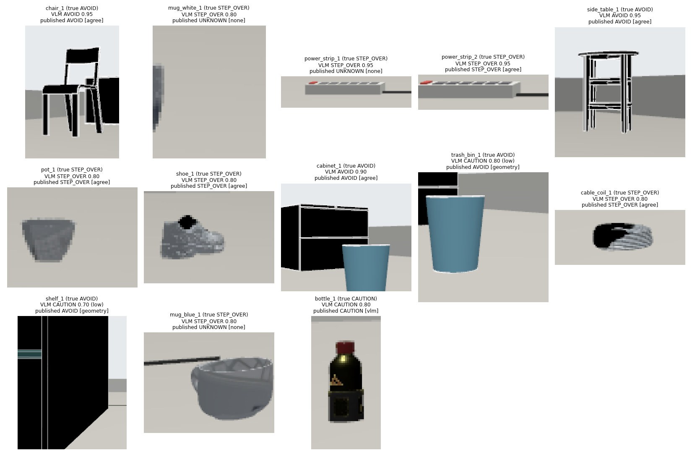

### Navigation trials (Phase 3)

Five trials per mode, alternating modes, seeds 1234–1238 (random spawn and three
goals each), 90 s per leg, RPP collision detection on. Full tables:
[stats.md](semantic/trials/stats.md), [per_trial.md](semantic/trials/per_trial.md),
[semantic.md](semantic/trials/semantic.md).

| Per trial, mean ± SD | `baseline` | `traversability` | `traversability_semantic` |
|---|---|---|---|
| Goals reached (of 3) | 2.80 ± 0.45 | 1.80 ± 1.30 | 2.40 ± 0.89 |
| SPL | 0.88 ± 0.15 | 0.57 ± 0.41 | 0.75 ± 0.29 |
| Nav2 collision aborts | 0.2 ± 0.4 | 5.0 ± 10.6 | 2.6 ± 4.7 |
| Trunk hits | 0.6 ± 0.9 | 0.2 ± 0.4 | 1.0 ± 2.2 |
| Foot strikes on step-over items | 3.8 ± 4.2 ⚠ | 2.6 ± 4.8 | 3.4 ± 4.1 |
| Step-over cells entered by the body centre (median) | 4 | 0 | 0 |

⚠ **Baseline foot numbers in this table are confounded.** The sim bridge kept
the last `/gait/command` between trials, and baseline (no gait supervisor) ran
right after `traversability_semantic`: baseline trials 2, 3 and 4 walked the whole
trial with the `STOP` lift (0.12 m) instead of `NORMAL` (0.04 m). Foot strikes and
foot clearance for baseline here do not describe the baseline gait. Goals, SPL,
aborts and paths are unaffected (the legs are kinematic and do not steer).
Part 1's baseline trials all ran `NORMAL` and are clean. `run_all.sh` now resets
the gait to `NORMAL` before every trial; Part 3 Phase 4 uses re-run baselines.

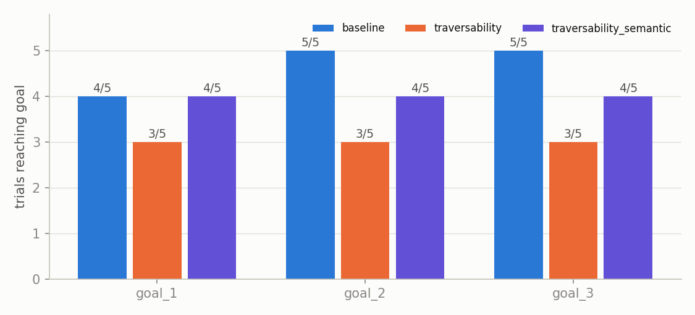

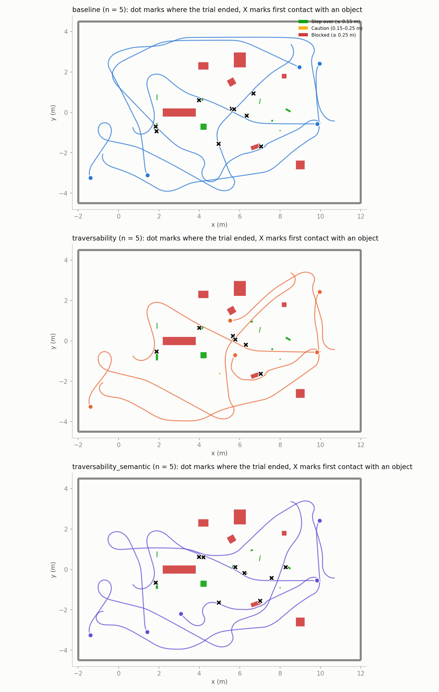

Labels published during the trials, one vote per object per trial (the label it
held longest):

| true \ published | STEP_OVER | CAUTION | AVOID | UNKNOWN |
|---|---|---|---|---|
| STEP_OVER | 20 | 0 | 0 | 7 |
| CAUTION | 0 | 0 | 0 | 3 |
| AVOID | 0 | 0 | 17 | 3 |
| no object (false detection) | 0 | 1 | 2 | 5 |


*Local costmap during a semantic trial. Solid red: semantic `AVOID` marks as
oriented rectangles; dashed blue: true objects. `STEP_OVER` marks add no cost.*

### Findings and limits

- **Disc marks blocked passages (fixed).** The first semantic trial got stuck
  between the file cabinet and the wall: RPP aborted 9 times ("detected
  collision ahead"). `AVOID` objects were marked as a lethal disc of the box's
  half-diagonal, much larger than a long object. Marks are now the box's oriented
  rectangle; the same seed then reached all three goals with 0 aborts. The batch
  above ran after the fix.
- **The toolbox (0.30 m) is missed by every mode.** In seed 1235 the body hit
  `toolbox_1` in all three modes (baseline included). LiDAR never measured its
  height, so the fused track had no band; the VLM saw it 6 s before contact but
  said `CAUTION` ("20 cm"), which rule 4 rejects for an unmeasured object. This
  is a perception gap in the shared stack, not in the semantic layer, and is open.
- **The VLM echoes the detector's class.** A false YOLO "person" on the floor was
  confirmed by the VLM as a person (`AVOID`, 0.95). A false "airplane" got 0.10
  confidence and was ignored. Wrong detections lead to over-caution, not to
  unsafe labels, in these trials.
- **Many low objects stay `UNKNOWN`.** The VLM's `STEP_OVER` is not trusted
  without a LiDAR height; those objects still get the height band layer's cost.
- **n = 5 per mode** is enough to find failures, not to rank the modes.

### llava:7b comparison

Raw `qwen2.5vl` failed the "0 unsafe labels" check in the live trials (5 tall
objects called low, 2 of them `STEP_OVER`), so `llava:7b` was tried on the same
30 offline frames. Data: [semantic/llava/vlm_eval.md](semantic/llava/vlm_eval.md).

| Same 28 crops | `qwen2.5vl` | `llava:7b` |
|---|---|---|
| VLM alone: accuracy | **0.89** | 0.39 |
| VLM alone: tall called low | 3 (`CAUTION`) | **0** |
| VLM alone: true step-over items called `STEP_OVER` | **17 of 17** | 0 of 17 (16 `CAUTION`) |
| Published label: accuracy | **0.82** | 0.36 |
| Published label: tall called low | 0 | 0 |
| Median latency | **1.1 s** | 1.8 s |

`llava:7b` is safe only because it calls everything low `CAUTION`. Published,
every walkable item would cost 200 and the robot would route around all of them.
Since the published `qwen2.5vl` labels are already at 0 unsafe, `qwen2.5vl`
stays the default. `model: llava:7b` in `ollama.yaml` switches it.

### Reproduce

```bash
# WSL; sim and Nav2 containers as in gazebo.md
python3 tests/traversability/eval_vlm_frames.py --world gazebo/worlds/cluttered_items.json \
    --out /tmp/vlm_eval --frames 30 RUN_DIR [RUN_DIR ...]
MODES="baseline traversability traversability_semantic" SEED=1234 TIMEOUT=90 \
    tests/traversability/run_all.sh RESULTS "1 2 3 4 5"
python3 tests/traversability/analyze.py RESULTS OUT gazebo/worlds/cluttered_items.json
python3 tests/traversability/analyze_semantic.py RESULTS OUT gazebo/worlds/cluttered_items.json
```

Hardware: none of this runs on the robot yet. `gait_supervisor` and
`vlm_heuristic_node` take `backend: gazebo` only; `sport_client` raises
`NotImplementedError` (Phase 2 hardware work).

## Part 3: Hardware readiness (in progress)

Work after Part 2 to bring the simulation in line with the real Go2 before
hardware trials. Status as of 2026-11-08.

### MPPI step-over critic: built, null result on these routes

`src/legged_mppi_critic` (`mppi::critics::StepOverCritic`) rewards MPPI
trajectories by the number of distinct step-over cells they cross (weight 0.2).
It builds against `nav2_mppi_controller` 1.1.20, which is only in the `go2-3d`
image, so MPPI trial modes run `controller_server` in a `go2-3d` container
(`tests/traversability/run_all.sh`, `CONTROLLER_EXTERNAL`). The trial modes in
Parts 1 and 2 use RotationShim + RPP, which has no critics.

| Seed 1234 | MPPI | MPPI + StepOverCritic |
|---|---|---|
| Critic cost band 30–60 (first run): goals / step-over cells crossed / foot strikes on low items | 3/3 · 0 · 0 | 3/3 · 0 · 1 |
| Critic cost band 38–42 (only the height band's cost 40): same | 3/3 · 0 · 0 | 3/3 · 0 · 0 |

The 30–60 band also matched the inflation layer's falloff next to obstacles, so
it was narrowed to 38–42. Neither run crossed a step-over cell: this route does
not force a step-over decision, so the critic's value is unmeasured here.

### Step-over band narrowed to the real foot lift

The Go2 SDK's `FootRaiseHeight` tops out at about 0.12 m, so the height bands are
now step over ≤ 0.12 m, caution 0.12–0.22 m, lethal ≥ 0.22 m (HeightBandLayer,
fusion, labeller, analysis), with `min_range: 0.25` on the layer. The shoe
(0.124 m), plastic cup (0.13 m) and white mug (0.115 m, inside the 2 cm margin
of the lift) are CAUTION in the world truth. Gait: `HIGH_STEP` up to 0.10 m (the
0.12 m lift minus a 2 cm margin; a floating-point bug that sent 0.10 m to
`CAREFUL` was fixed), `CAREFUL` above that, `STOP` from 0.25 m.

Raw costs from a synthetic-cloud check (`tests/traversability/height_band_check.py`):

| Object height | HeightBandLayer alone | Whole local costmap |
|---|---|---|
| 0.10 m | 40 | 40 |
| 0.14 m | 200 | 200 |
| 0.20 m | 200 | 254 |
| 0.30 m | 254 | 254 |

The nominal caution band is 0.12–0.22 m, but the obstacle_layer's
`min_obstacle_height: 0.15` makes the effective caution band 0.12–0.15 m.
This is intentional: anything ≥ 0.15 m is beyond the SDK's 12 cm foot lift and
should not be considered passable regardless of semantic label.

### Semantic fusion (final)

- **Height from LiDAR, meaning from the VLM.** With a LiDAR height, the published
  label is the more severe of the LiDAR band (40 / 200 / 254) and the VLM label:
  VLM AVOID → 254, CAUTION → 200, STEP_OVER → 40. The VLM's own height estimate
  is not used: with the band at 0.12 m its usual "15 cm" guess turned low items
  into CAUTION and blocked passages.
- **Two-signal lethal rule.** A VLM AVOID is lethal only when LiDAR measured the
  object. With no LiDAR height, any VLM label is published as CAUTION (200),
  flagged `low_confidence`, and the gait is at least `CAREFUL`. A single signal
  never makes a cell lethal, and an unmeasured object is never assumed to be clutter.
- **Unsafe-label metric counts measured objects only.** An unmeasured tall object
  held at CAUTION is the rule working, not a safety failure; such objects are
  reported separately (`unmeasured_objects`, `unmeasured_tall_held_at_caution`).
- **Layer placement.** Semantic mode differs from traversability mode by adding
  semantic information to *both* planning (global) and control (local). This
  reflects the proposal's claim that semantic reasoning should drive global
  re-routing, not only local speed modulation. With the layer in the local
  costmap only, the global plan ran through lethal semantic marks and RPP
  aborted on them ("detected collision ahead!") instead of anything routing
  around. Trial-mode costmaps now:

| Mode | Global costmap | Local costmap |
|---|---|---|
| `baseline` | obstacle, inflation | obstacle, inflation |
| `traversability` | obstacle, inflation | obstacle, height band, inflation |
| `traversability_semantic` | obstacle, **semantic**, inflation | obstacle, height band, semantic, inflation |

- A fragile low object was added to the world: `laptop_1`, 0.06 m, on the fixed
  route at (7.0, −0.05). The height band alone would call it step over.
- `/gait/status` reports `backstop_raised` when the costmap backstop lifts the
  gait above what the boxes asked for.

### Phase 2 attempts on the fixed route

One trial per mode each time; `baseline` and `traversability` reached 3/3 in every attempt.

| Attempt | Change | `traversability_semantic` goals | RPP collision aborts | What blocked it |
|---|---|---|---|---|
| 1 | Band 0.12 m, VLM height guess raises the label | 0/3, then 1/3 | 12 (repeat) | "Starting point in lethal space" by the shelf; false YOLO "person" on the shoe confirmed by the VLM |
| 2 | Height from LiDAR only, no class hint, laptop added; semantic local only | 1/3 | 11 | AVOID marks on the laptop (correct), blue mug ("furniture"), plant pot ("basketball hoop") at x ≈ 6–7.6 m; global plan ran through them |
| 3 | Semantic in both costmaps, two-signal lethal, class hint as verification | 2/3 | 10 | VLM answered "detector wrong" on 45 of 46 crops and AVOID on 43: the measured cable coil, saucer and power strip became lethal; aborts at (5.31, −0.36) ×5 by `cable_coil_1` |

Attempt 3 per object: laptop never measured by LiDAR and the VLM answer below
`confidence_min`, so UNKNOWN; toolbox (0.30 m, unmeasured) held at CAUTION;
backstop 7 episodes; 0 unsafe labels on measured objects, 4 unmeasured objects.
Phase 2 is closed here: implemented, VLM accuracy insufficient for
safety-critical use.

### VLM prompt selection

Three prompts on the same 30 saved frames (28 crops of 13 objects, truth with
the 0.12 / 0.22 m bands), `qwen2.5vl`, `tests/traversability/eval_vlm_frames.py --prompt`.
Per-prompt confusion matrices: [verify_oneword](semantic/prompt_selection/verify_oneword.md),
[verify_defs_first](semantic/prompt_selection/verify_defs_first.md),
[object_first](semantic/prompt_selection/object_first.md).
Rule set before running: the lowest AVOID-on-low-items rate with 0 unsafe
answers wins, and the winner ships even if none passes.

| Prompt | AVOID on true step-over crops | VLM accuracy | VLM tall-called-low (of which STEP_OVER) | Published accuracy | Published unsafe | Median latency |
|---|---|---|---|---|---|---|
| `verify_oneword`: detector class to verify, one-word answer | **2 / 14** | **0.68** | 1 (1) | **0.71** | 0 | 2.1 s |
| `verify_defs_first`: definitions first, class as a suggestion, JSON | 9 / 14 | 0.43 | 1 (1) | 0.54 | 0 | 1.0 s |
| `object_first`: no class, name then label, JSON | 3 / 14 | 0.46 | 3 (0) | 0.64 | 0 | 1.0 s |

None reached 0 unsafe raw answers. **`verify_oneword` ships** (`PROMPT_ID` in
`scripts/nodes/semantic_labeler.py`): lowest AVOID-on-low rate, tied lowest
unsafe count. Its one STEP_OVER on a tall object is caught by the LiDAR floor,
so the published labels stay at 0 unsafe. A one-word answer carries no
confidence (scored 1.0), so `confidence_min` does not filter its answers. The
earlier 0.89 (Part 2) was a different prompt and the 0.15 / 0.25 m bands; the
numbers are not comparable. Best available with a 7B model on these crops.

### Semantic mode: what it does and does not establish

The semantic layer is integrated end-to-end: `SemanticCostmapLayer` loads in
both global and local costmaps, the two-signal lethal rule prevents single-
source escalations, and unmeasured objects are held at CAUTION. What the sim
does not establish is that the semantic layer improves navigation. Across
three Phase 2 attempts, the VLM's classification accuracy on Gazebo-rendered
crops of small objects (mugs, pots, cable coils) was insufficient to drive
routing decisions: misclassifications either closed low-clutter corridors or
produced RPP aborts. The architecture is sound; the perception input is not
yet reliable enough for safety-critical use. Improving VLM accuracy (larger
model, better crops, or a fine-tuned classifier) is future work and does not
block the hardware trial, which tests the height-band and backstop stack.

### Backstop measurement (Phase 3)

The gait comes from the fused 3D boxes; with `backstop_enabled` it is never lower
than what the local costmap ahead calls for, so an object the camera missed
still raises the feet. Measured on the fixed route (about ten low items),
`traversability` with the backstop off and on, three pairs in alternating order.
A gait sample "needs care" when the true objects in the 1.5 m corridor call for
anything but `NORMAL`. A `NORMAL` sample there is split by why:

- **Costmap saw it** (`costmap_gait` not `NORMAL`) and the gait stayed `NORMAL`:
  a backstop failure. Target 0 with the backstop on.
- **Unseen** by both the costmap and the camera: a perception gap, reported only.

Data: [results/phase3_backstop/](results/phase3_backstop/trials.csv).

| Trial | Backstop | Goals | Care-needed samples | NORMAL, costmap saw it | NORMAL, unseen | Backstop raised the gait |
|---|---|---|---|---|---|---|
| 1 | off | 3/3 | 453 | 77 | 9 | — |
| 1 | on | 3/3 | 504 | **0** | 3 | 276 |
| 2 | off | 0/3 | 865 | 0 | 0 | — |
| 2 | on | 3/3 | 460 | **0** | 7 | 232 |
| 3 | off | 3/3 | 504 | 140 | 3 | — |
| 3 | on | 3/3 | 501 | **0** | 4 | 217 |
| **Total** | **off** | 6/9 | 1822 | **217 (11.9 %)** | 12 (0.7 %) | — |
| **Total** | **on** | 9/9 | 1465 | **0 (0 %)** | 14 (1.0 %) | 725 |

The backstop is validated: with it on, the gait never stayed `NORMAL` while the
costmap had something in the corridor (0 of 1465 samples), against 217 of 1822
with it off. What remains with it on (14 samples, 1 %) is objects neither sensor
saw, a perception limitation rather than a backstop failure: the keyboard
(0.024 m) is 4 mm above the 0.02 m ground tolerance, and the book (0.051 m) is
rarely resolved. Off-trial 2 stalled by the bookshelf ("Starting point in lethal
space!" ×14, the planner limitation seen before; the gait is `dry_run` and does
not steer), so it adds no costmap-saw samples. An earlier seeded check (seed
1234, one pair) is not comparable: with the backstop off the path never put an
object in the corridor, and all 33 `NORMAL` samples with it on were the book
and keyboard, unseen.

### Safety-metric trial matrix (Phase 4)

Ten trials per mode, seeds 1234–1243 (same seeds across modes), modes in
alternating order, 90 s per leg. Navigation efficiency is not the metric of
interest; this trial validates the safety stack, and goals and path are given
for completeness only. Full tables: [safety.md](results/phase4/safety.md),
[stats.md](results/phase4/stats.md), [semantic.md](results/phase4/semantic.md),
[per_trial.md](results/phase4/per_trial.md).

**Baseline was re-run.** In the first run, 5 of the 10 baseline trials walked
the whole trial with the 0.12 m lift (`CAREFUL` or `STOP`) left on the sim
bridge by the preceding `traversability_semantic` trial; baseline runs no gait
supervisor. `run_all.sh` now resets the gait to `NORMAL` before every trial, and
all 10 re-run baselines ran `NORMAL`. With the clean baseline its foot numbers
got worse, as expected for a 0.04 m lift:

| Baseline | Goals | Foot strikes per metre (median) | Strikes on step-over items (total) | Clearance on items ≤ 0.10 m |
|---|---|---|---|---|
| First run (confounded) | 27/30 | 0.30 | 27 | 21/56 (38 %) |
| Re-run (`NORMAL` throughout) | 27/30 | 0.24 | 34 | **15/58 (26 %)** |

| Safety metric | `baseline` | `traversability` | `traversability_semantic` |
|---|---|---|---|
| Unsafe published labels, LiDAR-measured | n/a | n/a | **0** of 149 trial-objects |
| NORMAL while the costmap saw something (backstop failure) | n/a | **0** of 2359 | **0** of 3534 |
| NORMAL, unseen by costmap and camera (perception gap) | n/a | 86 of 2359 (3.6 %) | 23 of 3534 (0.7 %) |
| Foot clearance on items ≤ 0.10 m | 15/58 (26 %) | **25/47 (53 %)** | 15/37 (41 %) |
| … of which under `HIGH_STEP` | — | 10/13 | 2/3 |
| Foot strikes per metre, median [IQR] | 0.24 [0.16–0.35] | 0.23 [0.04–0.40] | 0.24 [0.03–0.43] |
| Trunk hits, median | 0 | 0 | 0 |
| Backstop raised the gait, samples per trial (median) | — | 197 | 232 |
| RPP collision aborts, median (known limitation) | 0 | 0.5 | 1.5 |
| Goals reached (completeness) | 27/30 | 25/30 | 21/30 |
| Path per trial, m, median (completeness) | 19.7 | 18.7 | 16.1 |

Semantic log: 426 VLM requests, 0 failed, median 2.1 s; 55 trial-objects had no
LiDAR height (4 of them tall, held at CAUTION by the two-signal rule); the raw
VLM answered `STEP_OVER` on a tall measured object 6 times, all caught by the
LiDAR floor.

Pairwise tests (significant only with p < 0.05 and Cohen's h > 0.2 or r > 0.1;
backstop samples are not compared, since baseline has no gait supervisor):

| Comparison | Metric | p | Effect | 95% CI of difference | Significant |
|---|---|---|---|---|---|
| `traversability` vs `baseline` | Foot clearance ≤ 0.10 m | 0.008 | h = +0.57 | +0.09 to +0.46 | **yes** |
| `traversability` vs `baseline` | Foot strikes per metre | 0.761 | r = 0.08 | −0.27 to +0.24 | no |
| `traversability` vs `baseline` | Goals reached | 0.704 | h = −0.20 | −0.24 to +0.10 | no |
| `traversability_semantic` vs `baseline` | Foot clearance ≤ 0.10 m | 0.202 | h = +0.31 | −0.05 to +0.34 | no |
| `traversability_semantic` vs `baseline` | Foot strikes per metre | 0.849 | r = 0.05 | −0.27 to +0.26 | no |
| `traversability_semantic` vs `baseline` | Goals reached | 0.107 | h = −0.52 | −0.40 to −0.00 | no |
| `traversability_semantic` vs `traversability` | Foot clearance ≤ 0.10 m | 0.351 | h = −0.25 | −0.34 to +0.09 | no |
| `traversability_semantic` vs `traversability` | Goals reached | 0.360 | h = −0.32 | −0.34 to +0.08 | no |

Path walked and step-over cells entered: no comparison significant (all p > 0.2).

What n = 10 establishes: the height-band and gait stack clears low items more
often than the low-stepping baseline (53 % vs 26 %, p = 0.008, h = 0.57).
Nothing else differs significantly, including foot strikes per metre and goals.
The validated safety claims are within-mode and hold at n = 10: 0 unsafe
published labels on measured objects, and 0 backstop failures in 5893
care-needed samples. `HIGH_STEP` cleared 12 of 16 passes; the misses ended about
2 cm below the item top (foothold landing, see below). The MPPI critic is not a
comparison arm; its two single-trial checks are in the MPPI section above.

### Known limitations

- Blue mug (0.095 m) was cleared on 0 of 3 HIGH_STEP passes despite 12 cm
  clearance being sufficient. Cause: foothold landing inside footprint, not lift
  height. Foothold margin may need widening; deferred to hardware trial.
- Toolbox (0.30 m) missed by every mode in seed 1235 (Part 2).
- MPPI step-over critic: no measurable effect on the routes tried.

## Appendix: First version on plain shapes (`cluttered_nav_test`)

A Gazebo arena of low and tall clutter, and the results of running Nav2 through
it with and without the traversability stack: the height costmap layer, the
camera + LiDAR 3D boxes, and the gait supervisor in `dry_run`
(5 trials each, 2026-11-06).

### Results at a glance

| | `baseline` (n = 5) | `traversability` (n = 5) | p |
|---|---|---|---|
| Goals reached (3 per trial) | **15 / 15** | 12 / 15 | 0.22 (Fisher, per leg) |
| Time per reached goal (median) | 51 s | 52 s | |
| SPL (1 = shortest path, every goal) | 0.91 ± 0.03 | 0.75 ± 0.19 | 0.13 |
| Contact episodes per trial | 5.8 ± 2.1 | 4.8 ± 2.4 | 0.50 |
| Nav2 "collision ahead" aborts per trial | 3.4 ± 1.3 | 4.6 ± 2.4 | 0.37 |
| Closest to a tall object or wall | 0.02 m | 0.14 m | |

Mean ± SD over trials; p from Welch's t-test unless noted. No navigation
difference reaches p < 0.05 with 5 trials per mode.

| Fusion, traversability trials only | Result |
|---|---|
| Height error of the best track per object (median, n = 72) | **1.8 cm** |
| Low objects known before first contact | **12 of 14** contacts, median 19 s ahead |
| Height band right, all final tracks (n = 139) | 93 of 139 (67 %) |
| Unsafe labels: a taller object's track marked lower than it is | **13 tracks, in all 5 trials** |

**In short: the fusion can see and measure low obstacles before the robot reaches
them, which plain Nav2 cannot do, but it is not ready to drive a gait.** It adds
no navigation benefit yet, and the traversability stack reached fewer goals,
though not significantly. Its tracks include repeatable false "step over" labels
on tall objects, which must be fixed before any test on the real dog. This
simulator cannot show stepping at all: the legs are fixed and the body glides.

---

### The world

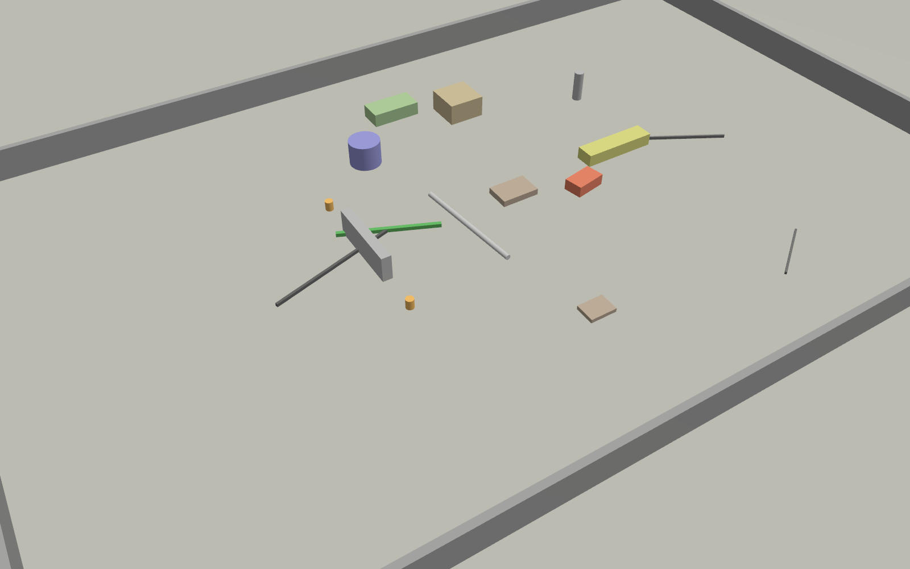

*Rendered by Gazebo
(`CAM_OVERVIEW=... ./gazebo/worlds/render_world.sh cluttered_nav_test`).*

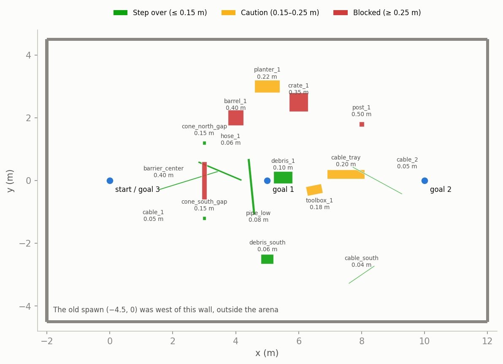

*Floor plan from the world file. Color is the height band, also named in the
legend. The heights are true object tops.*

- **14 × 9 m walled arena,** walls 0.5 m tall. The world expects the spawn at
  (0, 0): `SIM_SPAWN="0 0 0"`. The default spawn (−4.5, 0) is outside the wall.
- **16 objects in three height bands:**
  - step over (≤ 0.15 m): cables, a hose, a pipe, debris, two cones;
  - caution (0.15–0.25 m): a toolbox, a cable tray, a planter;
  - blocked (≥ 0.25 m): a barrel, a crate, a post, a central barrier.
- **A 1.2 m barrier at x = 3** forces a choice of north or south gap.
- **Plain shapes, no textures.** That matters for the camera: see
  [What a stock YOLO model sees](#what-a-stock-yolo-model-sees).

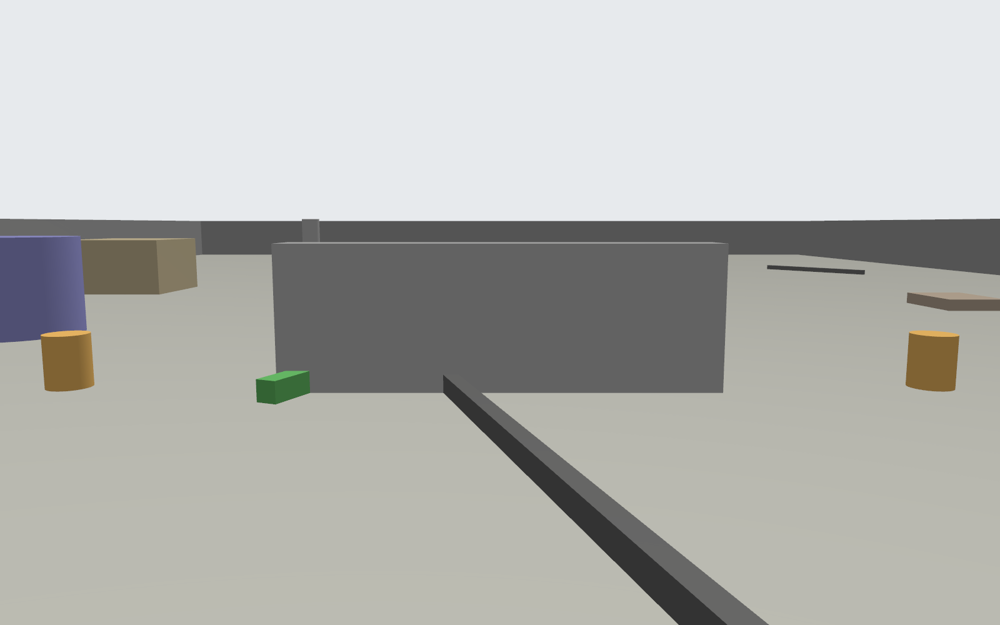

#### Use it

```bash
GO2_HOST_IP=127.0.0.1 SIM_ARM=0 SIM_WORLD=cluttered_nav_test SIM_SPAWN="0 0 0" \
    SIM_CAMERA=1 SIM_CONTACTS=1 ./gazebo/run_sim.sh up
tests/traversability/run_all.sh RESULTS_DIR "1 2 3 4 5"
```

### The concept under test

The front camera says what an object is. The LiDAR says where it is and how tall
it is. Together they give a 3D box, and the box height picks the gait.

1. **2D detection:** YOLO's boxes on `/yolo/detections`. In this sim a stand-in
   supplies them (below).
2. **3D box:** [`object_box_fusion.py`](../../scripts/nodes/object_box_fusion.py)
   projects the last 15 self-filtered LiDAR scans into the image, keeps the points
   inside the 2D box and above the floor, clusters them in the floor plane and
   fits a box to the nearest cluster.
3. **Band:** step over, caution, blocked, or unknown when too few points hit it.
4. **World-fixed tracks,** so an object is still known when it has left the camera's
   view under the nose.
5. **Gait:** [`gait_supervisor.py`](../../scripts/nodes/gait_supervisor.py) takes the
   tallest object in the 1.5 m corridor ahead. It picks `HIGH_STEP` only if the
   raised foot (0.10 m) clears the object by 2 cm, otherwise `CAREFUL` or `STOP`.

Depth comes from the LiDAR cloud and not the costmap, because a 2D costmap has no
height.

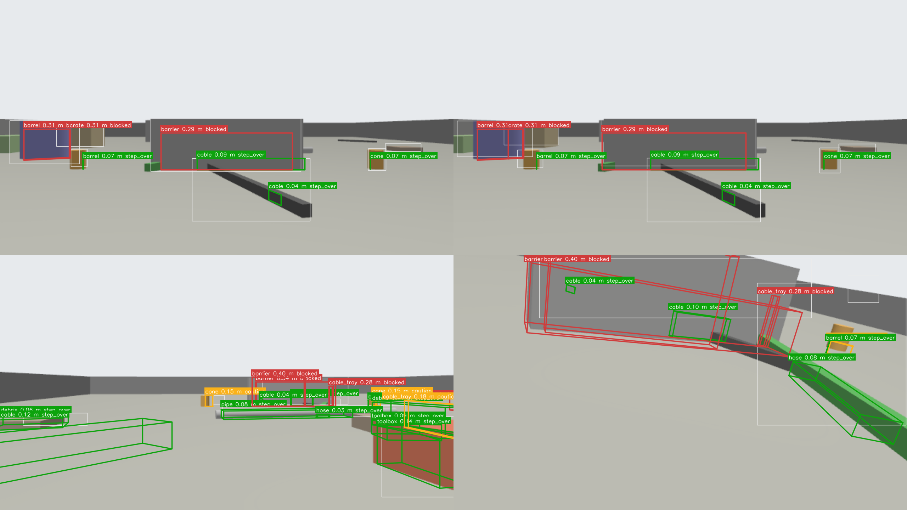

*Sim camera frames from traversability1. White: 2D detections. Colored wireframes:
fused 3D boxes, with class, height and band in the label (green step over, yellow
caution, red blocked). Good boxes sit beside bad ones here: "barrel 0.07 m
step_over" is the cone standing in front of the barrel, and the second "toolbox"
track is too low. See [Fusion errors](#fusion-errors).*

#### The detector is a stand-in

[`sim_box_detector.py`](../../scripts/nodes/sim_box_detector.py) is **not a vision
model**. It reads each object's true class and shape from the world file and
projects it into the camera, with 3 px of noise, a 6 m limit and a check for
objects hidden behind taller ones. It behaves like a perfect custom-trained
detector, so these results test the steps after the detector and say nothing about
detection itself.

#### What a stock YOLO model sees

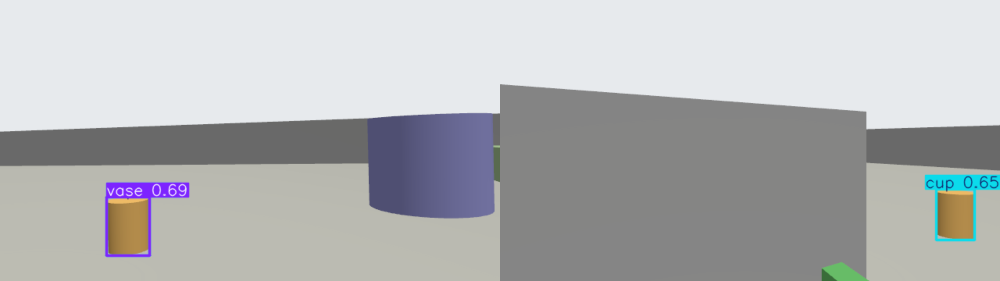

*The real YOLO11s (COCO) over the same frames, confidence 0.25.*

Over 216 frames from traversability1, stock YOLO11s reported 42 detections on 29
frames, **none of them a real class in this world**: cup 13, vase 10, airplane 10,
then single labels such as tv, bench and person. The cones became cups and vases.
COCO has no cable, hose, pipe or debris class, so the real system needs a
custom-trained model. It should also expect false labels on simple shapes.

### How it was tested

Trials alternated, baseline1, traversability1, baseline2 and so on, with the robot
reset to (0, 0) by Gazebo between trials. Both modes:

- Nav2 with the values of go2-nav2-wifi's 3D launch files: lattice planner, Regulated
  Pure Pursuit, full footprint, **collision detection on**;
- the URDF self-filter on, removing about 690 of the robot's own points per scan;
- commands through the same `go2_cmd_vel_tcp.py` TCP path the real robot uses;
- camera on, 5 Hz LiDAR, contact sensors on, about 0.79× real time.

| | `baseline` | `traversability` |
|---|---|---|
| Global costmap | obstacles, inflation | the same |
| Local costmap | obstacles, inflation | adds `HeightBandLayer` |
| 3D boxes and gait supervisor | off | on, `dry_run` |

In `dry_run` the gait is only recorded, so **it cannot change the robot's motion**.
Any difference in navigation comes from the height layer or chance.

Goals are (5, 0), (10, 0), then back to (0, 0), sent once to `/goal_pose`. A leg is:

- **reached** within 0.5 m;
- **timeout** after 120 s;
- **stuck** with less than 0.15 m of progress in 45 s.

The active path is cancelled when a leg ends. A leg that stops early is re-sent
after 8 s without motion.

[`analyze.py`](../../tests/traversability/analyze.py) scores every trial against
the world file, so both modes are measured the same way:

| Metric | How |
|---|---|
| Contact | Gazebo contact sensors. An episode is a touch with gaps under 2 s |
| SPL | Reached × shortest ÷ max(walked, shortest), mean over legs. Shortest path keeps 0.3 m from objects taller than 0.15 m |
| Closest approach | The 0.70 × 0.31 m body against objects taller than 0.15 m and walls |
| Box error | Final track of the object's class nearest the true object |
| Track audit | Every final track, duplicates included, against the nearest object of its class |
| Right gait | The gait rule applied to the true objects in the same corridor |

### Results

#### Navigation

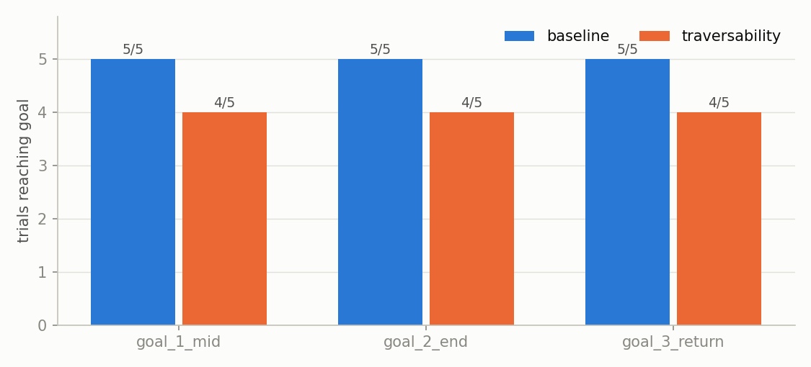

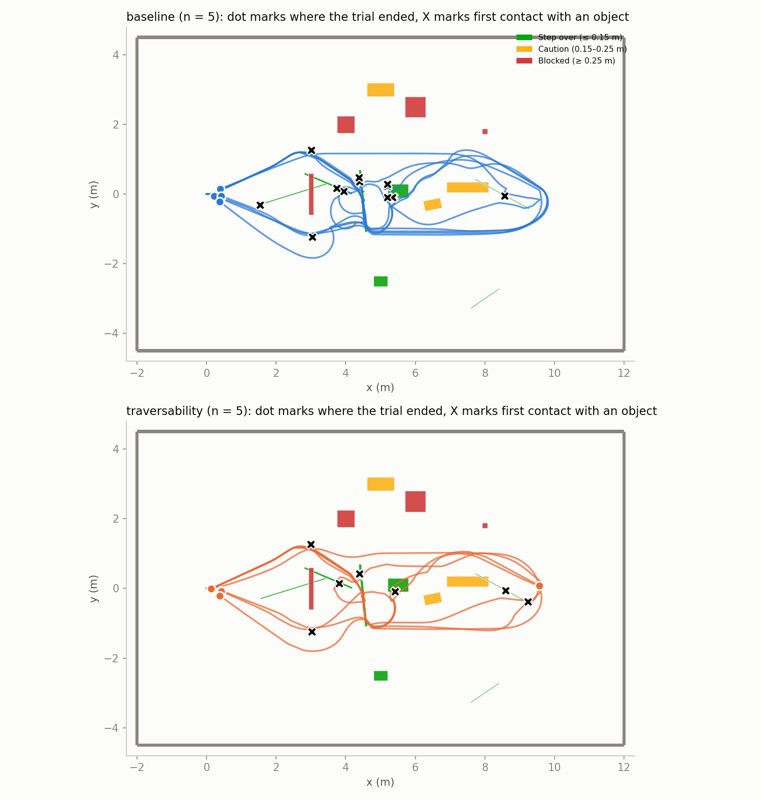

*Both modes take the same routes around the barrier, because the global costmap is
the same. The low objects under those routes are not avoided.*

- **Baseline reached every goal.** Plain Nav2 can complete this course.
- **The traversability trials failed 3 legs:**

  | Trial | Leg | Ended at | Nav2's message |
  |---|---|---|---|
  | traversability1 | goal 1 | (3.66, −0.03) | *collision ahead*, 3 times |
  | traversability2 | goal 2 | (5.19, −0.20) | *collision ahead*, 5 times |
  | traversability5 | goal 3 | (9.57, 0.08) | *no valid path*, 5 times |

  The difference is not significant (p = 0.22), and the cause is not established.
  The third failure is in the planner, whose configuration is the same in both modes.
- **Contacts did not drop,** as expected: the gait is `dry_run` and the routes are the
  same.
- **Both modes pushed over low objects.** Obstacle-layer points below 0.15 m are
  ignored, so Nav2 drives into them. The glide body rides over them instead of
  stopping, which the real dog may not do.

#### Seeing objects before contact

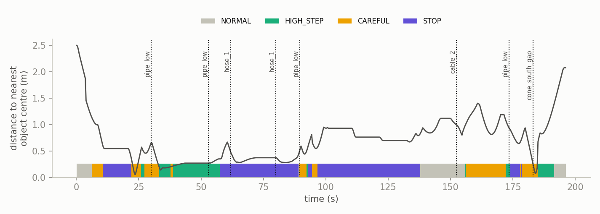

*traversability1. Line: distance to the nearest object's centre. Band along the
bottom: gait chosen. Dotted lines: contacts.*

Of the 14 first contacts with an object in the traversability trials, the object
already had a track in **12**. It was first placed 1.8–3.2 m away, a median of 19 s
before contact. Baseline has no such warning for anything under 0.15 m. The two
misses were `hose_1` and the thin `cable_2` in traversability1.

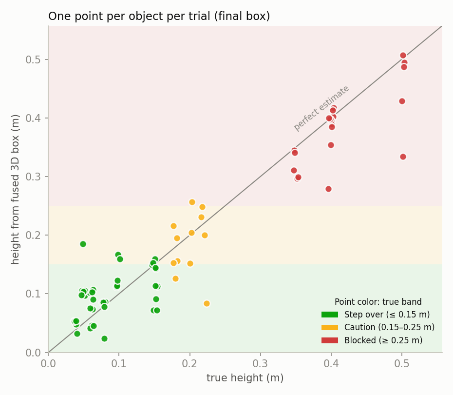

- **Heights are close where the object is seen well:** median error 1.8 cm, mean 3.3 cm.
- **Positions are less good:** mean 25 cm. The LiDAR sees part of a long object, so
  the box centre sits on the visible part.
- **`cable_1` reads 0.10 m, not 0.05 m,** because it runs into the barrier.
- **`cable_2` was seen in only 1 of 5 trials,** and then at 0.19 m. At 3 cm wide, it
  gets few LiDAR hits.

#### Gait choice

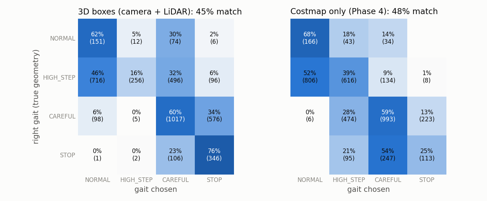

*Each row sums to 100 %. Right gait: the same rule on the true objects.*

| | 3D boxes | Costmap only |
|---|---|---|
| Exact match over all samples (n = 3958) | 45 % | 48 % |
| Exact match at the 14 first contacts, for the object touched | 5 / 14 | 8 / 14 |
| Chose `HIGH_STEP` when the foot would not clear (`CAREFUL` or `STOP` was right) | **7 of 2151 (0.3 %)** | **569 of 2151 (26 %)** |
| Chose `NORMAL` when `CAREFUL` or `STOP` was right | 99 of 2151 (4.6 %) | 6 of 2151 (0.3 %) |

- **The 3D boxes are not more accurate overall.** The exact-match scores are about
  equal.
- **They differ in the mistake they make.** The costmap has no height, so it often
  calls for a high step over things the foot cannot clear: all 3 `debris_1` contacts
  in that table. Boxes almost never do. In exchange, they more often miss an object
  and stay `NORMAL`.
- **At `pipe_low`, boxes chose `CAREFUL` in 5 of 5 contacts, which counts as a miss.**
  In each, the taller `debris_1` was in the same 1.5 m corridor, so the rule chose
  correctly by its own logic. The per-object score is the harsher of the two.

#### Fusion errors

The box score above uses only the best track for each object. Auditing every final
track shows more:

- **139 tracks over 5 trials,** about 28 per trial for 16 objects. One object often
  gets several tracks.
- **46 of 139 (33 %) have the wrong band.**
- **13 tracks are unsafe,** labelled lower than the true object, in all 5 trials:

  | Object | True height | Unsafe tracks | Typical reading |
  |---|---|---|---|
  | `barrel_1` | 0.40 m | 5 | 0.07 m, step over |
  | `toolbox_1` | 0.18 m | 5 | 0.09–0.13 m, step over |
  | `post_1` | 0.50 m | 2 | 0.02–0.17 m |
  | `planter_1` | 0.22 m | 1 | 0.08 m, step over |

The barrel is the clearest case. `cone_north_gap` stands in front of it, inside the
barrel's 2D box, and the fusion takes the cluster nearest the camera. So the cone's
points become a "barrel" 1.3 m from the real one. The others most likely come from
seeing only a low part of an object from far away, which was not confirmed
track by track. A better view at another position starts a new track, so a bad
early box stays.

### What this says

1. **The concept's first half works.** Camera + LiDAR can place and size low objects
   that Nav2 ignores, seconds before the robot reaches them. Nothing else in the stack
   provides that.
2. **Fusion is not ready to choose a gait on the real dog.** A tall object marked
   step over is the worst error it can make. The next fix is in fusion: reject boxes
   whose cluster fills only a small part of the 2D box, and merge duplicates.
3. **No navigation gain yet, and none was expected from these runs.** The gait is
   `dry_run`, and the global costmap stays free of the plugins, so routes do not
   change. The 3 failed legs need a closer look before more trials.
4. **`HIGH_STEP` lifts the foot to 0.10 m, and `CAREFUL` to 0.08 m.** So `CAREFUL` is
   the lower step, and neither clears `debris_1` (0.10 m) with a margin. The real
   foot height needs measuring on the robot, and `CAREFUL` needs a rethink.
5. **Stepping itself needs the real robot or a legged simulator.**

### Limits

- **Sim only.** The body glides with no gait and localization is perfect. No result
  here shows the dog stepping over anything.
- **The detector is perfect by construction,** apart from pixel noise. A real model
  will miss objects and add false ones, so real fusion results will be worse.
- **5 trials per mode in one world, from one spawn,** on a run where the sim was at
  about 0.79× real time while Nav2 runs on wall-clock time.
- **Not exercised here:** `SemanticCostmapLayer`, `vlm_heuristic_node` and
  `traversability_critic_node`. Boxes are JSON on `/objects/boxes_json`;
  `SemanticObstacle.msg` has no size fields yet.
- **Footprint checks treat objects as solid boxes,** and contact is on the lumped leg
  and body collision.

### Found along the way

- **Earlier trial numbers are withdrawn.** Runs before this report reached 0–1 of 3
  goals, wrongly suggesting Nav2 could not handle the clutter. They were invalid:
  - the robot spawned at (−4.5, 0), outside the closed arena;
  - Nav2's output was remapped to `/sim/cmd_vel`, where the sim bridge was publishing
    zeros at 20 Hz. The proper path is the `go2_cmd_vel_tcp.py` client;
  - collision detection was off, HeightBandLayer was in the global costmap, and goals
    were shortened after a failure, all against the project's rules;
  - "crossings" counted odometry samples, so a parked robot scored about 19 000.
- **`pipe_low` was a 0.94 m pole.** An SDF cylinder's axis is z, and the world had no
  roll on it. The LiDAR showed points up to 0.94 m. It stood beside goal 1 and caused
  freezes with no contact. A full 10-trial batch was discarded and rerun after
  the fix (`<pose>4.5 -0.2 0.04 1.5708 0 0.1</pose>`).
- **Self-hits are real.** About 690 points per scan are the robot itself. The URDF
  self-filter is the right fix, so these trials do not use `HeightBandLayer`'s
  `min_range` (default 0).
- **go2-nav2-wifi has HeightBandLayer in its global costmap.** Its working copy of
  `lidar3d_planner.yaml` has an uncommitted edit adding it, and the local costmap is
  copied from that file. These trials avoid it with their own configs in
  [`tests/traversability/`](../../tests/traversability/); the real launch files would
  not. That edit breaks the local-only rule and should be reverted.
- **The fused scores first looked better than they were.** The per-object score ignored
  duplicate tracks. Looking at the frames found the "barrel 0.07 m" error, and the
  track audit was added.

### Full statistics

Generated by `analyze.py`: [`stats.md`](../images/cluttered_nav/stats.md), [`trials.csv`](../images/cluttered_nav/trials.csv).

Per mode over trials: mean ± SD [min–max]; p from Welch's t-test.

| Metric | `baseline` (n=5) | `traversability` (n=5) | p (Welch t) |
|---|---|---|---|
| Goals reached (of 3) | 3.00 ± 0.00 [3.00–3.00] | 2.40 ± 0.55 [2.00–3.00] | 0.070 |
| Total time (s) | 160.74 ± 25.35 [133.40–187.80] | 153.70 ± 22.59 [132.80–191.80] | 0.655 |
| Distance walked (m) | 23.57 ± 1.12 [22.65–25.52] | 18.82 ± 5.73 [12.43–24.02] | 0.138 |
| SPL | 0.91 ± 0.03 [0.85–0.94] | 0.75 ± 0.19 [0.59–1.00] | 0.129 |
| Contact episodes | 5.80 ± 2.05 [4.00–9.00] | 4.80 ± 2.39 [2.00–8.00] | 0.498 |
| Objects touched | 3.60 ± 0.89 [3.00–5.00] | 2.80 ± 0.84 [2.00–4.00] | 0.182 |
| Nav2 collision aborts | 3.40 ± 1.34 [2.00–5.00] | 4.60 ± 2.41 [2.00–8.00] | 0.366 |
| Plans refused: start in lethal space | 0.00 ± 0.00 [0.00–0.00] | 0.00 ± 0.00 [0.00–0.00] |  |
| Goals re-sent | 3.40 ± 1.34 [2.00–5.00] | 5.00 ± 1.58 [3.00–7.00] | 0.124 |
| Closest to a tall object or wall (m) | 0.15 ± 0.07 [0.02–0.20] | 0.20 ± 0.05 [0.14–0.28] | 0.230 |
| Sim real-time factor | 0.79 ± 0.01 [0.78–0.80] | 0.78 ± 0.01 [0.77–0.79] | 0.262 |

`baseline` legs reached: 15/15

`traversability` legs reached: 12/15

Fisher exact, per leg: p = 0.224

### Per-trial results

| trial | mode | reached | time_s | walked_m | spl | contact_episodes | objects_hit | collision_aborts | start_in_lethal | resends | min_clear_tall_m | rtf |
|---|---|---|---|---|---|---|---|---|---|---|---|---|
| baseline1 | baseline | 3 | 175.5 | 23.28 | 0.924 | 9 | 5 | 4 | 0 | 4 | 0.02 | 0.798 |
| baseline2 | baseline | 3 | 133.4 | 23.05 | 0.929 | 4 | 3 | 2 | 0 | 2 | 0.184 | 0.795 |
| baseline3 | baseline | 3 | 133.9 | 22.65 | 0.929 | 4 | 3 | 2 | 0 | 2 | 0.197 | 0.787 |
| baseline4 | baseline | 3 | 173.1 | 23.34 | 0.936 | 6 | 4 | 5 | 0 | 5 | 0.17 | 0.783 |
| baseline5 | baseline | 3 | 187.8 | 25.52 | 0.853 | 6 | 3 | 4 | 0 | 4 | 0.18 | 0.779 |
| traversability1 | traversability | 2 | 191.8 | 24.02 | 0.667 | 8 | 4 | 6 | 0 | 5 | 0.14 | 0.789 |
| traversability2 | traversability | 2 | 149.1 | 12.9 | 0.591 | 3 | 2 | 8 | 0 | 7 | 0.278 | 0.771 |
| traversability3 | traversability | 3 | 142.3 | 21.1 | 1.0 | 5 | 3 | 4 | 0 | 4 | 0.17 | 0.793 |
| traversability4 | traversability | 3 | 152.5 | 23.65 | 0.908 | 6 | 3 | 3 | 0 | 3 | 0.204 | 0.783 |
| traversability5 | traversability | 2 | 132.8 | 12.43 | 0.593 | 2 | 2 | 2 | 0 | 6 | 0.224 | 0.771 |

### Graph data

The numbers behind each graph, also as CSV in [`docs/images/cluttered_nav/data/`](../images/cluttered_nav/data/), including every track in `tracks.csv` and every gait sample in `gait_samples.csv`.

#### Every leg (goals.png)

| trial | mode | goal | result | time_s | path_m | shortest_m | spl | resends |
|---|---|---|---|---|---|---|---|---|
| baseline1 | baseline | goal_1_mid | reached | 74.28 | 7.57 | 5.85 | 0.77 | 2 |
| baseline1 | baseline | goal_2_end | reached | 28.66 | 5.86 | 6.22 | 1.0 | 0 |
| baseline1 | baseline | goal_3_return | reached | 72.6 | 9.85 | 10.3 | 1.0 | 2 |
| baseline2 | baseline | goal_1_mid | reached | 50.81 | 7.38 | 5.85 | 0.79 | 1 |
| baseline2 | baseline | goal_2_end | reached | 37.0 | 5.17 | 5.24 | 1.0 | 1 |
| baseline2 | baseline | goal_3_return | reached | 45.55 | 10.5 | 10.45 | 0.99 | 0 |
| baseline3 | baseline | goal_1_mid | reached | 51.53 | 7.42 | 5.85 | 0.79 | 1 |
| baseline3 | baseline | goal_2_end | reached | 35.93 | 4.98 | 5.34 | 1.0 | 1 |
| baseline3 | baseline | goal_3_return | reached | 46.48 | 10.25 | 10.35 | 1.0 | 0 |
| baseline4 | baseline | goal_1_mid | reached | 34.83 | 5.28 | 5.85 | 1.0 | 1 |
| baseline4 | baseline | goal_2_end | reached | 79.57 | 7.52 | 6.22 | 0.83 | 3 |
| baseline4 | baseline | goal_3_return | reached | 58.66 | 10.54 | 10.35 | 0.98 | 1 |
| baseline5 | baseline | goal_1_mid | reached | 80.93 | 8.84 | 5.85 | 0.66 | 2 |
| baseline5 | baseline | goal_2_end | reached | 34.66 | 5.17 | 5.8 | 1.0 | 1 |
| baseline5 | baseline | goal_3_return | reached | 72.24 | 11.52 | 10.35 | 0.9 | 1 |
| traversability1 | traversability | goal_1_mid | stuck | 78.29 | 7.24 | 5.85 | 0.0 | 2 |
| traversability1 | traversability | goal_2_end | reached | 65.71 | 6.6 | 7.06 | 1.0 | 3 |
| traversability1 | traversability | goal_3_return | reached | 47.82 | 10.18 | 10.3 | 1.0 | 0 |
| traversability2 | traversability | goal_1_mid | reached | 53.07 | 7.56 | 5.85 | 0.77 | 1 |
| traversability2 | traversability | goal_2_end | stuck | 45.01 | 0.0 | 5.48 | 0.0 | 4 |
| traversability2 | traversability | goal_3_return | reached | 50.98 | 5.33 | 5.86 | 1.0 | 2 |
| traversability3 | traversability | goal_1_mid | reached | 44.97 | 5.28 | 5.85 | 1.0 | 2 |
| traversability3 | traversability | goal_2_end | reached | 51.98 | 6.01 | 6.22 | 1.0 | 2 |
| traversability3 | traversability | goal_3_return | reached | 45.32 | 9.81 | 10.3 | 1.0 | 0 |
| traversability4 | traversability | goal_1_mid | reached | 52.13 | 7.53 | 5.85 | 0.78 | 1 |
| traversability4 | traversability | goal_2_end | reached | 38.52 | 5.15 | 5.24 | 1.0 | 1 |
| traversability4 | traversability | goal_3_return | reached | 61.86 | 10.98 | 10.39 | 0.95 | 1 |
| traversability5 | traversability | goal_1_mid | reached | 51.63 | 7.51 | 5.85 | 0.78 | 1 |
| traversability5 | traversability | goal_2_end | reached | 36.13 | 4.92 | 5.24 | 1.0 | 1 |
| traversability5 | traversability | goal_3_return | stuck | 45.01 | 0.0 | 10.39 | 0.0 | 4 |

#### First contact with each object (trajectories.png)

| trial | mode | object | true_h | band | t_contact | right_gait | gait | costmap_gait | known | lead_s | lead_m | est_h |
|---|---|---|---|---|---|---|---|---|---|---|---|---|
| baseline1 | baseline | pipe_low | 0.08 | step_over | 30.0 | HIGH_STEP |  |  | False |  |  |  |
| baseline1 | baseline | hose_1 | 0.06 | step_over | 63.5 | HIGH_STEP |  |  | False |  |  |  |
| baseline1 | baseline | debris_1 | 0.1 | step_over | 81.7 | CAREFUL |  |  | False |  |  |  |
| baseline1 | baseline | cable_2 | 0.05 | step_over | 98.0 | HIGH_STEP |  |  | False |  |  |  |
| baseline1 | baseline | cone_north_gap | 0.15 | step_over | 164.9 | CAREFUL |  |  | False |  |  |  |
| baseline2 | baseline | pipe_low | 0.08 | step_over | 32.3 | HIGH_STEP |  |  | False |  |  |  |
| baseline2 | baseline | debris_1 | 0.1 | step_over | 51.0 | CAREFUL |  |  | False |  |  |  |
| baseline2 | baseline | cone_south_gap | 0.15 | step_over | 124.6 | CAREFUL |  |  | False |  |  |  |
| baseline3 | baseline | pipe_low | 0.08 | step_over | 32.8 | HIGH_STEP |  |  | False |  |  |  |
| baseline3 | baseline | debris_1 | 0.1 | step_over | 51.8 | CAREFUL |  |  | False |  |  |  |
| baseline3 | baseline | cone_south_gap | 0.15 | step_over | 124.2 | CAREFUL |  |  | False |  |  |  |
| baseline4 | baseline | cone_north_gap | 0.15 | step_over | 23.3 | CAREFUL |  |  | False |  |  |  |
| baseline4 | baseline | pipe_low | 0.08 | step_over | 30.6 | HIGH_STEP |  |  | False |  |  |  |
| baseline4 | baseline | debris_1 | 0.1 | step_over | 51.8 | CAREFUL |  |  | False |  |  |  |
| baseline4 | baseline | cable_1 | 0.05 | step_over | 172.2 | HIGH_STEP |  |  | False |  |  |  |
| baseline5 | baseline | pipe_low | 0.08 | step_over | 33.1 | HIGH_STEP |  |  | False |  |  |  |
| baseline5 | baseline | hose_1 | 0.06 | step_over | 71.7 | HIGH_STEP |  |  | False |  |  |  |
| baseline5 | baseline | debris_1 | 0.1 | step_over | 84.1 | CAREFUL |  |  | False |  |  |  |
| traversability1 | traversability | pipe_low | 0.08 | step_over | 29.9 | HIGH_STEP | CAREFUL | HIGH_STEP | True | 7.3 | 2.21 | 0.078 |
| traversability1 | traversability | hose_1 | 0.06 | step_over | 61.8 | HIGH_STEP | STOP | CAREFUL | False |  |  |  |
| traversability1 | traversability | cable_2 | 0.05 | step_over | 152.4 | HIGH_STEP | NORMAL | NORMAL | False |  |  |  |
| traversability1 | traversability | cone_south_gap | 0.15 | step_over | 183.1 | CAREFUL | CAREFUL | CAREFUL | True | 182.9 | 3.23 | 0.143 |
| traversability2 | traversability | pipe_low | 0.08 | step_over | 31.8 | HIGH_STEP | CAREFUL | HIGH_STEP | True | 7.5 | 2.24 | 0.086 |
| traversability2 | traversability | debris_1 | 0.1 | step_over | 51.3 | CAREFUL | CAREFUL | HIGH_STEP | True | 27.5 | 3.07 | 0.167 |
| traversability3 | traversability | pipe_low | 0.08 | step_over | 40.7 | HIGH_STEP | CAREFUL | HIGH_STEP | True | 15.9 | 1.84 | 0.086 |
| traversability3 | traversability | cable_2 | 0.05 | step_over | 82.9 | HIGH_STEP | CAREFUL | CAREFUL | True | 14.1 | 3.22 | 0.185 |
| traversability3 | traversability | cone_north_gap | 0.15 | step_over | 132.6 | CAREFUL | CAREFUL | CAREFUL | True | 132.4 | 3.23 | 0.159 |
| traversability4 | traversability | cone_north_gap | 0.15 | step_over | 23.0 | CAREFUL | STOP | CAREFUL | True | 22.8 | 3.22 | 0.144 |
| traversability4 | traversability | pipe_low | 0.08 | step_over | 30.7 | HIGH_STEP | CAREFUL | HIGH_STEP | True | 6.4 | 1.99 | 0.085 |
| traversability4 | traversability | debris_1 | 0.1 | step_over | 51.9 | CAREFUL | CAREFUL | HIGH_STEP | True | 27.6 | 2.69 | 0.159 |
| traversability5 | traversability | pipe_low | 0.08 | step_over | 30.2 | HIGH_STEP | CAREFUL | HIGH_STEP | True | 5.0 | 2.19 | 0.078 |
| traversability5 | traversability | debris_1 | 0.1 | step_over | 51.5 | CAREFUL | CAREFUL | HIGH_STEP | True | 27.4 | 3.11 | 0.123 |

#### Fused boxes per object (box_accuracy.png)

| object | class | true_h | true_band | seen_in_trials | mean_est_h | mean_err_xy | band_correct | mean_points |
|---|---|---|---|---|---|---|---|---|
| cable_1 | cable | 0.05 | step_over | 5/5 | 0.102 | 0.484 | 5/5 | 39.2 |
| hose_1 | hose | 0.06 | step_over | 4/5 | 0.101 | 0.263 | 4/4 | 36.8 |
| pipe_low | pipe | 0.08 | step_over | 5/5 | 0.072 | 0.286 | 5/5 | 36.4 |
| debris_1 | debris | 0.1 | step_over | 5/5 | 0.135 | 0.227 | 3/5 | 17.0 |
| toolbox_1 | toolbox | 0.18 | caution | 5/5 | 0.169 | 0.215 | 4/5 | 50.0 |
| cable_tray | cable_tray | 0.2 | caution | 3/5 | 0.204 | 0.245 | 2/3 | 129.0 |
| cable_2 | cable | 0.05 | step_over | 1/5 | 0.185 | 0.413 | 0/1 | 33.0 |
| barrel_1 | barrel | 0.4 | blocked | 5/5 | 0.373 | 0.208 | 5/5 | 97.8 |
| crate_1 | crate | 0.35 | blocked | 5/5 | 0.319 | 0.387 | 5/5 | 71.4 |
| post_1 | post | 0.5 | blocked | 5/5 | 0.45 | 0.082 | 5/5 | 84.6 |
| planter_1 | planter | 0.22 | caution | 4/5 | 0.191 | 0.384 | 3/4 | 46.8 |
| debris_south | debris | 0.06 | step_over | 5/5 | 0.056 | 0.163 | 5/5 | 12.0 |
| cable_south | cable | 0.04 | step_over | 5/5 | 0.048 | 0.242 | 5/5 | 8.4 |
| barrier_center | barrier | 0.4 | blocked | 5/5 | 0.394 | 0.348 | 5/5 | 273.2 |
| cone_north_gap | cone | 0.15 | step_over | 5/5 | 0.131 | 0.062 | 4/5 | 14.0 |
| cone_south_gap | cone | 0.15 | step_over | 5/5 | 0.111 | 0.091 | 4/5 | 14.0 |
