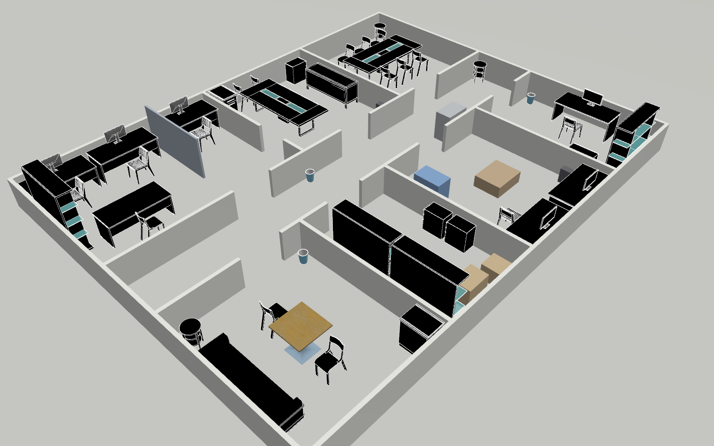

# Gazebo simulation

The Gazebo Harmonic simulation of the Go2 + D1 arm: setup, what is simulated,
the worlds, limits and troubleshooting.

The documentation moved to **[docs/simulation/gazebo.md](../docs/simulation/gazebo.md)**.

Worlds (`SIM_WORLD=`): `agri_rooms` (default: a field plus a building with
rooms), `agri_field`, and `lab_office`, an indoor research lab with 3DGEMS
furniture ([docs/simulation/lab_office.md](../docs/simulation/lab_office.md)):



```bash
./gazebo/setup_gazebo.sh                    # once: models + image + validation
./scripts/runtime/wifi_nav.sh --sim --arm   # the whole stack, simulated
```

The other simulator, the CMU Unity sim for explorer + Nav2 tests, is in
[docs/simulation/unity.md](../docs/simulation/unity.md).
